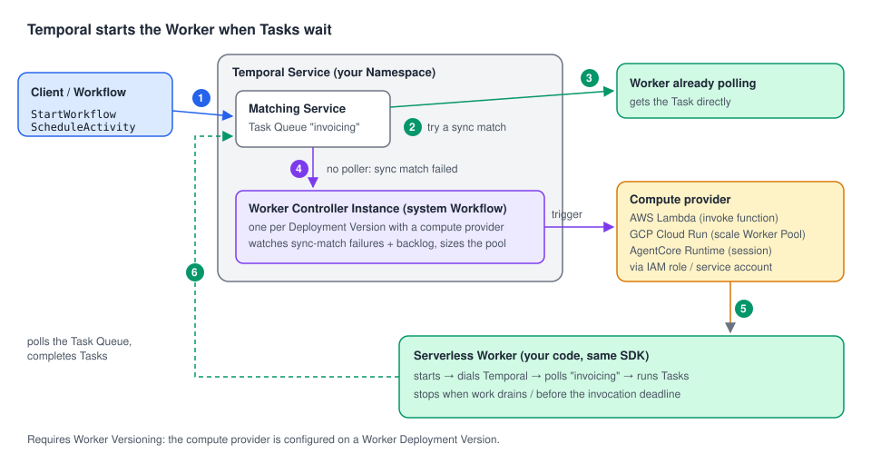

# 12 · Serverless Workers: Workers that Temporal starts for you

> **Level:** production · **Read time:** ~20 min
> **Sources:** [Encyclopedia — Serverless Workers](https://docs.temporal.io/serverless-workers) · [Go SDK — Serverless Workers](https://docs.temporal.io/develop/go/workers/serverless-workers) · linked from it: [AWS Lambda](https://docs.temporal.io/develop/go/workers/serverless-workers/aws-lambda), [GCP Cloud Run](https://docs.temporal.io/develop/go/workers/serverless-workers/cloud-run)

> **Public Preview.** AWS Lambda and GCP Cloud Run support are in Public Preview (Amazon Bedrock
> AgentCore Runtime is Pre-release). APIs and configuration may change.

---

## 1. The problem

The invoicing team runs one Workflow per customer at month-end: a huge burst on the 1st, then almost
nothing for four weeks. A fleet of long-lived Workers sized for the 1st sits idle 29 days a month.
Sized for the quiet days, it falls behind on the 1st.

A **Serverless Worker** is a normal Temporal Worker (same SDK, same registration) that runs on serverless
compute. **Temporal** starts Workers when Tasks wait on the Task Queue and stops them when the work
drains. You don't run or scale a Worker process.

---

## 2. How it works



The pieces:

| Piece | Role |
| --- | --- |
| **Compute provider** | Configuration on a **Worker Deployment Version** ([chapter 11](11-worker-versioning.md)): provider type, what to invoke (Lambda ARN, Cloud Run Worker Pool…), and the credentials Temporal uses (an IAM role to assume, a service account to impersonate). |
| **Worker Controller Instance (WCI)** | A system Workflow, one per Version with a compute provider, in your Namespace. It watches the Task Queue and adds or removes Workers. ID: `temporal-sys-worker-controller-instance:<deployment>:<build-id>`. |
| **Your Worker** | Started by the provider. It creates a Client, polls, processes Tasks, then stops. |

The invocation flow:

1. A Task is created (`StartWorkflow`, `ScheduleActivity`…).
2. The Matching Service tries to hand it straight to a polling Worker (**sync match**).
3. If one is polling, done.
4. If none is (sync match **fails**), Matching signals the WCI, which triggers the compute provider.
5. The Serverless Worker starts, dials Temporal, polls the Task Queue.
6. It processes Tasks.

Sync-match failures are one signal. The WCI also reacts to the **backlog**, and, depending on the
provider, periodically resizes the pool from the rate of incoming work.

You can inspect the WCIs like any Workflow:

```bash
temporal workflow list \
  --query 'TemporalNamespaceDivision = "TemporalWorkerControllerInstance"'
```

### Compute providers

| Provider | Execution model | Activity duration limit | Worker code |
| --- | --- | --- | --- |
| **AWS Lambda** | Short invocations: start, poll, drain before the deadline | 15 min (Lambda max) minus the shutdown buffer | `lambdaworker` package |
| **Amazon Bedrock AgentCore Runtime** (Pre-release) | Sessions with idle and max-lifetime limits | 8 h session lifetime | Standard Worker |
| **GCP Cloud Run** | A **Worker Pool** of long-lived instances that Temporal scales | none per invocation | Standard Worker |

Serverless and long-lived Workers **can share** a Task Queue. How the WCI accounts for the long-lived
ones depends on the provider (see the provider pages).

---

## 3. Constraints

| Constraint | Detail |
| --- | --- |
| **Worker Versioning is required** | Every Serverless Worker belongs to a Worker Deployment Version, and every Workflow needs a `Pinned` or `AutoUpgrade` behavior. Each Version must invoke an **immutable** build (a Lambda version/alias, a Cloud Run image digest). |
| Activity duration | Per provider (table above). |
| Workflow duration | Unlimited: a Workflow runs across as many Workers as needed. |
| Multi-cloud Replication | Not supported during Preview: after a failover to another cloud, Serverless Workers can't be invoked. |
| Multi-region Replication | The compute provider is regional: after a failover, the WCI keeps invoking the original region until you repoint it. |

---

## 4. Failure handling

Serverless Workers rely on the usual Temporal guarantees:

| What happens | Effect |
| --- | --- |
| A Worker crashes (OOM, panic, killed) | The Activity times out and is **retried on another Worker**. Nothing to do manually. |
| The provider's concurrency limit is hit (Lambda account concurrency, Cloud Run max instances) | The WCI can't add Workers. Tasks wait in the **backlog**. No data loss, just slower. |
| One Activity exhausts memory | It can take down the other Activities on the same Worker. To isolate: put Activities in their own Worker Deployment and set Activity slots to 1 (`MaxConcurrentActivityExecutionSize: 1`). |

So the same habits as [chapter 10](10-graceful-shutdown.md) apply, more strongly: **short Activities,
heartbeats with checkpoints, a `HeartbeatTimeout`**.

---

## 5. AWS Lambda in Go: `lambdaworker`

The package `go.temporal.io/sdk/contrib/aws/lambdaworker` (v0.1.1) turns a Lambda function into a
Worker. Each invocation dials Temporal, starts a Worker, polls until shortly before the invocation
deadline, stops the Worker, runs your shutdown hooks, and returns.

The Workflow and Activities are ordinary code:

```go
// file: invoicing/workflow.go
package invoicing

import (
	"context"
	"fmt"
	"time"

	"go.temporal.io/sdk/workflow"
)

const TaskQueue = "invoicing"

type MonthlyInvoiceInput struct {
	CustomerID string
	Month      string // "2026-10"
}

type Activities struct{}

func (a *Activities) ComputeUsage(ctx context.Context, in MonthlyInvoiceInput) (int64, error) {
	return 4200, nil
}

func (a *Activities) RenderInvoicePDF(ctx context.Context, in MonthlyInvoiceInput, amountCents int64) (string, error) {
	return fmt.Sprintf("s3://acme-invoices/%s/%s.pdf", in.Month, in.CustomerID), nil
}

func MonthlyInvoiceWorkflow(ctx workflow.Context, in MonthlyInvoiceInput) (string, error) {
	ctx = workflow.WithActivityOptions(ctx, workflow.ActivityOptions{
		StartToCloseTimeout: 2 * time.Minute, // well under the Lambda limit
		HeartbeatTimeout:    20 * time.Second,
	})
	var a *Activities
	var amount int64
	if err := workflow.ExecuteActivity(ctx, a.ComputeUsage, in).Get(ctx, &amount); err != nil {
		return "", err
	}
	var pdf string
	err := workflow.ExecuteActivity(ctx, a.RenderInvoicePDF, in, amount).Get(ctx, &pdf)
	return pdf, err
}
```

The Lambda entry point:

```go
// file: cmd/invoicing-lambda/main.go
package main

import (
	"context"
	"log"
	"time"

	"github.com/acme/shop/invoicing"
	"go.temporal.io/sdk/contrib/aws/lambdaworker"
	"go.temporal.io/sdk/worker"
	"go.temporal.io/sdk/workflow"
)

// buildID is set at build time: go build -ldflags "-X main.buildID=$GIT_SHA"
var buildID = "dev"

func main() {
	lambdaworker.RunWorker(worker.WorkerDeploymentVersion{
		DeploymentName: "shop-invoicing",
		BuildID:        buildID,
	}, func(opts *lambdaworker.Options) error {
		opts.TaskQueue = invoicing.TaskQueue // or the TEMPORAL_TASK_QUEUE env var

		// Give in-flight Activities 20s to finish when the invocation ends, and move the
		// shutdown start accordingly: the buffer is NOT recomputed from WorkerStopTimeout.
		opts.WorkerOptions.WorkerStopTimeout = 20 * time.Second
		opts.ShutdownDeadlineBuffer = opts.WorkerOptions.WorkerStopTimeout + 2*time.Second

		opts.RegisterWorkflowWithOptions(invoicing.MonthlyInvoiceWorkflow, workflow.RegisterOptions{
			VersioningBehavior: workflow.VersioningBehaviorPinned,
		})
		opts.RegisterActivity(&invoicing.Activities{})

		opts.OnShutdown(func(ctx context.Context) error {
			log.Println("invocation done, flushing telemetry")
			return nil
		})
		return nil
	})
}
```

What `lambdaworker` does for you (checked in the v0.1.1 source):

| Behavior | Detail |
| --- | --- |
| **Versioning** | Always on: `UseVersioning = true`, `Version` = the one you pass. An empty Version is a fatal error. |
| **Connection** | Loaded with `envconfig` from env vars and an optional TOML file: `$TEMPORAL_CONFIG_FILE`, else `$LAMBDA_TASK_ROOT/temporal.toml`, else `./temporal.toml`. |
| **Task Queue** | `opts.TaskQueue`, pre-filled from **`TEMPORAL_TASK_QUEUE`** if set (the Go page doesn't mention this variable). Missing both is a fatal error. |
| **Identity** | `<aws-request-id>@<function-arn>` per invocation, unless you set `ClientOptions.Identity`. |
| **Logger** | JSON `slog` to stderr if you don't set one. |
| **Fatal config errors** | Printed to stderr, then `os.Exit(1)`. |
| **Too-short timeout** | The invocation fails if the Lambda timeout leaves ≤ 1s of work after the buffer. It warns below 5s. |

Lambda-tuned defaults (applied only to fields you leave at zero, except eager Activities):

| Setting | Lambda default | Standard Worker default |
| --- | --- | --- |
| `MaxConcurrentActivityExecutionSize` | 2 | 1,000 |
| `MaxConcurrentWorkflowTaskExecutionSize` | 10 | 1,000 |
| `MaxConcurrentLocalActivityExecutionSize` | 2 | 1,000 |
| `MaxConcurrentNexusTaskExecutionSize` | 5 | 1,000 |
| `MaxConcurrentActivityTaskPollers` / `…WorkflowTaskPollers` / `…NexusTaskPollers` | 1 / 2 / 1 | 2 / 2 / 2 |
| `WorkerStopTimeout` | 5s | 0 |
| `DisableEagerActivities` | **always true** (can't be overridden) | false |
| Sticky cache size | 100 | 10,000 |
| `ShutdownDeadlineBuffer` | `WorkerStopTimeout` + 2s, computed **before** your callback | — |

> **Gotcha.** The Go page says the buffer's default "is `WorkerStopTimeout` + 2 seconds". It is computed
> once, from the 5s default, **before** your configure callback runs. If you raise
> `opts.WorkerOptions.WorkerStopTimeout` in the callback, also raise `opts.ShutdownDeadlineBuffer`
> (the package's own doc comment says so). Otherwise the Worker starts stopping only 7s before the
> deadline and Lambda kills it mid-drain. Raise the Lambda `--timeout` with them.

For metrics and traces, `go.temporal.io/sdk/contrib/aws/lambdaworker/otel` has `otel.ApplyDefaults(opts,
&opts.ClientOptions, otel.Options{})`, which exports to the ADOT Lambda layer's collector on
`localhost:4317`.

---

## 6. GCP Cloud Run in Go: a standard versioned Worker

On Cloud Run, the Worker is a normal long-lived process in a **Worker Pool**. Temporal only changes how
many instances run. The one requirement is Worker Versioning:

```go
// file: cmd/invoicing-cloudrun/main.go
package main

import (
	"log"
	"os"
	"time"

	"github.com/acme/shop/invoicing"
	"go.temporal.io/sdk/client"
	"go.temporal.io/sdk/contrib/envconfig"
	"go.temporal.io/sdk/worker"
	"go.temporal.io/sdk/workflow"
)

func main() {
	opts, err := envconfig.LoadDefaultClientOptions() // TEMPORAL_ADDRESS, TEMPORAL_NAMESPACE, TEMPORAL_API_KEY…
	if err != nil {
		log.Fatalln("invalid Temporal configuration:", err)
	}
	c, err := client.Dial(opts)
	if err != nil {
		log.Fatalln("unable to create Temporal client:", err)
	}
	defer c.Close()

	w := worker.New(c, invoicing.TaskQueue, worker.Options{
		WorkerStopTimeout: 8 * time.Second, // Cloud Run sends SIGTERM 10s before SIGKILL
		DeploymentOptions: worker.DeploymentOptions{
			UseVersioning: true,
			Version: worker.WorkerDeploymentVersion{
				DeploymentName: "shop-invoicing",
				BuildID:        os.Getenv("BUILD_ID"), // must match `temporal worker deployment create-version`
			},
			DefaultVersioningBehavior: workflow.VersioningBehaviorPinned,
		},
	})
	w.RegisterWorkflow(invoicing.MonthlyInvoiceWorkflow)
	w.RegisterActivity(&invoicing.Activities{})

	if err := w.Run(worker.InterruptCh()); err != nil {
		log.Fatalln("worker stopped:", err)
	}
}
```

The WCI decides to scale in from **Task Queue** activity, not from what one instance is doing, so an
instance can be stopped in the middle of a long Activity. Heartbeat a checkpoint so the retry resumes:

```go
// file: invoicing/batch.go
package invoicing

import (
	"context"

	"go.temporal.io/sdk/activity"
)

// SendInvoiceEmails sends one email per customer, resuming after the last one sent.
func (a *Activities) SendInvoiceEmails(ctx context.Context, customerIDs []string) (int, error) {
	start := 0
	if activity.HasHeartbeatDetails(ctx) {
		var last int
		if err := activity.GetHeartbeatDetails(ctx, &last); err == nil {
			start = last + 1
		}
	}
	for i := start; i < len(customerIDs); i++ {
		if err := ctx.Err(); err != nil {
			return i, err
		}
		// … send the email for customerIDs[i] …
		activity.RecordHeartbeat(ctx, i)
	}
	return len(customerIDs), nil
}
```

For a meaningful Worker identity on Cloud Run, the Go page uses the
`go.temporal.io/sdk/contrib/gcp/cloudrun/id` plugin (`id.NewCloudRunIDPlugin()`, identity
`<instance-id>@<revision>`), added to `client.Options.Plugins`. It needs the Cloud Run metadata server,
so it fails when run elsewhere.

---

## 7. When to use Serverless Workers

| Choose Serverless when… | Stay with long-lived Workers when… |
| --- | --- |
| Load is bursty or mostly idle | Load is steady: always-on is cheaper and has no cold start |
| You don't want to operate a Worker fleet | You need large in-memory caches (sticky cache is tiny on Lambda) |
| Activities are short (Lambda) or you use Cloud Run | Activities run longer than 15 minutes and you want Lambda |
| You already use Worker Versioning, or are ready to | You need Multi-cloud Replication today |

---

## 8. Key takeaways

- A Serverless Worker is a regular Worker whose **lifecycle Temporal manages**: the WCI system Workflow
  starts Workers through a **compute provider** when Tasks wait, and removes them as work drains.
- **Worker Versioning is mandatory**: the compute provider lives on a Worker Deployment Version, and every
  Workflow needs `Pinned` or `AutoUpgrade`.
- **Lambda:** use `lambdaworker.RunWorker`. Its defaults are small. If you raise `WorkerStopTimeout`, raise
  `ShutdownDeadlineBuffer` and the Lambda timeout too.
- **Cloud Run:** a standard versioned Worker. Expect scale-in in the middle of an Activity: heartbeat a checkpoint.
- Crashes become Activity retries and capacity limits become backlog. Nothing is lost.
- Back to the [roadmap](README.md).
