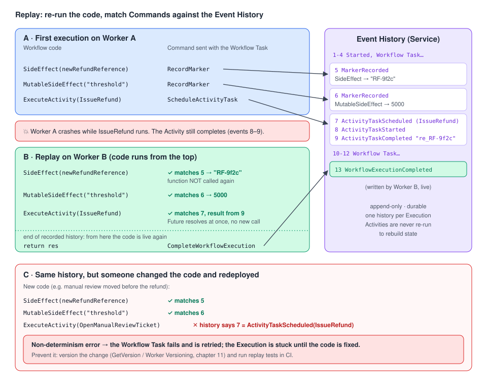

# 03 · Determinism and replay: how a Workflow really runs

> **Level:** core concept (how it works) · **Read time:** ~25 min
> **Sources:** [Encyclopedia — Temporal Workflow (replay)](https://docs.temporal.io/workflows) · [Workflow Definition (deterministic constraints)](https://docs.temporal.io/workflow-definition) · [Workflow Execution (commands, cache)](https://docs.temporal.io/workflow-execution) · [Events and Event History](https://docs.temporal.io/workflow-execution/event) · [Go SDK — Workflow basics](https://docs.temporal.io/develop/go/workflows/basics) · [Go SDK — Side Effects](https://docs.temporal.io/develop/go/workflows/side-effects) · [Go SDK — Versioning (runtime checking)](https://docs.temporal.io/develop/go/workflows/versioning)

---

## 1. The problem

Chapter 01 promised that a Workflow "continues where it left off" after a crash. Temporal doesn't
snapshot memory to do that. It **re-runs your function from the top** and uses a recorded log to
steer it back to the same state.

That trick only works if your code makes **the same decisions every time it runs with the same
history**. If you don't understand it, you will one day:

- read `time.Now()` and take a different branch during replay,
- deploy a "harmless" reorder of two Activity calls and break thousands of running Executions,
- log every line twice, or send an email from Workflow code on each replay.

This chapter explains the mechanism so these rules make sense instead of feeling arbitrary.

---

## 2. Commands, Events and the Event History

A Workflow Execution does only two things:

1. **Issue Commands** (schedule an Activity, start a Timer, start a Child Workflow, complete…).
2. **Wait on awaitables** (Futures): an Activity result, a Timer, a Signal, a Child result.

The loop looks like this:

1. The Service puts a **Workflow Task** on the Task Queue.
2. A Worker picks it up and runs your Workflow function **until it can't progress** without a result (a `Get`, a `Sleep`, a `Receive`…).
3. The Worker sends the **batch of Commands** produced so far when the Workflow Task completes.
4. The Service turns each Command into **Events** in the **Event History** (`ActivityTaskScheduled`, `TimerStarted`, …) and acts on them.
5. When something happens (an Activity completes, a Timer fires, a Signal arrives), a new Event is appended and a new Workflow Task is scheduled. Back to step 1.

The **Event History** is an **append-only** log, durably persisted by the Service. It is the source of
truth for your Workflow's state and doubles as an audit log. A history could read:

```text
1  WorkflowExecutionStarted
2  WorkflowTaskScheduled
3  WorkflowTaskStarted
4  WorkflowTaskCompleted
5  MarkerRecorded              (SideEffect: refund reference)
6  MarkerRecorded              (MutableSideEffect: auto-approve threshold)
7  ActivityTaskScheduled       (IssueRefund)
8  ActivityTaskStarted
9  ActivityTaskCompleted       (result: "re_RF-9f2c")
10 WorkflowTaskScheduled
…
```

Every `WorkflowTaskCompleted` matches a completion request from the Worker. That's where the Commands came from.

---

## 3. Replay: rebuilding state by re-running code

When a Worker needs to continue an Execution it doesn't have in memory (after a crash, a deploy, or a cache eviction):

1. It fetches the Event History.
2. It runs your Workflow function **from the beginning**.
3. Each time the code would issue a Command, the SDK **compares** it with the Event at the same position in the history.
   - It matches → the SDK does **not** re-send it. If the history has a result for it (an Activity result, a fired Timer), the Future resolves **immediately** with the recorded value.
   - It doesn't match → **non-determinism error**. The Workflow Task fails and is retried until the code is fixed.
4. When the code reaches the end of the recorded history, it is "live" again and new Commands go to the Service.

Activities are **not executed again** during replay. Their recorded results are reused.



### The Workflow cache and sticky execution

Replaying from scratch on every Workflow Task would be expensive. So each Worker keeps an in-memory
**LRU Workflow cache** of Executions it has processed. The Service sends the next Workflow Tasks of a
cached Execution to the **same Worker** through a dedicated **sticky queue**. The Worker then just
continues from memory.

If the Execution is evicted (cache full, Worker restarted), the next Worker that gets it **replays the
full history** to rebuild the state. Replay is the normal recovery path, not an edge case.

---

## 4. The determinism rules

**Deterministic** here means: given the same input and the same history, your code makes **the same
Workflow API calls, in the same order**.

### What produces Commands (must not be added, removed or reordered without versioning)

- starting or cancelling a **Timer** (`workflow.Sleep`, `workflow.NewTimer`)
- scheduling or cancelling an **Activity**, including Local Activities
- starting or cancelling a **Child Workflow**
- **signalling** or cancelling an **external Workflow**
- scheduling or cancelling a **Nexus operation**
- **ending** the Execution (complete, fail, cancel, continue-as-new)
- `GetVersion` calls (they follow their own [patching rules](11-versioning.md))
- upserting **Search Attributes** or **Memos**
- `SideEffect` / `MutableSideEffect`

### Changes that are safe on running Executions

- the **inputs, return values and timeouts** of Activities and Child Workflows (not their **type** or **ID**)
- the input of a Signal sent to an external Workflow
- a **Timer duration**, except changing it **to or from 0** (non-deterministic in Go)
- adding or removing calls that **don't produce Commands**, e.g. `workflow.GetInfo`, logging
- adding a Signal handler for a Signal Type that was never sent to this Execution

Anything else (new step, removed step, swapped order, a different Activity) needs **versioning**
([chapter 11](11-versioning.md)).

### What the Go SDK checks for you

At replay, the Go SDK flags these calls if they were added, removed or reordered:

`workflow.ExecuteActivity()` · `workflow.ExecuteChildWorkflow()` · `workflow.NewTimer()` ·
`workflow.RequestCancelWorkflow()` · `workflow.SideEffect()` · `workflow.SignalExternalWorkflow()` · `workflow.Sleep()`

> ⚠️ The check is shallow. It doesn't compare Activity **arguments** or Timer **durations**. Replay
> tests (section 7) are your real safety net.

> 📝 The Go runtime-check list in the docs names `workflow.RequestCancelWorkflow()`. In SDK v1.50.0 the
> function is called `workflow.RequestCancelExternalWorkflow()`.

### Intrinsic non-determinism

The second source of bugs is code that branches on values **not in the history**:

```go
// ❌ Anti-pattern (not compiled): every line here can change between the first run and a replay.
if time.Now().Hour() < 12 { // wall clock of whichever Worker replays
	_ = workflow.Sleep(ctx, time.Hour)
}
if rand.Intn(100) < 10 { // a new random number on every replay
	_ = workflow.ExecuteActivity(ctx, a.FlagForManualReview, req).Get(ctx, nil)
}
for carrier := range quotesByCarrier { // Go randomizes map order
	_ = workflow.ExecuteActivity(ctx, a.BookCarrier, carrier).Get(ctx, nil)
}
resp, _ := http.Get("https://fx.example.com/eur-usd") // network I/O outside an Activity
```

The rule: everything that isn't a pure computation on Workflow state goes through a **Temporal API**
(`workflow.Now`, `workflow.SideEffect`, an Activity…) so its value is **recorded** and **replayed**.

---

## 5. Recording non-deterministic values

### `workflow.SideEffect`: run once, record, replay the value

`SideEffect` runs a short function **once**, stores its return value in the history (a
`MarkerRecorded` Event), and returns the **recorded** value on every replay.

- Use it for **local, cheap, infallible** values: a UUID, a random number.
- It must **not fail**. A panic or error fails the Workflow Task and the function may run again. Anything that can fail belongs in an Activity.
- Return the value. Don't modify Workflow variables **inside** the function: it doesn't run during replay.

```go
// ❌ Anti-pattern (not compiled): `ref` stays "" on replay, because the function isn't re-executed.
var ref string
workflow.SideEffect(ctx, func(ctx workflow.Context) any {
	ref = newRefundReference()
	return nil
})
```

The correct shape is in the example below: return the value, then `.Get(&ref)`.

> Side Effects exist in Go, Java and PHP. A Local Activity fits the same use case, and so does a regular
> Activity when the value comes from an external system.

### `workflow.MutableSideEffect`: a value that may change over time

`MutableSideEffect(ctx, id, fn, equals)` runs `fn` each time it's called, but only records a new
Marker when the value **for that ID changes** (compared with `equals`). On replay it returns the
recorded values without calling `fn`. Typical use: a configuration value, such as a feature flag or a
threshold, read in a loop.

### `workflow.IsReplaying`: for side channels only

`workflow.IsReplaying(ctx)` tells you if the code is currently replaying. Use it to avoid duplicate
**metrics or notifications from interceptors**. **Never** use it to change business logic: that is
non-deterministic by definition. (`workflow.GetLogger` already skips logs during replay.)

---

## 6. Example: a deterministic refund Workflow

### Activities and configuration

```go
// file: refunds/activities.go
package refunds

import (
	"context"
	"sync/atomic"
)

// PaymentProvider is the PSP. Its calls are side effects, so they live in Activities.
type PaymentProvider interface {
	Refund(ctx context.Context, chargeID string, amountCents int64, reference string) (string, error)
}

type RefundActivities struct {
	PSP PaymentProvider
}

func (a *RefundActivities) IssueRefund(ctx context.Context, chargeID string, amountCents int64, reference string) (string, error) {
	return a.PSP.Refund(ctx, chargeID, amountCents, reference)
}

func (a *RefundActivities) OpenManualReviewTicket(ctx context.Context, reference string, amountCents int64) (string, error) {
	return "TICKET-" + reference, nil
}

// autoApproveThreshold is hot-reloaded by the Worker from its config file. Reading it directly in
// Workflow code would be non-deterministic; MutableSideEffect records it.
var autoApproveThreshold atomic.Int64

func SetAutoApproveThresholdCents(v int64) { autoApproveThreshold.Store(v) }

func autoApproveThresholdCents() int64 { return autoApproveThreshold.Load() }
```

### Workflow

```go
// file: refunds/workflow.go
package refunds

import (
	"crypto/rand"
	"encoding/hex"
	"time"

	"go.temporal.io/sdk/workflow"
)

const TaskQueue = "refunds"

type RefundRequest struct {
	OrderID     string
	ChargeID    string
	AmountCents int64
}

type RefundResult struct {
	Reference    string
	ProviderID   string
	TicketID     string
	RequestedAt  time.Time
	SLADeadline  time.Time
	AutoApproved bool
}

func newRefundReference() string {
	b := make([]byte, 6)
	_, _ = rand.Read(b)
	return "RF-" + hex.EncodeToString(b)
}

func RefundRequestWorkflow(ctx workflow.Context, req RefundRequest) (RefundResult, error) {
	logger := workflow.GetLogger(ctx)
	ctx = workflow.WithActivityOptions(ctx, workflow.ActivityOptions{StartToCloseTimeout: 30 * time.Second})
	var a *RefundActivities

	// ✅ Replay-safe time: the time of the current Workflow Task, identical on replay.
	res := RefundResult{RequestedAt: workflow.Now(ctx)}
	res.SLADeadline = res.RequestedAt.Add(48 * time.Hour)

	// ✅ Random value recorded once as a Marker, returned as-is on every replay.
	if err := workflow.SideEffect(ctx, func(ctx workflow.Context) any {
		return newRefundReference()
	}).Get(&res.Reference); err != nil {
		return RefundResult{}, err
	}

	// ✅ Config value recorded under the ID "auto-approve-threshold"; a new Marker only if it changed.
	var threshold int64
	err := workflow.MutableSideEffect(ctx, "auto-approve-threshold",
		func(ctx workflow.Context) any { return autoApproveThresholdCents() },
		func(a, b any) bool { return a.(int64) == b.(int64) },
	).Get(&threshold)
	if err != nil {
		return RefundResult{}, err
	}

	if req.AmountCents > threshold {
		// Big refunds go to a human first.
		if err := workflow.ExecuteActivity(ctx, a.OpenManualReviewTicket, res.Reference, req.AmountCents).Get(ctx, &res.TicketID); err != nil {
			return RefundResult{}, err
		}
		logger.Info("Refund needs manual review", "ticket", res.TicketID, "deadline", res.SLADeadline)
		return res, nil
	}

	// ✅ Network call in an Activity: executed once, its result recorded and reused on replay.
	res.AutoApproved = true
	if err := workflow.ExecuteActivity(ctx, a.IssueRefund, req.ChargeID, req.AmountCents, res.Reference).Get(ctx, &res.ProviderID); err != nil {
		return RefundResult{}, err
	}
	if workflow.Now(ctx).After(res.SLADeadline) {
		logger.Warn("Refund issued after SLA", "reference", res.Reference)
	}
	return res, nil
}
```

The Event History of an auto-approved refund contains two `MarkerRecorded` Events (the reference and
the threshold) followed by the `IssueRefund` Activity Events. Replay it next month with a different
threshold in the config file and you still get the **same** decision.

### Worker

```go
// file: cmd/refunds-worker/main.go
package main

import (
	"context"
	"log"

	"github.com/acme/shop/refunds"
	"go.temporal.io/sdk/client"
	"go.temporal.io/sdk/worker"
)

type fakePSP struct{}

func (fakePSP) Refund(ctx context.Context, chargeID string, amountCents int64, reference string) (string, error) {
	return "re_" + reference, nil
}

func main() {
	refunds.SetAutoApproveThresholdCents(50_00) // in real life: loaded and reloaded from config

	c, err := client.Dial(client.Options{})
	if err != nil {
		log.Fatalln("Unable to create client", err)
	}
	defer c.Close()

	w := worker.New(c, refunds.TaskQueue, worker.Options{})
	w.RegisterWorkflow(refunds.RefundRequestWorkflow)
	w.RegisterActivity(&refunds.RefundActivities{PSP: fakePSP{}})
	if err := w.Run(worker.InterruptCh()); err != nil {
		log.Fatalln("Unable to start Worker", err)
	}
}
```

---

## 7. Replay testing: catch non-determinism before production

The SDK's runtime check is shallow. The reliable way to know a code change is safe is to **replay real
histories** against the new code in a unit test:

1. Export histories of real Executions (from production or staging):
   `temporal workflow show --workflow-id refund-o-1001 --output json > refunds/testdata/refund-o-1001.json`
2. Replay them with `worker.NewWorkflowReplayer()` in CI. A non-determinism error fails the test.

```go
// file: refunds/replay_test.go
package refunds

import (
	"path/filepath"
	"testing"

	"go.temporal.io/sdk/worker"
)

func TestRefundRequestWorkflow_ReplaysRecordedHistories(t *testing.T) {
	files, err := filepath.Glob(filepath.Join("testdata", "refund-*.json"))
	if err != nil {
		t.Fatal(err)
	}
	if len(files) == 0 {
		t.Skip("no recorded histories in testdata/")
	}

	replayer := worker.NewWorkflowReplayer()
	replayer.RegisterWorkflow(RefundRequestWorkflow)

	for _, f := range files {
		t.Run(filepath.Base(f), func(t *testing.T) {
			// nil = the SDK default logger, not a no-op one (see the Testing guide, chapter 07)
			if err := replayer.ReplayWorkflowHistoryFromJSONFile(nil, f); err != nil {
				t.Fatalf("history %s is not compatible with the current code: %v", f, err)
			}
		})
	}
}
```

Keep a few histories per Workflow Type and per important code path (auto-approved, manual review).
Every time you change the Workflow, this test tells you if running Executions would break.

---

## Key takeaways

- Workflow code emits **Commands**; the Service records **Events**; the **Event History** is the source of truth.
- Recovery = **replay**: the code re-runs from the top and its Commands are matched against the history. Activities aren't re-executed; their results are reused.
- A Worker cache with **sticky queues** avoids most replays, but you must design for full replays anyway.
- Never branch on wall-clock time, randomness, map order, or I/O in Workflow code. Use `workflow.Now`, `SideEffect`, `MutableSideEffect`, `DeterministicKeys` and Activities.
- Adding, removing or reordering Command-producing calls needs **versioning**. Prove compatibility with **replay tests**.

⬅️ Previous: [02 · Defining Workflows in Go](02-defining-workflows.md) · ➡️ Next: [04 · Workflow Execution, IDs and lifecycle](04-workflow-execution-and-ids.md)
