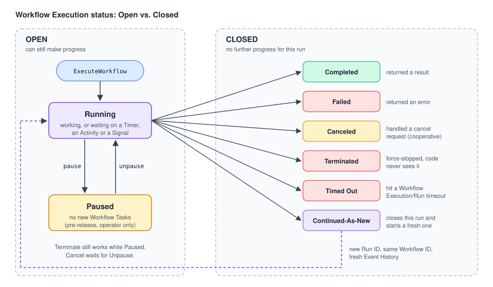
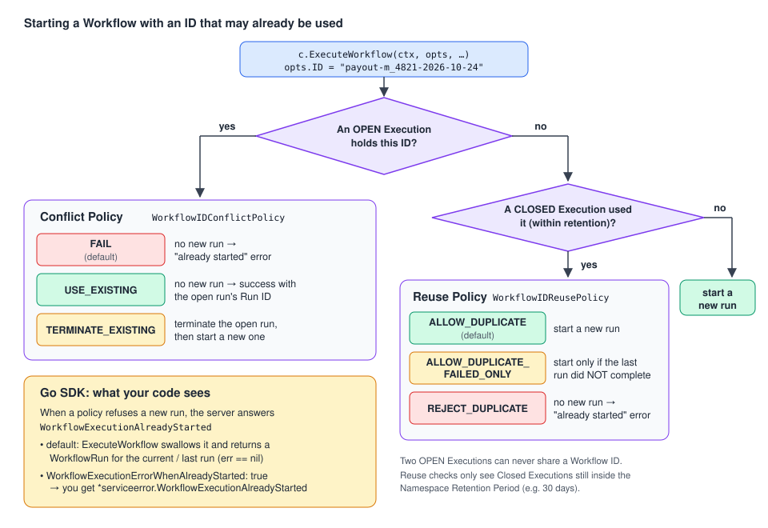

# 04 · Workflow Executions: status, IDs, timeouts and limits

> **Level:** core concept · **Read time:** ~20 min
> **Sources:** [Encyclopedia: Workflow Execution](https://docs.temporal.io/workflow-execution) · [Workflow Id and Run Id](https://docs.temporal.io/workflow-execution/workflowid-runid) · [Event History limits](https://docs.temporal.io/workflow-execution/event) · [Workflow Execution limits](https://docs.temporal.io/workflow-execution/limits) · [Go SDK: Workflow timeouts](https://docs.temporal.io/develop/go/workflows/timeouts)

---

## 1. The problem

Starting a Workflow is easy: `c.ExecuteWorkflow(ctx, opts, MerchantPayoutWorkflow, in)`. In production
you quickly hit harder questions:

- The payout API gets a retry from the load balancer. **Do we pay the merchant twice?**
- A support engineer asks "is the payout for merchant `m_4821` on 2026-10-24 done?" **How do we find it?**
- The Workflow failed and was retried. **Which run is "the" Workflow?**
- How long can it run, and how big can it get?

All of this is about the **Workflow Execution** itself: its status, its identity, and the limits it
lives within. This chapter covers all of it.

> 📌 A **Workflow Execution** is a durable, reliable, scalable function execution. It runs your
> Workflow Definition effectively once and to completion, whether that takes seconds or years.
> A single Execution has size and throughput limits. A Temporal application can run millions or
> billions of them.

---

## 2. Execution status: Open vs. Closed



Every Workflow Execution is either **Open** (it can still make progress) or **Closed** (it can't).

| Group | Status | Meaning |
| --- | --- | --- |
| Open | **Running** | Actively progressing, or waiting on something (Timer, Activity, Signal) |
| Open | **Paused** | An operator Paused it. It stays Open, but no new Workflow Tasks are dispatched until it is Unpaused. See [08](08-cancel-terminate-pause-reset.md) |
| Closed | **Completed** | The Workflow function returned a result |
| Closed | **Failed** | The Workflow function returned an error |
| Closed | **Canceled** | It handled a cancellation request and gave up. See [08](08-cancel-terminate-pause-reset.md) |
| Closed | **Terminated** | It was force-stopped. Workflow code never saw it |
| Closed | **Continued-As-New** | It handed over to a fresh run with the same Workflow ID. See [09](09-continue-as-new.md) |
| Closed | **Timed Out** | It hit a Workflow timeout (section 6) |

Waiting is **not** a special status. A Workflow sleeping for 30 days is simply **Running**.

---

## 3. Workflow ID vs. Run ID



| | **Workflow ID** | **Run ID** |
| --- | --- | --- |
| Who chooses it | **You** | The Temporal Service (globally unique) |
| What it means | A business identity: `payout-m_4821-2026-10-24`, `cart-c_991` | One specific run |
| Uniqueness | At most **one Open** Execution per Workflow ID in a Namespace | Unique everywhere |
| Stable? | Yes, across retries, Continue-As-New and cron runs | **No.** It changes on every retry, Continue-As-New, cron run and Reset |

A Workflow Execution is uniquely identified by **Namespace + Workflow ID + Run ID**.

**Rules of thumb:**

- Use the **Workflow ID** as the handle the rest of your system knows about. Derive it from the
  business key, so you can find the Execution again without storing anything.
- **Never put PII or secrets in a Workflow ID.** It is stored in plain text, it is **not** encoded by
  your Payload Codec, and it shows up in the Web UI, CLI output, Event History and logs. The same goes
  for Workflow Type names, Task Queue names, and Activity, Signal, Query and Update names.
- **Don't build logic on the current Run ID.** It changes on retry and Reset, which can lead to
  non-determinism problems.

### First, original and current Run IDs

Several runs can share one Workflow ID. They form a **Workflow Execution Chain**. Each link in the chain
is a **Workflow Run**. Runs are connected by:

- **Retries** (a Workflow Retry Policy, section 6)
- **Continue-As-New** ([09](09-continue-as-new.md))
- **Temporal Cron Jobs** ([10](10-schedules-and-cron.md))

```text
Workflow ID: payout-m_4821-2026-10-24
  run 1  (Failed)   ──retry──▶  run 2  (Continued-As-New) ──▶  run 3  (Running)
  ▲ FirstRunID = run 1 for every run in the chain
```

| Field in `workflow.GetInfo(ctx)` | Meaning |
| --- | --- |
| `WorkflowExecution.ID` | The Workflow ID |
| `WorkflowExecution.RunID` | The **current** Run ID |
| `FirstRunID` | Run ID of the **first** Execution in the chain |
| `OriginalRunID` | Run ID when the `WorkflowExecutionStarted` event happened. A **Reset** creates a new current Run ID but keeps this one |
| `Attempt` | Retry attempt of this run (starts at 1) |

---

## 4. Starting with the same Workflow ID twice: Reuse and Conflict policies

Two policies decide what happens when you start an Execution with a Workflow ID that was already used.

### Conflict Policy: an **Open** Execution already has this ID

| `WorkflowIDConflictPolicy` | Result |
| --- | --- |
| `WORKFLOW_ID_CONFLICT_POLICY_FAIL` **(default)** | No new Execution. Returns a `Workflow execution already started` error |
| `WORKFLOW_ID_CONFLICT_POLICY_USE_EXISTING` | No new Execution. Returns success with the **Open Execution's Run ID** |
| `WORKFLOW_ID_CONFLICT_POLICY_TERMINATE_EXISTING` | Terminates the Open Execution, then starts the new one |

Two Open Executions can **never** share a Workflow ID, whatever the policies say.

### Reuse Policy: only **Closed** Executions have used this ID

| `WorkflowIDReusePolicy` | New Execution allowed? | Use it when… |
| --- | --- | --- |
| `WORKFLOW_ID_REUSE_POLICY_ALLOW_DUPLICATE` **(default)** | Yes, whatever the previous status | Re-running the same business key is fine |
| `WORKFLOW_ID_REUSE_POLICY_ALLOW_DUPLICATE_FAILED_ONLY` | Only if the previous one did **not** complete successfully (Failed, Timed Out, Terminated, Canceled) | You may retry failures, but a **Completed** run must never run again |
| `WORKFLOW_ID_REUSE_POLICY_REJECT_DUPLICATE` | **Never** | Exactly one Execution per ID, ever (within retention) |
| `WORKFLOW_ID_REUSE_POLICY_TERMINATE_IF_RUNNING` | Applies to an **Open** Execution: terminate it and start | Legacy. Prefer Conflict Policy `TERMINATE_EXISTING`. The SDK refuses to combine the two |

> ⚠️ **Reuse checks are bounded by the Namespace Retention Period.** The Service only remembers
> Closed Executions for that period (for example the last 30 days). With `REJECT_DUPLICATE` and 30 days
> of retention, the same Workflow ID can run again on day 31. If "only once, ever" must hold for
> longer, make retention long enough, or design around [message passing](06-message-passing.md)
> instead of atomic starts.

### The Go SDK twist: `WorkflowExecutionErrorWhenAlreadyStarted`

The Encyclopedia says the default is to fail with "already started". The **Go client is different
by default.** In SDK v1.50.0, `ExecuteWorkflow` catches `*serviceerror.WorkflowExecutionAlreadyStarted`
and, unless you opted out, returns a `WorkflowRun` for the run that already holds the ID:

```go
// go.temporal.io/sdk@v1.50.0/internal/internal_workflow_client.go (excerpt)
if e, ok := err.(*serviceerror.WorkflowExecutionAlreadyStarted); ok && !in.Options.WorkflowExecutionErrorWhenAlreadyStarted {
	runID = e.RunId
	firstExecutionRunID = e.FirstExecutionRunId
}
```

So the policies still decide whether a **new** Execution starts. The flag only decides **what your
code sees** when it doesn't:

| Situation | `WorkflowExecutionErrorWhenAlreadyStarted: false` (default) | `true` |
| --- | --- | --- |
| Open run exists, Conflict = Fail | `WorkflowRun` of the **running** Execution, `err == nil` | `*serviceerror.WorkflowExecutionAlreadyStarted` |
| Closed run exists, Reuse = Reject Duplicate | `WorkflowRun` of the **last** (closed) run, `err == nil` | `*serviceerror.WorkflowExecutionAlreadyStarted` |
| Open run exists, Conflict = Use Existing | `WorkflowRun` of the running Execution | Same: Use Existing is a success, not an error |

> 💡 The default is convenient ("start or attach"), but it hides the fact that nothing new started.
> When a duplicate start means something to the business (a double payout attempt), set the flag to
> `true` and handle the error explicitly, as in the example below.

---

## 5. Example: idempotent daily merchant payouts

**The design:** one payout per merchant per day. The Workflow ID **is** the idempotency key:
`payout-<merchantID>-<yyyy-mm-dd>`. Reject Duplicate plus Conflict Fail means a second request for the
same day can never start a second payout, whether the first is still running or already done.

### The Activities

```go
// file: payouts/activities.go
package payouts

import (
	"context"
	"fmt"
)

// Ledger reads settled card payments for a merchant.
type Ledger interface {
	SettledBalanceCents(ctx context.Context, merchantID, payoutDate string) (int64, error)
}

// Bank sends money. It deduplicates on IdempotencyKey.
type Bank interface {
	Transfer(ctx context.Context, idempotencyKey, merchantID string, amountCents int64, currency string) (string, error)
}

type TransferRequest struct {
	IdempotencyKey string
	MerchantID     string
	AmountCents    int64
	Currency       string
}

type PayoutActivities struct {
	Ledger Ledger
	Bank   Bank
}

func (a *PayoutActivities) ComputeSettledBalance(ctx context.Context, in PayoutInput) (int64, error) {
	return a.Ledger.SettledBalanceCents(ctx, in.MerchantID, in.PayoutDate)
}

func (a *PayoutActivities) SendBankTransfer(ctx context.Context, req TransferRequest) (string, error) {
	if req.AmountCents <= 0 {
		return "", fmt.Errorf("refusing to transfer %d cents", req.AmountCents)
	}
	return a.Bank.Transfer(ctx, req.IdempotencyKey, req.MerchantID, req.AmountCents, req.Currency)
}
```

### The Workflow: reading its own identity

```go
// file: payouts/workflow.go
package payouts

import (
	"fmt"
	"time"

	"go.temporal.io/sdk/workflow"
)

const TaskQueue = "payouts"

type PayoutInput struct {
	MerchantID string
	PayoutDate string // yyyy-mm-dd
	Currency   string
}

type PayoutResult struct {
	TransferID  string
	AmountCents int64
}

// PayoutWorkflowID derives the Workflow ID from the business key. No PII, only opaque IDs.
func PayoutWorkflowID(merchantID string, day time.Time) string {
	return fmt.Sprintf("payout-%s-%s", merchantID, day.Format("2006-01-02"))
}

func MerchantPayoutWorkflow(ctx workflow.Context, in PayoutInput) (PayoutResult, error) {
	logger := workflow.GetLogger(ctx)
	info := workflow.GetInfo(ctx)
	logger.Info("Payout run started",
		"workflowID", info.WorkflowExecution.ID,
		"runID", info.WorkflowExecution.RunID, // changes on retry/reset: log it, don't branch on it
		"firstRunID", info.FirstRunID,
		"originalRunID", info.OriginalRunID,
		"attempt", info.Attempt,
	)

	ctx = workflow.WithActivityOptions(ctx, workflow.ActivityOptions{StartToCloseTimeout: time.Minute})
	var a *PayoutActivities

	var balance int64
	if err := workflow.ExecuteActivity(ctx, a.ComputeSettledBalance, in).Get(ctx, &balance); err != nil {
		return PayoutResult{}, err
	}
	if balance == 0 {
		return PayoutResult{}, nil
	}

	// The Workflow ID is stable across retries and Continue-As-New, so it is a safe idempotency key.
	// The Run ID would NOT be: a retried run would look like a brand-new payout to the bank.
	var transferID string
	err := workflow.ExecuteActivity(ctx, a.SendBankTransfer, TransferRequest{
		IdempotencyKey: info.WorkflowExecution.ID,
		MerchantID:     in.MerchantID,
		AmountCents:    balance,
		Currency:       in.Currency,
	}).Get(ctx, &transferID)
	if err != nil {
		return PayoutResult{}, err
	}

	// A Memo is metadata for humans and tools. UpsertMemo produces a Command, like an Activity call.
	if err := workflow.UpsertMemo(ctx, map[string]any{"stage": "transfer-sent"}); err != nil {
		return PayoutResult{}, err
	}

	logger.Info("Payout done", "historyEvents", workflow.GetInfo(ctx).GetCurrentHistoryLength())
	return PayoutResult{TransferID: transferID, AmountCents: balance}, nil
}
```

### The API that starts it

```go
// file: cmd/payouts-api/start.go
package main

import (
	"context"
	"errors"
	"fmt"
	"time"

	"github.com/acme/shop/payouts"
	"go.temporal.io/api/enums/v1"
	"go.temporal.io/api/serviceerror"
	"go.temporal.io/sdk/client"
)

// ErrPayoutAlreadyRequested tells the HTTP layer to answer 409 instead of 202.
var ErrPayoutAlreadyRequested = errors.New("payout already requested for this merchant and day")

func StartDailyPayout(ctx context.Context, c client.Client, merchantID string, day time.Time) (client.WorkflowRun, error) {
	opts := client.StartWorkflowOptions{
		ID:        payouts.PayoutWorkflowID(merchantID, day),
		TaskQueue: payouts.TaskQueue,
		// Closed run with this ID (within retention)? Never start again.
		WorkflowIDReusePolicy: enums.WORKFLOW_ID_REUSE_POLICY_REJECT_DUPLICATE,
		// Open run with this ID? Don't start a second one (this is also the default).
		WorkflowIDConflictPolicy: enums.WORKFLOW_ID_CONFLICT_POLICY_FAIL,
		// Return an error instead of silently attaching to the existing run.
		WorkflowExecutionErrorWhenAlreadyStarted: true,
		// Non-indexed metadata shown by Describe/List and in the Web UI. Not for business-critical data.
		Memo: map[string]any{"trigger": "daily-batch", "merchantTier": "gold"},
	}

	run, err := c.ExecuteWorkflow(ctx, opts, payouts.MerchantPayoutWorkflow, payouts.PayoutInput{
		MerchantID: merchantID,
		PayoutDate: day.Format("2006-01-02"),
		Currency:   "EUR",
	})
	var already *serviceerror.WorkflowExecutionAlreadyStarted
	if errors.As(err, &already) {
		return nil, fmt.Errorf("%w (existing run %s)", ErrPayoutAlreadyRequested, already.RunId)
	}
	return run, err
}

// AttachToPayout finds an Execution again from its business key only. Empty Run ID = latest run.
func AttachToPayout(ctx context.Context, c client.Client, merchantID string, day time.Time) (payouts.PayoutResult, error) {
	var result payouts.PayoutResult
	err := c.GetWorkflow(ctx, payouts.PayoutWorkflowID(merchantID, day), "").Get(ctx, &result)
	return result, err
}
```

### Describing an Execution (status, history size, memo)

```go
// file: cmd/payouts-api/describe.go
package main

import (
	"context"
	"log"

	"go.temporal.io/sdk/client"
	"go.temporal.io/sdk/converter"
)

func PrintPayoutStatus(ctx context.Context, c client.Client, workflowID string) error {
	desc, err := c.DescribeWorkflow(ctx, workflowID, "") // "" = latest run for this Workflow ID
	if err != nil {
		return err
	}
	var trigger string
	if desc.Memo != nil {
		if p, ok := desc.Memo.GetFields()["trigger"]; ok {
			_ = converter.GetDefaultDataConverter().FromPayload(p, &trigger)
		}
	}
	log.Printf("workflow=%s run=%s type=%s status=%s historyEvents=%d trigger=%s",
		desc.WorkflowExecution.ID, desc.WorkflowExecution.RunID, desc.WorkflowType.Name,
		desc.Status, desc.HistoryLength, trigger)
	return nil
}
```

```go
// file: cmd/payouts-api/main.go
package main

import (
	"context"
	"errors"
	"log"
	"time"

	"go.temporal.io/sdk/client"
)

func main() {
	c, err := client.Dial(client.Options{})
	if err != nil {
		log.Fatalln(err)
	}
	defer c.Close()
	ctx := context.Background()
	day := time.Date(2026, 10, 24, 0, 0, 0, 0, time.UTC)

	run, err := StartDailyPayout(ctx, c, "m_4821", day)
	switch {
	case errors.Is(err, ErrPayoutAlreadyRequested):
		log.Println("duplicate request ignored:", err)
	case err != nil:
		log.Fatalln(err)
	default:
		log.Println("started", run.GetID(), run.GetRunID())
	}

	// Second call for the same merchant and day: rejected, whatever the first run's status.
	if _, err := StartDailyPayout(ctx, c, "m_4821", day); err != nil {
		log.Println("second start:", err)
	}

	result, err := AttachToPayout(ctx, c, "m_4821", day)
	if err != nil {
		log.Fatalln(err)
	}
	log.Printf("paid %d cents, transfer %s", result.AmountCents, result.TransferID)
	if err := PrintPayoutStatus(ctx, c, "payout-m_4821-2026-10-24"); err != nil {
		log.Fatalln(err)
	}
}
```

### The Worker

```go
// file: cmd/payouts-worker/main.go
package main

import (
	"context"
	"log"

	"github.com/acme/shop/payouts"
	"go.temporal.io/sdk/client"
	"go.temporal.io/sdk/worker"
)

type fakeLedger struct{}

func (fakeLedger) SettledBalanceCents(ctx context.Context, merchantID, payoutDate string) (int64, error) {
	return 125_00, nil
}

type fakeBank struct{}

func (fakeBank) Transfer(ctx context.Context, key, merchantID string, amountCents int64, currency string) (string, error) {
	return "tr_" + key, nil
}

func main() {
	c, err := client.Dial(client.Options{})
	if err != nil {
		log.Fatalln(err)
	}
	defer c.Close()

	w := worker.New(c, payouts.TaskQueue, worker.Options{})
	w.RegisterWorkflow(payouts.MerchantPayoutWorkflow)
	w.RegisterActivity(&payouts.PayoutActivities{Ledger: fakeLedger{}, Bank: fakeBank{}})
	log.Fatalln(w.Run(worker.InterruptCh()))
}
```

Try it with the CLI too:

```bash
temporal workflow describe --workflow-id payout-m_4821-2026-10-24
temporal workflow list --query 'WorkflowType = "MerchantPayoutWorkflow" AND ExecutionStatus = "Running"'
```

---

## 6. Workflow timeouts and Workflow retries

Workflow timeouts are set on `client.StartWorkflowOptions` when you start the Execution:

| Option | Limits… | Scope |
| --- | --- | --- |
| `WorkflowExecutionTimeout` | the total time of the Execution | The whole **chain**: retries and Continue-As-New included |
| `WorkflowRunTimeout` | the time of a single run | **One run** |
| `WorkflowTaskTimeout` | how long a Worker may spend on one Workflow Task | One Workflow Task (defaults to 10s) |

> 📌 **Temporal generally recommends not setting Workflow timeouts.** Workflows are built to be long and
> resilient, and a timeout cuts that off. When the *business* needs a deadline ("refund if not shipped in
> 7 days"), use a **Timer** inside the Workflow ([05](05-timers-selectors-concurrency.md)). Then the
> Workflow can react: compensate, notify, escalate. A timeout just kills it as **Timed Out**.

**Workflow retries:** Workflow Executions do **not** retry by default. A Workflow Retry Policy re-runs
the **whole Workflow from the start** as a new run in the chain. Use it only in specific situations.
Most failures belong in **Activity** retries, which repeat only the failing step.

Here is a legitimate case: a short, stateless statement export, where a hard deadline and a full restart are acceptable.

```go
// file: cmd/payouts-api/statement.go
package main

import (
	"time"

	"go.temporal.io/sdk/client"
	"go.temporal.io/sdk/temporal"
)

// statementExportOptions is for a short, side-effect-free export where the merchant
// is waiting on screen: a hard deadline and a full restart on failure are acceptable.
func statementExportOptions(merchantID, month string) client.StartWorkflowOptions {
	return client.StartWorkflowOptions{
		ID:        "statement-export-" + merchantID + "-" + month,
		TaskQueue: "payouts",
		// Hard cap on the whole chain, retries included.
		WorkflowExecutionTimeout: 15 * time.Minute,
		// Each run gets at most 5 minutes before it is retried.
		WorkflowRunTimeout: 5 * time.Minute,
		// Re-run the whole Workflow if it fails (Workflows don't retry by default).
		RetryPolicy: &temporal.RetryPolicy{
			InitialInterval:    time.Second,
			BackoffCoefficient: 2.0,
			MaximumInterval:    30 * time.Second,
			MaximumAttempts:    3,
		},
	}
}
```

---

## 7. Memo: metadata for humans

A **Memo** is a non-indexed set of key/value metadata on an Execution. You set it at start
(`StartWorkflowOptions.Memo`) or from Workflow code (`workflow.UpsertMemo`). It comes back when you
describe or list Executions (section 5 shows both).

Use Memos sparingly. **Never put data the Workflow needs to run in a Memo**:

- Memos have **no type safety**, unlike Workflow inputs.
- They are **eventually consistent** and may not be available right away.
- Business state kept in Memos is hidden from the Event History.

On Temporal Cloud, a Memo is limited to **40 KB**. Memos aren't indexed, so you can't filter on them.

---

## 8. Limits you must design for

A single Execution is not infinite. Temporal enforces these limits (defaults, set by dynamic config on self-hosted):

| What | Warning at | Hard limit | What happens at the limit |
| --- | --- | --- | --- |
| Event History length | 10,240 events | **51,200 events** | Execution is **terminated** |
| Event History size | 10 MB | **50 MB** | Execution is terminated |
| Updates in the history | — | **2,000** | Execution is terminated |
| Signals in the history | — | **10,000** | Execution is terminated |
| Pending (incomplete) Activities, Child Workflows, Signals to external Workflows, Cancel requests | — | **2,000 each** | The Workflow Task fails and is retried until you're under the limit |
| Pending Nexus Operations | — | **30** | Same: the Workflow Task fails and is retried |

There is **no limit on how long** a Workflow can run, and no limit on the number of concurrent
Executions. Long-lived or chatty Workflows avoid the history limits with **Continue-As-New**
([09](09-continue-as-new.md)). In Go, `workflow.GetInfo(ctx).GetCurrentHistoryLength()` and
`GetCurrentHistorySize()` tell you where you stand, and `GetContinueAsNewSuggested()` tells you when
the Service thinks it's time.

### State Transitions

A **State Transition** is one unit of progress, persisted by the Service. A simple Workflow with two
sequential Activities (no retries) produces **11**: two for the Workflow start, four per Activity, and
one for completion. An Activity heartbeat costs two (the heartbeat and a Timer). It is a useful mental
model for cost and throughput.

### Workflow cache and sticky execution

When a Worker processes a Workflow Task, it keeps the Workflow's state **in memory** (an LRU cache).
The Service sends that Workflow's next tasks to the same Worker through a **sticky queue**, so the
Worker can continue without replaying the whole history. If the entry is evicted, or another Worker
gets the task, the Worker replays the history from the start. That works because Workflow code is
deterministic ([03](03-determinism-and-replay.md)).

In Go, the cache is shared by all Workers in the process. You can size it before starting any Worker:

```go
// file: cmd/payouts-worker/cache.go
package main

import "go.temporal.io/sdk/worker"

func init() {
	// Must run before any Worker starts. The SDK default is 10K Executions (it may change).
	worker.SetStickyWorkflowCacheSize(20_000)
}
```

---

## Key takeaways

- An Execution is **Open** (Running, Paused) or **Closed** (Completed, Failed, Canceled, Terminated, Continued-As-New, Timed Out).
- The **Workflow ID** is your business identity: stable, chosen by you, with no PII. The **Run ID** changes on every retry, Continue-As-New, cron run and Reset, so don't base logic on it.
- At most **one Open Execution per Workflow ID**. The **Conflict Policy** handles an open duplicate, and the **Reuse Policy** handles closed ones (within retention).
- In Go, `ExecuteWorkflow` **attaches to the existing run** unless `WorkflowExecutionErrorWhenAlreadyStarted: true`. Then it returns `*serviceerror.WorkflowExecutionAlreadyStarted`.
- Avoid Workflow timeouts and Workflow retries. Use Timers for business deadlines and Activity retries for flaky steps.
- Memos are for humans. Keep an eye on history limits (51,200 events / 50 MB) and use Continue-As-New before you reach them.

⬅️ Previous: [03 · Determinism and replay](03-determinism-and-replay.md) · ➡️ Next: [05 · Timers, Selectors and concurrency](05-timers-selectors-concurrency.md)
