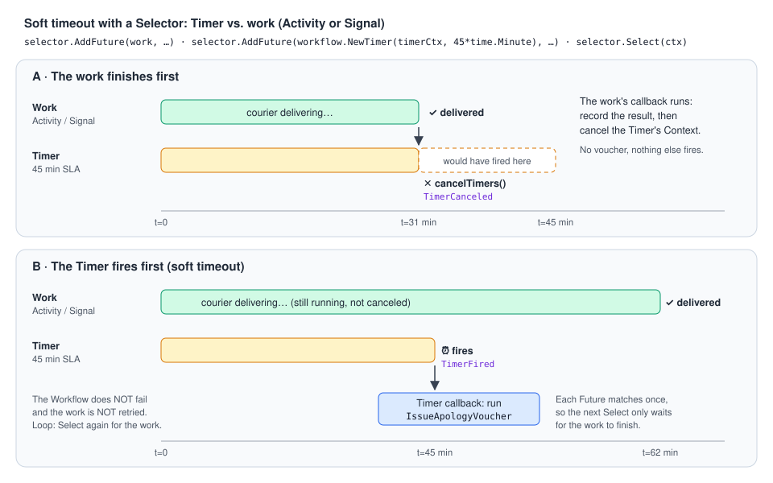

# 05 · Timers, Selectors and concurrency inside a Workflow

> **Level:** core concept · **Read time:** ~20 min
> **Sources:** [Encyclopedia: Timers and Start Delays](https://docs.temporal.io/workflow-execution/timers-delays) · [Workflow Definition: deterministic constraints](https://docs.temporal.io/workflow-definition) · [Go SDK: Timers](https://docs.temporal.io/develop/go/workflows/timers) · [Go SDK: Selectors](https://docs.temporal.io/develop/go/workflows/selectors) · [Go SDK: Workflow basics](https://docs.temporal.io/develop/go/workflows/basics)

---

## 1. The problem

Real business processes **wait** and **race**:

- "Wait 2 minutes for the customer to change their mind before we charge."
- "Ask three couriers for a quote and take the first answer."
- "If the food isn't delivered within 45 minutes, send a voucher, **but keep tracking the delivery**."

In normal Go you'd use `time.Sleep`, `go`, `chan` and `select`. In a Workflow these are **forbidden**:
they aren't recorded in the Event History, so a replay could take a different path. `select` even
picks a random ready case. The Go SDK gives you deterministic, **durable** replacements:

| Native Go | In Workflow code | Why |
| --- | --- | --- |
| `time.Sleep(d)` | `workflow.Sleep(ctx, d)` | Durable Timer, recorded in history |
| `time.NewTimer(d)` | `workflow.NewTimer(ctx, d)` / `NewTimerWithOptions` | Same, returns a `workflow.Future` |
| `time.Now()` | `workflow.Now(ctx)` | Time of the current Workflow Task, the same on replay |
| `go f()` | `workflow.Go(ctx, f)` | Deterministic coroutine scheduling |
| `chan T` | `workflow.NewChannel(ctx)` / `NewBufferedChannel` | Deterministic channel |
| `select { … }` | `workflow.NewSelector(ctx)` | No random choice, works with Futures too |
| `context.Context` | `workflow.Context` (+ `workflow.WithCancel`) | Cancels Timers, Activities and children |

> ✅ `select`, goroutines and `time` are fine **inside Activities**. The rules only apply to Workflow code.

---

## 2. Durable Timers

A **Timer** is persisted by the Temporal Service. If your Worker or the Service is down when the
time is up, the waiting code resumes **as soon as they are back**. Waiting costs nothing: the Workflow
isn't in memory and no thread is blocked. A single Worker can have **millions** of pending Timers.

```go
// Sleep: the simple form. Returns nil when the time has passed, or *CanceledError if ctx is canceled.
err := workflow.Sleep(ctx, 2*time.Minute)

// Timer: a Future you can combine with other Futures in a Selector (section 4).
timer := workflow.NewTimer(ctx, 45*time.Minute)

// With a summary that shows up in the Web UI / Event History.
sla := workflow.NewTimerWithOptions(ctx, 45*time.Minute, workflow.TimerOptions{Summary: "delivery SLA"})
```

What you need to know:

- **A duration is a minimum.** 11.97 seconds will probably fire closer to 12 seconds, because scheduling
  and firing take time. **Don't rely on sub-second accuracy.** Durations can range from about a second to years.
- **A zero or negative** `Sleep` returns immediately.
- **Cancel a Timer** by canceling its Context: create it with `workflow.WithCancel(ctx)` and call
  `cancel()`. The Timer's Future then resolves with a `*CanceledError`.
- **Changing a Timer's duration** in code that already has running Executions is a safe change, **except
  from or to 0**, which is non-deterministic in Go ([03](03-determinism-and-replay.md)). Adding, removing
  or reordering Timers needs Versioning ([11](11-versioning.md)).
- To start a whole **Workflow** later (once, not on a recurrence), use **Start Delay** on the client, not a
  Sleep at the top of the Workflow. See [10](10-schedules-and-cron.md).

> 💡 Prefer a Timer over a **Workflow timeout** for business deadlines ([04](04-workflow-execution-and-ids.md)):
> when a Timer fires, your code decides what to do. A timeout just stops the Workflow.

---

## 3. Waiting on a condition: `workflow.Await` and `AwaitWithTimeout`

Often you don't wait for a fixed time, you wait for **state** to change (usually because a Signal
arrived). `workflow.Await(ctx, cond)` blocks until `cond()` returns true. The condition is re-checked
whenever the Workflow's state may have changed.
`workflow.AwaitWithTimeout(ctx, d, cond)` adds a durable timeout. It returns `ok=false` if the time ran out.

```go
foodReady := false
// … a goroutine or Signal handler sets foodReady = true …
ok, err := workflow.AwaitWithTimeout(ctx, 30*time.Minute, func() bool { return foodReady })
```

The condition function must only **read** Workflow state. It must not block or call Temporal APIs.

---

## 4. Selectors: deterministic `select`

A `workflow.Selector` waits until **one** of its registered cases is ready, then runs **that case's
callback**:

| Method | Case |
| --- | --- |
| `AddFuture(f, func(f workflow.Future))` | An Activity, Child Workflow or Timer Future becomes ready |
| `AddReceive(ch, func(c workflow.ReceiveChannel, more bool))` | A message is available on a channel (for example a Signal channel) |
| `AddSend(ch, v, func())` | A send on a channel can proceed |
| `AddDefault(func())` | Nothing else is ready right now |
| `Select(ctx)` | Block until one case is ready and run its callback (**only one** per call) |
| `HasPending()` | Is a case ready right now? Useful to avoid losing Signals before completing or Continue-As-New ([09](09-continue-as-new.md)) |

Rules that trip people up:

1. **Nothing runs until `Select` is called.** `ExecuteActivity` only queues a Command. Commands are
   sent to the Service at the next point where the Workflow blocks, `Select` included.
2. **A Future matches only once per Selector**, even if you call `Select` again. Calling `Select` N times on N
   Futures collects all of them. If several are ready at once, the matching order is not defined.
3. **`AddReceive` doesn't consume the message.** Call `c.Receive(ctx, &v)` in the callback.
   Otherwise the same message matches again and again.

### The soft-timeout race



A classic use is a **soft timeout**: race a Timer against slow work. When the Timer wins, you **react**
(notify, compensate, escalate) without failing or retrying the work. When the work wins, you **cancel
the Timer**.

---

## 5. Example: food delivery with quotes, an SLA and reminders

`FoodDeliveryWorkflow`:

1. **Grace period:** `workflow.Sleep` for 2 minutes so the customer can still cancel for free.
2. **Pick-first:** ask three couriers for a quote **in parallel**, keep the first successful one and
   **cancel the others**.
3. **Kitchen:** `workflow.Go` plus `AwaitWithTimeout` waits for the restaurant to mark the food ready.
4. **Delivery race:** wait for the `order-delivered` Signal. A 20-minute **reminder Timer** and a
   45-minute **soft SLA Timer** run at the same time. When the SLA passes, the customer gets an apology
   voucher and **the Workflow keeps waiting** for the delivery. When the Signal arrives, the timers that
   haven't fired are canceled.

### Activities

```go
// file: delivery/activities.go
package delivery

import (
	"context"
	"time"

	"go.temporal.io/sdk/activity"
)

type QuoteRequest struct {
	Courier       string
	OrderID       string
	PickupAddress string
	DropoffZone   string
}

type CourierQuote struct {
	Courier    string
	PriceCents int64
	PickupETA  time.Duration
}

// CourierGateway wraps the courier partners' HTTP APIs.
type CourierGateway interface {
	Quote(ctx context.Context, req QuoteRequest) (CourierQuote, error)
	Dispatch(ctx context.Context, orderID string, q CourierQuote) (string, error)
}

// CustomerNotifier sends push notifications / SMS.
type CustomerNotifier interface {
	Notify(ctx context.Context, orderID, message string) error
}

// VoucherService issues compensation vouchers.
type VoucherService interface {
	Issue(ctx context.Context, orderID string, amountCents int64) (string, error)
}

type DeliveryActivities struct {
	Couriers CourierGateway
	Notifier CustomerNotifier
	Vouchers VoucherService
}

func (a *DeliveryActivities) RequestCourierQuote(ctx context.Context, req QuoteRequest) (CourierQuote, error) {
	activity.GetLogger(ctx).Info("Requesting quote", "courier", req.Courier)
	return a.Couriers.Quote(ctx, req)
}

func (a *DeliveryActivities) DispatchCourier(ctx context.Context, orderID string, q CourierQuote) (string, error) {
	return a.Couriers.Dispatch(ctx, orderID, q)
}

func (a *DeliveryActivities) SendDeliveryReminder(ctx context.Context, orderID string) error {
	return a.Notifier.Notify(ctx, orderID, "Your courier is on the way, thanks for your patience!")
}

func (a *DeliveryActivities) IssueApologyVoucher(ctx context.Context, orderID string) (string, error) {
	voucherID, err := a.Vouchers.Issue(ctx, orderID, 5_00)
	if err != nil {
		return "", err
	}
	return voucherID, a.Notifier.Notify(ctx, orderID, "Sorry for the delay, here is a 5€ voucher: "+voucherID)
}
```

### Pick-first-and-cancel-the-rest

```go
// file: delivery/quotes.go
package delivery

import (
	"errors"
	"fmt"

	"go.temporal.io/sdk/workflow"
)

// fastestQuote asks every courier in parallel and returns the first successful quote.
// The losing requests are canceled through their shared Context.
func fastestQuote(ctx workflow.Context, order DeliveryOrder) (CourierQuote, error) {
	quoteCtx, cancelQuotes := workflow.WithCancel(ctx)
	defer cancelQuotes()

	var a *DeliveryActivities
	selector := workflow.NewSelector(ctx)
	var (
		winner   CourierQuote
		found    bool
		failures []error
	)
	// order.Couriers is a slice, so the iteration order is deterministic (never range over a map here).
	for _, courier := range order.Couriers {
		f := workflow.ExecuteActivity(quoteCtx, a.RequestCourierQuote, QuoteRequest{
			Courier:       courier,
			OrderID:       order.OrderID,
			PickupAddress: order.RestaurantAddress,
			DropoffZone:   order.DropoffZone,
		})
		selector.AddFuture(f, func(f workflow.Future) {
			var q CourierQuote
			if err := f.Get(ctx, &q); err != nil {
				failures = append(failures, err)
				return
			}
			if !found {
				winner, found = q, true
			}
		})
	}

	// Each Select runs exactly one ready callback. Stop at the first success.
	for i := 0; i < len(order.Couriers) && !found; i++ {
		selector.Select(ctx)
	}
	if !found {
		return CourierQuote{}, fmt.Errorf("no courier available: %w", errors.Join(failures...))
	}
	cancelQuotes() // cancel the quote requests still pending
	return winner, nil
}
```

### The Workflow

```go
// file: delivery/workflow.go
package delivery

import (
	"time"

	"go.temporal.io/sdk/temporal"
	"go.temporal.io/sdk/workflow"
)

const (
	TaskQueue       = "delivery"
	DeliveredSignal = "order-delivered"
	FoodReadySignal = "food-ready"
)

type DeliveryOrder struct {
	OrderID           string
	RestaurantAddress string
	DropoffZone       string
	Couriers          []string // e.g. ["swiftbike", "urbandrop", "citycourier"]
	CancelGracePeriod time.Duration
	ReminderAfter     time.Duration
	DeliverySLA       time.Duration
}

type DeliveryProof struct {
	CourierID  string
	PhotoURL   string
	ReceivedBy string
}

type DeliveryResult struct {
	Courier      string
	DispatchID   string
	FoodReady    bool
	Proof        DeliveryProof
	VoucherID    string // set only if the SLA was missed
	ReminderSent bool
}

func FoodDeliveryWorkflow(ctx workflow.Context, order DeliveryOrder) (DeliveryResult, error) {
	logger := workflow.GetLogger(ctx)
	ctx = workflow.WithActivityOptions(ctx, workflow.ActivityOptions{
		StartToCloseTimeout: 30 * time.Second,
		RetryPolicy:         &temporal.RetryPolicy{MaximumAttempts: 3},
	})
	var a *DeliveryActivities
	var result DeliveryResult

	// 1. Durable grace period: survives Worker restarts, costs nothing while waiting.
	if err := workflow.Sleep(ctx, order.CancelGracePeriod); err != nil {
		return result, err // *CanceledError if the Workflow was canceled during the grace period
	}

	// 2. Parallel quotes, first one wins.
	quote, err := fastestQuote(ctx, order)
	if err != nil {
		return result, err
	}
	result.Courier = quote.Courier
	if err := workflow.ExecuteActivity(ctx, a.DispatchCourier, order.OrderID, quote).Get(ctx, &result.DispatchID); err != nil {
		return result, err
	}

	// 3. A coroutine listens to the kitchen while the main code waits on a condition.
	kitchen := workflow.GetSignalChannel(ctx, FoodReadySignal)
	workflow.Go(ctx, func(gctx workflow.Context) {
		kitchen.Receive(gctx, nil)
		result.FoodReady = true
	})
	ok, err := workflow.AwaitWithTimeout(ctx, 30*time.Minute, func() bool { return result.FoodReady })
	if err != nil {
		return result, err
	}
	if !ok {
		logger.Warn("Kitchen did not confirm within 30 minutes, courier will wait on site")
	}

	// 4. Delivery race: Signal vs reminder Timer vs soft SLA Timer.
	timerCtx, cancelTimers := workflow.WithCancel(ctx)
	defer cancelTimers()
	reminder := workflow.NewTimerWithOptions(timerCtx, order.ReminderAfter, workflow.TimerOptions{Summary: "courier reminder"})
	sla := workflow.NewTimerWithOptions(timerCtx, order.DeliverySLA, workflow.TimerOptions{Summary: "delivery SLA"})

	delivered := false
	selector := workflow.NewSelector(ctx)
	selector.AddReceive(workflow.GetSignalChannel(ctx, DeliveredSignal), func(c workflow.ReceiveChannel, more bool) {
		c.Receive(ctx, &result.Proof) // AddReceive does NOT consume: always Receive in the callback
		delivered = true
	})
	selector.AddFuture(reminder, func(f workflow.Future) {
		if f.Get(ctx, nil) != nil {
			return // canceled: the order was delivered first
		}
		if err := workflow.ExecuteActivity(ctx, a.SendDeliveryReminder, order.OrderID).Get(ctx, nil); err != nil {
			logger.Warn("Reminder failed", "error", err)
			return
		}
		result.ReminderSent = true
	})
	selector.AddFuture(sla, func(f workflow.Future) {
		if f.Get(ctx, nil) != nil {
			return
		}
		// Soft timeout: compensate the customer, but DON'T stop waiting for the delivery.
		if err := workflow.ExecuteActivity(ctx, a.IssueApologyVoucher, order.OrderID).Get(ctx, &result.VoucherID); err != nil {
			logger.Error("Voucher failed", "error", err)
		}
	})

	// Each Future matches once, so after both Timers fired only the Signal case is left.
	for !delivered {
		selector.Select(ctx)
		if ctx.Err() != nil {
			return result, ctx.Err() // the Workflow itself was canceled
		}
	}
	cancelTimers() // the timers that haven't fired are canceled and never fire
	return result, nil
}
```

### Worker, starter and the courier app

```go
// file: cmd/delivery-worker/main.go
package main

import (
	"context"
	"log"
	"time"

	"github.com/acme/shop/delivery"
	"go.temporal.io/sdk/client"
	"go.temporal.io/sdk/worker"
)

type fakeCouriers struct{}

func (fakeCouriers) Quote(ctx context.Context, req delivery.QuoteRequest) (delivery.CourierQuote, error) {
	return delivery.CourierQuote{Courier: req.Courier, PriceCents: 4_90, PickupETA: 12 * time.Minute}, nil
}

func (fakeCouriers) Dispatch(ctx context.Context, orderID string, q delivery.CourierQuote) (string, error) {
	return "disp_" + orderID, nil
}

type logNotifier struct{}

func (logNotifier) Notify(ctx context.Context, orderID, message string) error {
	log.Printf("[notify %s] %s", orderID, message)
	return nil
}

type fakeVouchers struct{}

func (fakeVouchers) Issue(ctx context.Context, orderID string, amountCents int64) (string, error) {
	return "VCH-" + orderID, nil
}

func main() {
	c, err := client.Dial(client.Options{})
	if err != nil {
		log.Fatalln(err)
	}
	defer c.Close()

	w := worker.New(c, delivery.TaskQueue, worker.Options{})
	w.RegisterWorkflow(delivery.FoodDeliveryWorkflow)
	w.RegisterActivity(&delivery.DeliveryActivities{
		Couriers: fakeCouriers{},
		Notifier: logNotifier{},
		Vouchers: fakeVouchers{},
	})
	log.Fatalln(w.Run(worker.InterruptCh()))
}
```

```go
// file: cmd/delivery-start/main.go
package main

import (
	"context"
	"log"
	"time"

	"github.com/acme/shop/delivery"
	"go.temporal.io/sdk/client"
)

func main() {
	c, err := client.Dial(client.Options{})
	if err != nil {
		log.Fatalln(err)
	}
	defer c.Close()

	order := delivery.DeliveryOrder{
		OrderID:           "ord_77120",
		RestaurantAddress: "12 rue des Lilas, Lyon",
		DropoffZone:       "lyon-3",
		Couriers:          []string{"swiftbike", "urbandrop", "citycourier"},
		CancelGracePeriod: 2 * time.Minute,
		ReminderAfter:     20 * time.Minute,
		DeliverySLA:       45 * time.Minute,
	}
	run, err := c.ExecuteWorkflow(context.Background(), client.StartWorkflowOptions{
		ID:        "delivery-" + order.OrderID,
		TaskQueue: delivery.TaskQueue,
	}, delivery.FoodDeliveryWorkflow, order)
	if err != nil {
		log.Fatalln(err)
	}
	log.Println("started", run.GetID(), run.GetRunID())
}
```

```go
// file: cmd/courier-app/main.go
package main

import (
	"context"
	"flag"
	"log"

	"github.com/acme/shop/delivery"
	"go.temporal.io/sdk/client"
)

// courier-app -order ord_77120 -event food-ready|delivered
func main() {
	orderID := flag.String("order", "", "order ID")
	event := flag.String("event", "delivered", "food-ready or delivered")
	flag.Parse()

	c, err := client.Dial(client.Options{})
	if err != nil {
		log.Fatalln(err)
	}
	defer c.Close()

	workflowID := "delivery-" + *orderID
	ctx := context.Background()
	switch *event {
	case "food-ready":
		err = c.SignalWorkflow(ctx, workflowID, "", delivery.FoodReadySignal, nil)
	default:
		err = c.SignalWorkflow(ctx, workflowID, "", delivery.DeliveredSignal, delivery.DeliveryProof{
			CourierID:  "cr_311",
			PhotoURL:   "https://cdn.example.com/proofs/ord_77120.jpg",
			ReceivedBy: "front desk",
		})
	}
	if err != nil {
		log.Fatalln(err)
	}
	log.Println("signal sent:", *event)
}
```

Signals are covered in depth in [06](06-message-passing.md). The point here is that a Signal channel is
just another case in a Selector.

---

## 6. What ends up in the Event History

Run the example and open the Workflow in the Web UI (<http://localhost:8233>). You'll see:

| Code | Events |
| --- | --- |
| `workflow.Sleep(ctx, 2*time.Minute)` | `TimerStarted` … `TimerFired` |
| 3 × `ExecuteActivity` for quotes | 3 × `ActivityTaskScheduled`, then the winner's completion, and `ActivityTaskCancelRequested` for losers still pending |
| `NewTimerWithOptions(... "delivery SLA")` | `TimerStarted` (the summary is shown in the UI) |
| `cancelTimers()` before a Timer fired | `TimerCanceled` |
| Courier sends the Signal | `WorkflowExecutionSignaled` |

Because every Timer start, fire and cancel is an event, the replayed code makes **the same choices**,
whatever the Worker's clock says. This is what makes Timers and Selectors safe where `time` and `select` aren't.

---

## Key takeaways

- Use `workflow.Sleep` / `workflow.NewTimer(WithOptions)`, never `time.Sleep`. Timers are durable, cheap and fire at least after their duration.
- Cancel a Timer by canceling its `workflow.WithCancel` Context. Changing a duration is safe, except from or to 0.
- `workflow.Await` / `AwaitWithTimeout` wait for **state**. Timers wait for **time**.
- `workflow.Selector` replaces `select`: `AddFuture`, `AddReceive` (always `Receive` inside), one callback per `Select`, each Future matches once.
- Patterns: **pick-first and cancel the rest**, and **soft timeouts** (react when the Timer fires, keep waiting for the real result).
- `workflow.Go` and `workflow.Channel` replace `go` and `chan` in Workflow code. In Activities, plain Go is fine.

⬅️ Previous: [04 · Workflow Executions: status, IDs, timeouts and limits](04-workflow-execution-and-ids.md) · ➡️ Next: [06 · Message passing](06-message-passing.md)
