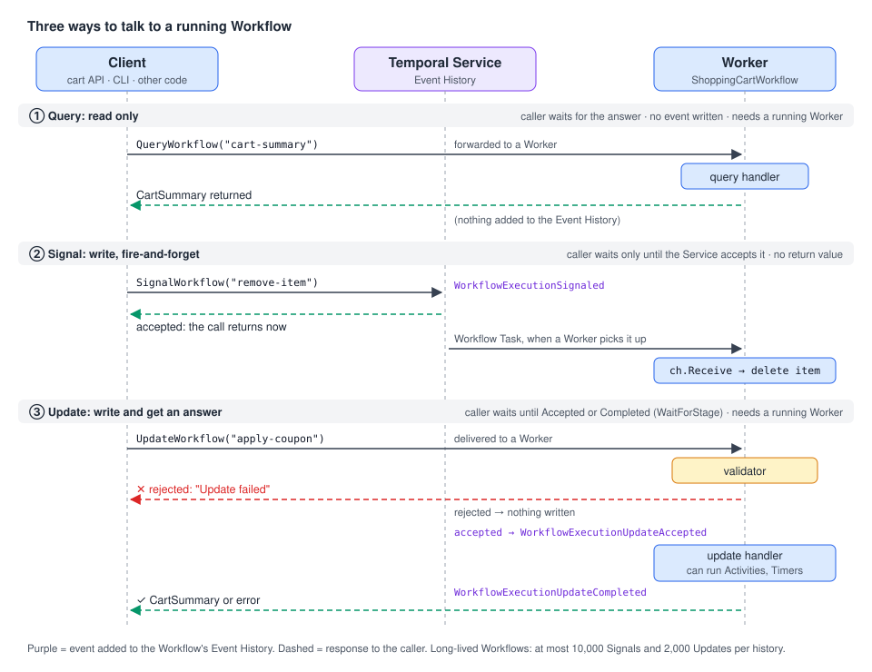

# 06 · Message passing: Queries, Signals and Updates

> **Level:** core concept · **Read time:** ~25 min
> **Sources:** [Go SDK — Workflow message passing](https://docs.temporal.io/develop/go/workflows/message-passing) · [Go SDK — Selectors](https://docs.temporal.io/develop/go/workflows/selectors) · [Encyclopedia — Events and Event History](https://docs.temporal.io/workflow-execution/event) · [Encyclopedia — Timers and Start Delays](https://docs.temporal.io/workflow-execution/timers-delays) · [Encyclopedia — Workflow Id and Run Id](https://docs.temporal.io/workflow-execution/workflowid-runid)

---

## 1. The problem

Up to now, a Workflow received its input at start time and returned a result at the end. Real
business processes don't work like that. While they run, other systems need to **read** their state
and **steer** them:

- the web shop shows "3 items, €42.50" → it needs to **read** the cart
- the customer clicks "remove" → the cart must **change**, and nobody needs to wait for it
- the customer clicks "add to cart" → the cart must change **and** the UI needs the new total, or an
  error such as "unknown product"

Without Temporal you would put the cart in a database, add an API in front of it, add locking, and
poll for changes. With Temporal, **a Workflow Execution can act like a stateful web service**. It
holds the state in plain Go variables and exposes three kinds of endpoints:

| Message | Direction | Caller waits? | Can change state? | Written to Event History? |
| --- | --- | --- | --- | --- |
| **Query** | read | yes, for the answer | ❌ no | ❌ no |
| **Signal** | write | only until the Service accepts it | ✅ yes | ✅ `WorkflowExecutionSignaled` |
| **Update** | write + read | yes, until accepted, and optionally until completed | ✅ yes | ✅ `WorkflowExecutionUpdateAccepted` + `WorkflowExecutionUpdateCompleted` (nothing if rejected) |



> Rules that apply to all three: values sent in messages and the values handlers return must be
> **serializable**, and you should prefer **a single struct argument** over several arguments, so you
> can add fields later without changing the signature.

---

## 2. The running example: a shopping cart per customer

We build one long-lived `ShoppingCartWorkflow` per customer, with Workflow ID `cart-<customerID>`.
This kind of Workflow, which represents one business object rather than a one-off process, is often
called an **entity Workflow**.

> ⚠️ Use an internal, opaque customer ID in the Workflow ID, never an e-mail address. Workflow IDs,
> Signal names, Query names and Update names are stored in plain text and are visible in the UI, the
> CLI and the logs. They are **not** encrypted by a Payload Codec.

| Name | Kind | What it does |
| --- | --- | --- |
| `cart-summary` | Query | returns items and totals |
| `add-item` | Update | adds a product. A **validator** rejects unknown SKUs and quantities ≤ 0 |
| `apply-coupon` | Update | calls a `ValidateCoupon` Activity, so the handler **blocks**. Guarded by a `workflow.Mutex` |
| `remove-item` | Signal | removes a product, fire-and-forget |
| `checkout` | Signal | ends the cart. The Workflow places the order and Signals the customer's loyalty Workflow |

### Shared types and names

Put message names and payload types in one place. Clients and the Workflow import the same constants,
so a typo can't silently send a Signal nobody listens to.

```go
// file: carts/messages.go
package carts

// Message names: the contract between the cart API and the Workflow.
const (
	TaskQueue = "carts"

	CartSummaryQuery  = "cart-summary"
	AddItemUpdate     = "add-item"
	ApplyCouponUpdate = "apply-coupon"
	RemoveItemSignal  = "remove-item"
	CheckoutSignal    = "checkout"

	// Sent to the customer's LoyaltyAccountWorkflow (see chapter 09).
	PointsEarnedSignal = "points-earned"
)

// CartWorkflowID gives one cart per customer. Use an internal ID, never PII.
func CartWorkflowID(customerID string) string { return "cart-" + customerID }

// LoyaltyWorkflowID is the ID of the customer's loyalty account Workflow.
func LoyaltyWorkflowID(customerID string) string { return "loyalty-" + customerID }

type CartInput struct {
	CustomerID string
}

type CartItem struct {
	SKU            string
	Quantity       int
	UnitPriceCents int64
}

type CartSummary struct {
	Items         []CartItem
	SubtotalCents int64
	DiscountCents int64
	TotalCents    int64
	Coupon        string
	CheckedOut    bool
}

type AddItemRequest struct {
	SKU      string
	Quantity int
}

type RemoveItemRequest struct {
	SKU string
}

type ApplyCouponRequest struct {
	Code string
}

type CheckoutRequest struct {
	PaymentMethodID string
}

type CheckoutResult struct {
	OrderID    string
	TotalCents int64
}

type PointsEarned struct {
	OrderID string
	Points  int64
}
```

### The Activities

The cart itself has no I/O. Only coupon validation and order placement talk to other systems, so they
are Activities.

```go
// file: carts/activities.go
package carts

import "context"

type CouponDecision struct {
	Valid           bool
	DiscountPercent int64
	Reason          string
}

// CouponService and OrderService are your real backends (HTTP clients, DB access...).
type CouponService interface {
	Check(ctx context.Context, code string, subtotalCents int64) (CouponDecision, error)
}

type OrderService interface {
	Place(ctx context.Context, customerID, paymentMethodID string, items []CartItem, totalCents int64) (string, error)
}

type PlaceOrderRequest struct {
	CustomerID      string
	PaymentMethodID string
	Items           []CartItem
	TotalCents      int64
}

type CartActivities struct {
	Coupons CouponService
	Orders  OrderService
}

func (a *CartActivities) ValidateCoupon(ctx context.Context, code string, subtotalCents int64) (CouponDecision, error) {
	return a.Coupons.Check(ctx, code, subtotalCents)
}

func (a *CartActivities) PlaceOrder(ctx context.Context, req PlaceOrderRequest) (string, error) {
	return a.Orders.Place(ctx, req.CustomerID, req.PaymentMethodID, req.Items, req.TotalCents)
}
```

### The cart state

Plain Go. Note `workflow.DeterministicKeys`: iterating a map with `range` gives a random order, which
is not allowed in Workflow code (see chapter 03). The helper returns the keys sorted.

```go
// file: carts/state.go
package carts

import "go.temporal.io/sdk/workflow"

// priceList stands in for the product catalog. In production, load it with an
// Activity at the start of the Workflow (it must not change during replay).
var priceList = map[string]int64{
	"SKU-COFFEE-1KG": 1890,
	"SKU-GRINDER":    8900,
	"SKU-FILTERS":    450,
}

type cartState struct {
	items           map[string]CartItem
	coupon          string
	discountPercent int64
	checkedOut      bool
}

func (c *cartState) subtotal() int64 {
	var total int64
	for _, sku := range workflow.DeterministicKeys(c.items) {
		item := c.items[sku]
		total += int64(item.Quantity) * item.UnitPriceCents
	}
	return total
}

func (c *cartState) summary() CartSummary {
	s := CartSummary{Coupon: c.coupon, CheckedOut: c.checkedOut}
	for _, sku := range workflow.DeterministicKeys(c.items) {
		s.Items = append(s.Items, c.items[sku])
	}
	s.SubtotalCents = c.subtotal()
	s.DiscountCents = s.SubtotalCents * c.discountPercent / 100
	s.TotalCents = s.SubtotalCents - s.DiscountCents
	return s
}
```

---

## 3. Queries: read the state

A **Query** is a synchronous, read-only request. The handler is a plain function, registered with
`workflow.SetQueryHandler`. It must return **two values**, a serializable result and an `error`.

```go
// file: carts/query.go
package carts

import "go.temporal.io/sdk/workflow"

func registerCartQuery(ctx workflow.Context, cart *cartState) error {
	return workflow.SetQueryHandler(ctx, CartSummaryQuery, func() (CartSummary, error) {
		// Read only: a Query handler must never change cart.
		return cart.summary(), nil
	})
}
```

What you need to know about Queries:

- **No events.** Sending a Query doesn't add anything to the Event History.
- **No blocking work.** A Query handler can't run Activities, sleep or wait. It inspects state and returns.
- **A Worker must be running.** The Query is answered by Workflow code, so a Worker must be polling
  the Task Queue. Otherwise the Client gets a `FAILED_PRECONDITION` error.
- **Closed Workflows can be queried** (completed, failed, timed out) during the Namespace retention
  period. **Terminated** Workflows can't. So a checked-out cart can still answer `cart-summary` for a while.

---

## 4. Signals: change the state, fire-and-forget

A **Signal** is an asynchronous message. The Client call returns as soon as the Temporal Service has
**accepted** it and written `WorkflowExecutionSignaled` to the history. It does **not** wait for the
Workflow to process it, and it can't return a value.

In Go, Signals arrive on a **Signal Channel**: `workflow.GetSignalChannel(ctx, name)`. You read it with:

| API | Behaviour |
| --- | --- |
| `ch.Receive(ctx, &v)` | blocks until a Signal arrives |
| `ch.ReceiveAsync(&v)` | returns `false` immediately if nothing is buffered. Used to **drain** |
| `selector.AddReceive(ch, fn)` | waits on several channels, timers and futures at once (chapter 05) |

Two rules from the docs:

- **Signals are buffered.** If a Signal arrives before your code calls `GetSignalChannel`, the SDK
  keeps it. So you can finish initialization first, then start reading.
- **Drain before you finish.** Before the Workflow completes or Continues-As-New, read any remaining
  Signals with `ReceiveAsync`. Otherwise **they are lost**.

The main loop of our cart waits on two Signal Channels with a Selector. Matching a channel in a Selector
doesn't consume the message, so each callback calls `Receive`:

```go
// file: carts/signals.go
package carts

import "go.temporal.io/sdk/workflow"

// waitForCheckout processes remove-item Signals until a checkout Signal arrives.
func waitForCheckout(ctx workflow.Context, cart *cartState) CheckoutRequest {
	removeCh := workflow.GetSignalChannel(ctx, RemoveItemSignal)
	checkoutCh := workflow.GetSignalChannel(ctx, CheckoutSignal)

	var checkout CheckoutRequest
	for !cart.checkedOut {
		selector := workflow.NewSelector(ctx)
		selector.AddReceive(removeCh, func(c workflow.ReceiveChannel, more bool) {
			var req RemoveItemRequest
			c.Receive(ctx, &req)
			delete(cart.items, req.SKU)
		})
		selector.AddReceive(checkoutCh, func(c workflow.ReceiveChannel, more bool) {
			c.Receive(ctx, &checkout)
			cart.checkedOut = true
		})
		selector.Select(ctx)
	}
	return checkout
}

// drainRemovals applies remove-item Signals that are still buffered.
// Without this, they would be silently lost when the Workflow completes.
func drainRemovals(ctx workflow.Context, cart *cartState) {
	removeCh := workflow.GetSignalChannel(ctx, RemoveItemSignal)
	for {
		var req RemoveItemRequest
		if !removeCh.ReceiveAsync(&req) {
			return
		}
		delete(cart.items, req.SKU)
	}
}
```

### Signals from another Workflow (External Signal)

A Workflow can Signal another Workflow with `workflow.SignalExternalWorkflow`. The sender's history
gets `SignalExternalWorkflowExecutionInitiated`, and the receiver's history gets
`WorkflowExecutionSignaled`. The call returns a Future that holds either an empty success or a
failure. With an empty Run ID, the currently running Workflow with that ID gets the Signal. You can
only Signal Workflows that are still open.

```go
// file: carts/loyalty.go
package carts

import "go.temporal.io/sdk/workflow"

// notifyLoyalty tells the customer's LoyaltyAccountWorkflow (chapter 09) about earned points.
// A missing loyalty account must not break checkout, so the error is only logged.
func notifyLoyalty(ctx workflow.Context, customerID string, points PointsEarned) {
	err := workflow.SignalExternalWorkflow(ctx, LoyaltyWorkflowID(customerID), "", PointsEarnedSignal, points).Get(ctx, nil)
	if err != nil {
		workflow.GetLogger(ctx).Warn("Could not signal loyalty account", "customerID", customerID, "error", err)
	}
}
```

---

## 5. Updates: change the state and get an answer

An **Update** is a **trackable, synchronous** request. It can change state, run blocking work
(Activities, Timers, `workflow.Await`), and **return a value or an error** to the caller.

Register it with `workflow.SetUpdateHandler` or `workflow.SetUpdateHandlerWithOptions`:

- The handler's first parameter is a `workflow.Context`. It returns `(T, error)` or just `error`.
- An optional **validator** takes the same arguments and returns one `error`. It runs **before**
  anything is written to history:
  - validator returns `nil` (or there is no validator) → `WorkflowExecutionUpdateAccepted` is written, then the handler runs
  - validator returns an error (or panics) → the Update is **rejected**, nothing is written, and the caller gets an "Update failed" error
- When the handler finishes → `WorkflowExecutionUpdateCompleted` is written.
- A validator only **reads**. Don't change state there.

Because each Update adds events, a long-lived Workflow has a budget: the history allows at most
**2,000 Updates** and **10,000 Signals** before the Workflow is terminated. Long-lived entities must
**Continue-As-New** (chapter 09).

### `add-item`: validated, non-blocking

```go
// file: carts/update_add_item.go
package carts

import (
	"errors"
	"fmt"

	"go.temporal.io/sdk/workflow"
)

func registerAddItem(ctx workflow.Context, cart *cartState) error {
	return workflow.SetUpdateHandlerWithOptions(ctx, AddItemUpdate,
		func(ctx workflow.Context, req AddItemRequest) (CartSummary, error) {
			item := cart.items[req.SKU]
			item.SKU = req.SKU
			item.Quantity += req.Quantity
			item.UnitPriceCents = priceList[req.SKU]
			cart.items[req.SKU] = item
			return cart.summary(), nil
		},
		workflow.UpdateHandlerOptions{
			// Reject bad requests before they reach the Event History.
			Validator: func(ctx workflow.Context, req AddItemRequest) error {
				if cart.checkedOut {
					return errors.New("cart is already checked out")
				}
				if req.Quantity <= 0 {
					return fmt.Errorf("quantity must be positive, got %d", req.Quantity)
				}
				if _, ok := priceList[req.SKU]; !ok {
					return fmt.Errorf("unknown product %q", req.SKU)
				}
				return nil
			},
		})
}
```

### `apply-coupon`: a blocking handler

Signal and Update handlers **can block**: run Activities, sleep, wait on conditions. That is powerful,
but it means **handlers and the main Workflow function run concurrently**. Temporal runs them one at a
time and switches between them only when one blocks (an Activity call, `Sleep`, `Await`...).

Here is the bug that creates. Two `apply-coupon` Updates arrive at almost the same time:

```text
handler A: reads subtotal → ExecuteActivity(ValidateCoupon "WELCOME10")  ── blocks ──┐
handler B: reads subtotal → ExecuteActivity(ValidateCoupon "VIP25")      ── blocks ──┤
handler B resumes: coupon = VIP25, discount = 25%                                    │
handler A resumes: coupon = WELCOME10, discount = 10%   ← last writer wins, randomly ◄┘
```

`workflow.NewMutex` fixes it. Only one holder of the lock runs the critical section at a time. The
others wait in `Lock(ctx)`.

`workflow.GetCurrentUpdateInfo(ctx)` returns the Update's ID and name. The ID is useful for logs and
for de-duplication when the same request may be sent twice.

```go
// file: carts/update_apply_coupon.go
package carts

import (
	"errors"
	"time"

	"go.temporal.io/sdk/temporal"
	"go.temporal.io/sdk/workflow"
)

func registerApplyCoupon(ctx workflow.Context, cart *cartState) error {
	couponLock := workflow.NewMutex(ctx)

	return workflow.SetUpdateHandlerWithOptions(ctx, ApplyCouponUpdate,
		func(ctx workflow.Context, req ApplyCouponRequest) (CartSummary, error) {
			// Only one coupon validation at a time. Others wait here.
			if err := couponLock.Lock(ctx); err != nil {
				return CartSummary{}, err
			}
			defer couponLock.Unlock()

			info := workflow.GetCurrentUpdateInfo(ctx)
			workflow.GetLogger(ctx).Info("Applying coupon", "updateID", info.ID, "code", req.Code)

			actx := workflow.WithActivityOptions(ctx, workflow.ActivityOptions{StartToCloseTimeout: 10 * time.Second})
			var a *CartActivities
			var decision CouponDecision
			if err := workflow.ExecuteActivity(actx, a.ValidateCoupon, req.Code, cart.subtotal()).Get(actx, &decision); err != nil {
				return CartSummary{}, err
			}
			if !decision.Valid {
				// Fails this Update only. The cart Workflow keeps running.
				return CartSummary{}, temporal.NewApplicationError("coupon rejected: "+decision.Reason, "CouponRejected")
			}
			cart.coupon = req.Code
			cart.discountPercent = decision.DiscountPercent
			return cart.summary(), nil
		},
		workflow.UpdateHandlerOptions{
			Validator: func(ctx workflow.Context, req ApplyCouponRequest) error {
				if cart.checkedOut {
					return errors.New("cart is already checked out")
				}
				if req.Code == "" {
					return errors.New("coupon code is required")
				}
				return nil
			},
		})
}
```

> 💡 Returning an error from an Update **handler** fails that Update. The caller gets the error, and
> the Workflow keeps running. A Workflow fails only when the **main** function returns an error.

---

## 6. The Workflow: putting it together

Two more patterns appear in the main function:

- **Register handlers early**, before the first blocking call, so the Workflow can answer from the
  start. (Delaying registration is also safe: the SDK buffers Updates until a handler exists. But
  `SetUpdateHandler` then runs buffered Updates **immediately**, which can reorder messages of
  different types.)
- **Wait for all handlers to finish before you return** with
  `workflow.Await(ctx, func() bool { return workflow.AllHandlersFinished(ctx) })`. If the main function
  returns (or Continues-As-New) while an `apply-coupon` handler is still waiting on its Activity, the
  handler is interrupted and its caller gets a "workflow execution already completed" error. By
  default the Worker logs a warning for unfinished Update handlers. You can silence it per handler with
  `workflow.UpdateHandlerOptions{UnfinishedPolicy: workflow.HandlerUnfinishedPolicyAbandon}`, but only
  do that if abandoning really is fine.

```go
// file: carts/workflow.go
package carts

import (
	"time"

	"go.temporal.io/sdk/workflow"
)

func ShoppingCartWorkflow(ctx workflow.Context, in CartInput) (CheckoutResult, error) {
	cart := &cartState{items: map[string]CartItem{}}

	// 1. Expose the endpoints before doing anything that blocks.
	if err := registerCartQuery(ctx, cart); err != nil {
		return CheckoutResult{}, err
	}
	if err := registerAddItem(ctx, cart); err != nil {
		return CheckoutResult{}, err
	}
	if err := registerApplyCoupon(ctx, cart); err != nil {
		return CheckoutResult{}, err
	}

	// 2. Process Signals until the customer checks out.
	checkout := waitForCheckout(ctx, cart)

	// 3. Let in-flight Updates (e.g. a coupon being validated) finish.
	if err := workflow.Await(ctx, func() bool { return workflow.AllHandlersFinished(ctx) }); err != nil {
		return CheckoutResult{}, err
	}
	// 4. Apply Signals that are still buffered, so none are lost.
	drainRemovals(ctx, cart)

	// 5. Place the order.
	summary := cart.summary()
	actx := workflow.WithActivityOptions(ctx, workflow.ActivityOptions{StartToCloseTimeout: 30 * time.Second})
	var a *CartActivities
	var orderID string
	err := workflow.ExecuteActivity(actx, a.PlaceOrder, PlaceOrderRequest{
		CustomerID:      in.CustomerID,
		PaymentMethodID: checkout.PaymentMethodID,
		Items:           summary.Items,
		TotalCents:      summary.TotalCents,
	}).Get(ctx, &orderID)
	if err != nil {
		return CheckoutResult{}, err
	}

	// 6. One loyalty point per euro spent, sent to another Workflow.
	notifyLoyalty(ctx, in.CustomerID, PointsEarned{OrderID: orderID, Points: summary.TotalCents / 100})

	return CheckoutResult{OrderID: orderID, TotalCents: summary.TotalCents}, nil
}
```

> 🧪 Exercise: an abandoned cart stays open forever. Replace `selector.Select(ctx)` with a loop that also
> waits on a 30-day Timer (chapter 05) and closes the cart when it fires.

---

## 7. Sending messages from a Client

Everything is sent through `client.Client`. Look at the handler in the Workflow to know the argument
and return types.

| I want to… | Client API | Notes |
| --- | --- | --- |
| Read state | `QueryWorkflow(ctx, wfID, runID, name, args...)` → `EncodedValue.Get(&out)` | empty `runID` = the current run |
| Send a Signal | `SignalWorkflow(ctx, wfID, runID, name, arg)` | returns when the Service accepts it |
| Signal, starting the Workflow if needed | `SignalWithStartWorkflow(ctx, wfID, name, arg, startOptions, wf, wfArgs...)` | no Run ID: the Workflow may not exist yet |
| Send an Update | `UpdateWorkflow(ctx, client.UpdateWorkflowOptions{…, WaitForStage})` → `handle.Get(ctx, &out)` | `WaitForStage` is **required** |
| Update, starting the Workflow if needed | `UpdateWithStartWorkflow(ctx, client.UpdateWithStartWorkflowOptions{…})` | needs a Workflow ID Conflict Policy |

`WaitForStage` decides when `UpdateWorkflow` returns its handle:

- `client.WorkflowUpdateStageAccepted`: after the validator passed. Call `handle.Get` later for the result.
- `client.WorkflowUpdateStageCompleted`: after the handler finished. `handle.Get` returns immediately.

Always pass a `context.WithTimeout` when you send an Update. If no Worker is polling, the SDK keeps
retrying until the context is cancelled.

### Update-With-Start: the "add to cart" button

The customer's first "add to cart" must **create** the cart. Later ones must **reuse** it. That is
exactly what Update-With-Start does:

- if a Workflow with that ID is running, the Update is sent to it
- if not, the Workflow is started **and** the Update is processed **before** the main Workflow function starts running

You must set a Workflow ID Conflict Policy. Use `WORKFLOW_ID_CONFLICT_POLICY_USE_EXISTING`, and make
the handler safe to run again, in case the Client retries after a failure. (Not every start option is
allowed here. A `CronSchedule`, for example, causes an error.) A `WithStartWorkflowOperation` can be
used only once.

```go
// file: cmd/cart-api/main.go
package main

import (
	"context"
	"log"
	"time"

	"github.com/acme/shop/carts"
	enumspb "go.temporal.io/api/enums/v1"
	"go.temporal.io/sdk/client"
)

// CartAPI is what your HTTP handlers call. It holds one long-lived Temporal Client.
type CartAPI struct {
	Temporal client.Client
}

func startOptions(customerID string) client.StartWorkflowOptions {
	return client.StartWorkflowOptions{
		ID:                       carts.CartWorkflowID(customerID),
		TaskQueue:                carts.TaskQueue,
		WorkflowIDConflictPolicy: enumspb.WORKFLOW_ID_CONFLICT_POLICY_USE_EXISTING,
	}
}

// AddItem creates the cart on first use (Update-With-Start) and returns the new totals.
func (api *CartAPI) AddItem(ctx context.Context, customerID string, req carts.AddItemRequest) (carts.CartSummary, error) {
	ctx, cancel := context.WithTimeout(ctx, 15*time.Second)
	defer cancel()

	startOp := api.Temporal.NewWithStartWorkflowOperation(startOptions(customerID),
		carts.ShoppingCartWorkflow, carts.CartInput{CustomerID: customerID})

	handle, err := api.Temporal.UpdateWithStartWorkflow(ctx, client.UpdateWithStartWorkflowOptions{
		StartWorkflowOperation: startOp,
		UpdateOptions: client.UpdateWorkflowOptions{
			UpdateName:   carts.AddItemUpdate,
			WaitForStage: client.WorkflowUpdateStageCompleted,
			Args:         []any{req},
		},
	})
	if err != nil {
		return carts.CartSummary{}, err // includes validator rejections ("unknown product")
	}
	var summary carts.CartSummary
	err = handle.Get(ctx, &summary)
	return summary, err
}

// Summary reads the cart with a Query. No event is written.
func (api *CartAPI) Summary(ctx context.Context, customerID string) (carts.CartSummary, error) {
	value, err := api.Temporal.QueryWorkflow(ctx, carts.CartWorkflowID(customerID), "", carts.CartSummaryQuery)
	if err != nil {
		return carts.CartSummary{}, err
	}
	var summary carts.CartSummary
	err = value.Get(&summary)
	return summary, err
}

// RemoveItem is fire-and-forget. Signal-With-Start means the API doesn't need to know
// whether the cart exists yet. It can't return a result: use an Update if the UI needs one.
func (api *CartAPI) RemoveItem(ctx context.Context, customerID, sku string) error {
	_, err := api.Temporal.SignalWithStartWorkflow(ctx, carts.CartWorkflowID(customerID),
		carts.RemoveItemSignal, carts.RemoveItemRequest{SKU: sku},
		startOptions(customerID), carts.ShoppingCartWorkflow, carts.CartInput{CustomerID: customerID})
	return err
}

// ApplyCoupon waits for the handler to finish, because the UI shows the discount.
func (api *CartAPI) ApplyCoupon(ctx context.Context, customerID, code string) (carts.CartSummary, error) {
	ctx, cancel := context.WithTimeout(ctx, 15*time.Second)
	defer cancel()

	handle, err := api.Temporal.UpdateWorkflow(ctx, client.UpdateWorkflowOptions{
		WorkflowID:   carts.CartWorkflowID(customerID),
		UpdateName:   carts.ApplyCouponUpdate,
		WaitForStage: client.WorkflowUpdateStageCompleted,
		Args:         []any{carts.ApplyCouponRequest{Code: code}},
	})
	if err != nil {
		return carts.CartSummary{}, err
	}
	var summary carts.CartSummary
	err = handle.Get(ctx, &summary) // "coupon rejected: ..." arrives here
	return summary, err
}

// Checkout ends the cart. The order result is available later from the Workflow result.
func (api *CartAPI) Checkout(ctx context.Context, customerID, paymentMethodID string) error {
	return api.Temporal.SignalWorkflow(ctx, carts.CartWorkflowID(customerID), "",
		carts.CheckoutSignal, carts.CheckoutRequest{PaymentMethodID: paymentMethodID})
}

func main() {
	c, err := client.Dial(client.Options{})
	if err != nil {
		log.Fatalln("Unable to create client", err)
	}
	defer c.Close()

	api := &CartAPI{Temporal: c}
	ctx := context.Background()

	summary, err := api.AddItem(ctx, "c-1042", carts.AddItemRequest{SKU: "SKU-COFFEE-1KG", Quantity: 2})
	if err != nil {
		log.Fatalln("add-item failed", err)
	}
	log.Printf("Cart total: %d cents", summary.TotalCents)
}
```

> 📝 In the Go SDK, `SignalWithStartWorkflow` uses `WorkflowIDReusePolicy` **AllowDuplicate** by
> default (from the SDK doc comment). After a cart is checked out, a new `remove-item` would start a
> new, empty cart with the same ID. If that's wrong for your use case, set a different reuse policy
> (chapter 04).

> ❌ You **can't** send an Update from one Workflow to another. To do it anyway, call an Activity that
> uses a Client. Signals (`SignalExternalWorkflow`) are the Workflow-to-Workflow option.

### The Worker

```go
// file: cmd/cart-worker/main.go
package main

import (
	"context"
	"log"

	"github.com/acme/shop/carts"
	"go.temporal.io/sdk/client"
	"go.temporal.io/sdk/worker"
)

type fakeCoupons struct{}

func (fakeCoupons) Check(ctx context.Context, code string, subtotalCents int64) (carts.CouponDecision, error) {
	if code == "WELCOME10" {
		return carts.CouponDecision{Valid: true, DiscountPercent: 10}, nil
	}
	return carts.CouponDecision{Valid: false, Reason: "unknown code"}, nil
}

type fakeOrders struct{}

func (fakeOrders) Place(ctx context.Context, customerID, paymentMethodID string, items []carts.CartItem, totalCents int64) (string, error) {
	return "ord-" + customerID, nil
}

func main() {
	c, err := client.Dial(client.Options{})
	if err != nil {
		log.Fatalln("Unable to create client", err)
	}
	defer c.Close()

	w := worker.New(c, carts.TaskQueue, worker.Options{})
	w.RegisterWorkflow(carts.ShoppingCartWorkflow)
	w.RegisterActivity(&carts.CartActivities{Coupons: fakeCoupons{}, Orders: fakeOrders{}})

	if err := w.Run(worker.InterruptCh()); err != nil {
		log.Fatalln("Unable to start Worker", err)
	}
}
```

Try it with the CLI while the Worker runs:

```bash
temporal workflow query  --workflow-id cart-c-1042 --type cart-summary
temporal workflow signal --workflow-id cart-c-1042 --name remove-item --input '{"SKU":"SKU-FILTERS"}'
temporal workflow update execute --workflow-id cart-c-1042 --name apply-coupon --input '{"Code":"WELCOME10"}'
temporal workflow signal --workflow-id cart-c-1042 --name checkout --input '{"PaymentMethodID":"pm_123"}'
```

---

## 8. Choosing between Query, Signal and Update

| Question | Query | Signal | Update |
| --- | --- | --- | --- |
| Need the current state, no change? | ✅ | | |
| Need to change state, don't need an answer? | | ✅ | |
| Need to change state **and** get a result or validation error? | | | ✅ |
| Caller must not wait for a Worker? | | ✅ the Service accepts it even if no Worker is up | ❌ a Worker must accept it |
| Can the handler run Activities / Timers? | ❌ | ✅ | ✅ |
| Can it be rejected before it's recorded? | — | ❌ | ✅ with a validator |
| Sent from another Workflow? | ❌ | ✅ `SignalExternalWorkflow` | ❌ (use an Activity) |
| Start the Workflow if missing? | ❌ | ✅ Signal-With-Start | ✅ Update-With-Start |
| History cost | none | 1 event | 2 events if accepted |

> 💡 The docs' advice: if you need a response as soon as the Server receives the request, use a
> **Signal**. An Update makes the caller wait for a Worker.

---

## 9. Troubleshooting

All three can fail with "the Client can't reach the Server" and "the Workflow doesn't exist". The rest
differs, because Queries and Updates wait for a Worker:

| Symptom | Message | What's going on |
| --- | --- | --- |
| Update call never returns | Update | No Worker is polling the Task Queue. The SDK retries until your context is cancelled. Always set a timeout. |
| "Update failed" | Update | The validator rejected it, or the handler returned an error (failed Activity with finite retries, failed Child Workflow, your own `error`, or a panic depending on `WorkflowPanicPolicy`). |
| `FAILED_PRECONDITION` | Update | The handler made the Workflow Task fail **before** the Update was accepted. Once accepted, an Update is durable: after you fix and redeploy, get its result with a `WorkflowUpdateHandle`. |
| "workflow execution already completed" | Update | The Workflow finished while the handler was still running: it was cancelled or failed, or it completed / Continued-As-New without waiting for `AllHandlersFinished`. |
| `FAILED_PRECONDITION` | Query | No Worker is polling the Task Queue. |
| `QueryFailed` | Query | The Query handler returned an error or panicked. Unlike Signals and Updates, a panic in a Query handler doesn't fail the Workflow Task. |
| Workflow Task fails | Query | The Query handler blocked too long without yielding. |
| Signals "disappear" | Signal | The Workflow completed or Continued-As-New with Signals still in the channel. Drain with `ReceiveAsync`. |

---

## Key takeaways

- A Workflow can be a **stateful service**: **Queries** read, **Signals** write without an answer,
  **Updates** write and answer.
- Queries write no events. Signals write one. Accepted Updates write two, rejected ones none.
- Use **validators** to reject bad Updates before they reach the history. Validators must not change state.
- Handlers run **concurrently** with the main function and with each other. Use `workflow.Mutex` around
  critical sections that block, and `workflow.Await(... AllHandlersFinished ...)` before you return or Continue-As-New.
- **Drain Signal Channels** with `ReceiveAsync` before finishing, or Signals are lost.
- **Signal-With-Start** and **Update-With-Start** (with `USE_EXISTING`) let callers skip "does it exist yet?" checks.
- Long-lived entity Workflows hit the 10,000 Signals / 2,000 Updates history limits. Plan for Continue-As-New (chapter 09).

⬅️ Previous: [05 · Timers, Selectors & concurrency](05-timers-selectors-concurrency.md) · ➡️ Next: [07 · Child Workflows](07-child-workflows.md)
