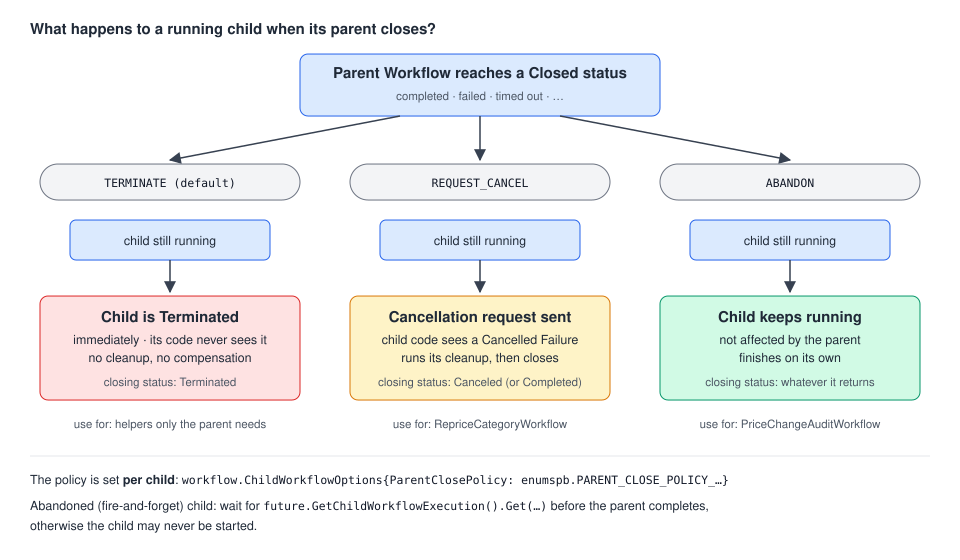

# 07 · Child Workflows: composing Workflows

> **Level:** sub-feature · **Read time:** ~20 min
> **Sources:** [Go SDK — Child Workflows](https://docs.temporal.io/develop/go/workflows/child-workflows) · [Encyclopedia — Cancellation and Termination](https://docs.temporal.io/encyclopedia/workflow/cancellation-and-termination) · [Encyclopedia — Workflow Execution limits](https://docs.temporal.io/workflow-execution/limits) · [Encyclopedia — Events and Event History](https://docs.temporal.io/workflow-execution/event)

---

## 1. The problem

The marketing team wants to change prices on 40 categories at once ("-10% on everything in Garden and
Outdoor"). Each category has thousands of products. You could write one Workflow that calls
`RepriceProduct` for every product, but:

- **one history gets huge.** Every Activity adds events to the Workflow's Event History. A history is
  limited to **51,200 events or 50 MB**, and Temporal warns at 10,240 events or 10 MB.
- **you can't act on one category.** Support asks "is Garden done?" or "stop Garden, the supplier
  changed its prices". With one big Workflow there is nothing to query or cancel at that level.
- **some work belongs to another team.** The compliance team owns the audit trail of price changes,
  runs its own Workers, and its process must keep going even if the batch fails.

A **Child Workflow Execution** is a Workflow Execution started **from inside another Workflow**. It is
a full Workflow: its own Workflow ID, its own Event History, its own Task Queue if you want, and it
can be queried, signalled and cancelled on its own. The parent can wait for its result like it waits
for an Activity.

---

## 2. How a Child Workflow is started

```go
childCtx := workflow.WithChildOptions(ctx, workflow.ChildWorkflowOptions{ /* ... */ })
future := workflow.ExecuteChildWorkflow(childCtx, RepriceCategoryWorkflow, input) // ChildWorkflowFuture
err := future.Get(ctx, &result)                                                     // wait for the result
```

- `workflow.ChildWorkflowOptions` has the **same fields as `client.StartWorkflowOptions`** (Workflow
  ID, Task Queue, timeouts, Retry Policy, ID Reuse Policy, Memo…) plus child-only fields such as
  `ParentClosePolicy` and `WaitForCancellation`.
- Fields you don't set **are inherited from the parent's options**. If you don't set `WorkflowID`, one
  is **generated** for you.
- `ExecuteChildWorkflow` returns a **`ChildWorkflowFuture`**:
  - `Get(ctx, &result)` waits for the child's **result**
  - `GetChildWorkflowExecution()` returns another Future that resolves when the child has **started**.
    It gives you a `workflow.Execution` (Workflow ID + Run ID).
  - `SignalChildWorkflow(ctx, name, data)` sends a Signal to that child

The parent's Event History records the child's life:

| Event in the **parent's** history | Meaning |
| --- | --- |
| `StartChildWorkflowExecutionInitiated` | the parent asked to start the child. It comes from a Command, so the call must stay deterministic (chapter 03) |
| `ChildWorkflowExecutionStarted` | the child is running. **Must be recorded before the parent completes**, or the child isn't started |
| `ChildWorkflowExecutionCompleted` (or `…Failed`, `…Canceled`, `…TimedOut`, `…Terminated`) | the child closed. Its result or error is now available to `Get` |

The child's own Activities, Timers and Signals live in the **child's** history, not the parent's. That
is what keeps the parent's history small.

---

## 3. Parent Close Policy: what happens to children when the parent closes



The **Parent Close Policy** is set **per child**, in `ChildWorkflowOptions.ParentClosePolicy`. It
decides what happens to that child when the parent reaches a Closed status (completed, failed, timed
out…). Values come from `go.temporal.io/api/enums/v1`:

| Policy | What happens to a still-running child | Use it when |
| --- | --- | --- |
| `PARENT_CLOSE_POLICY_TERMINATE` **(default)** | **Terminated** immediately. Its code never sees it and no cleanup runs | the child is only useful to its parent |
| `PARENT_CLOSE_POLICY_REQUEST_CANCEL` | gets a **Cancellation request**, and can run its cleanup | the child should stop, but cleanly (release holds, compensate) |
| `PARENT_CLOSE_POLICY_ABANDON` | **not affected**. It keeps running on its own | the child's work must finish whatever the parent does (audit, notifications) |

Because the policy is per child, one parent can terminate some children, cancel others, and leave the
rest running.

---

## 4. The example: bulk repricing

```text
BulkRepriceWorkflow  (batch "spring-sale")                    Task Queue: catalog
├── RepriceCategoryWorkflow  reprice-spring-sale-garden        Request Cancel on parent close
├── RepriceCategoryWorkflow  reprice-spring-sale-outdoor       Request Cancel on parent close
├── ...
└── PriceChangeAuditWorkflow price-audit-spring-sale           Abandon · Task Queue: compliance
```

### Types and Activities

```go
// file: catalog/types.go
package catalog

import "time"

const (
	TaskQueue           = "catalog"
	ComplianceTaskQueue = "compliance"
)

type BulkRepriceInput struct {
	BatchID       string
	Categories    []string
	PercentChange int64         // -10 means 10% cheaper
	MaxDuration   time.Duration // 0 = no deadline
	RequestedBy   string        // internal employee ID
}

type BulkRepriceResult struct {
	BatchID         string
	Categories      []RepriceCategoryResult
	TotalUpdated    int
	AuditWorkflowID string
}

type RepriceCategoryInput struct {
	BatchID       string
	Category      string
	PercentChange int64
}

type RepriceCategoryResult struct {
	Category        string
	ProductsUpdated int
}

type PriceChangeAuditInput struct {
	BatchID     string
	Categories  []string
	RequestedBy string
}

// RepriceWorkflowID gives every child a meaningful, unique ID: easy to find, query or cancel.
func RepriceWorkflowID(batchID, category string) string {
	return "reprice-" + batchID + "-" + category
}

func AuditWorkflowID(batchID string) string { return "price-audit-" + batchID }
```

```go
// file: catalog/activities.go
package catalog

import "context"

// PriceStore is your pricing database or service.
type PriceStore interface {
	ApplyPercentChange(ctx context.Context, category string, percent int64, idempotencyKey string) (int, error)
}

// AuditLog is the compliance team's system of record.
type AuditLog interface {
	Record(ctx context.Context, batchID string, categories []string, requestedBy string) error
}

type PricingActivities struct {
	Prices PriceStore
}

// RepriceCategory updates every product of one category. The batch ID makes retries idempotent.
func (a *PricingActivities) RepriceCategory(ctx context.Context, in RepriceCategoryInput) (int, error) {
	return a.Prices.ApplyPercentChange(ctx, in.Category, in.PercentChange, in.BatchID+"/"+in.Category)
}

type AuditActivities struct {
	Log AuditLog
}

func (a *AuditActivities) RecordPriceChange(ctx context.Context, in PriceChangeAuditInput) error {
	return a.Log.Record(ctx, in.BatchID, in.Categories, in.RequestedBy)
}
```

### The Child Workflows

A child is a **regular Workflow Definition**. Nothing in its code says "I am a child".

```go
// file: catalog/children.go
package catalog

import (
	"time"

	"go.temporal.io/sdk/workflow"
)

// RepriceCategoryWorkflow reprices one category. It can also be started on its own.
func RepriceCategoryWorkflow(ctx workflow.Context, in RepriceCategoryInput) (RepriceCategoryResult, error) {
	ctx = workflow.WithActivityOptions(ctx, workflow.ActivityOptions{StartToCloseTimeout: 10 * time.Minute})

	var a *PricingActivities
	var updated int
	if err := workflow.ExecuteActivity(ctx, a.RepriceCategory, in).Get(ctx, &updated); err != nil {
		return RepriceCategoryResult{}, err
	}
	return RepriceCategoryResult{Category: in.Category, ProductsUpdated: updated}, nil
}

// PriceChangeAuditWorkflow is owned by the compliance team and runs on their Task Queue.
func PriceChangeAuditWorkflow(ctx workflow.Context, in PriceChangeAuditInput) error {
	ctx = workflow.WithActivityOptions(ctx, workflow.ActivityOptions{StartToCloseTimeout: time.Minute})

	var a *AuditActivities
	return workflow.ExecuteActivity(ctx, a.RecordPriceChange, in).Get(ctx, nil)
}
```

### The parent: fan out, then collect

Start **all** children first and keep their futures. Only then call `Get`. If you called `Get`
right after each `ExecuteChildWorkflow`, the categories would run one after another.

```go
// file: catalog/parent.go
package catalog

import (
	"errors"
	"fmt"

	enumspb "go.temporal.io/api/enums/v1"
	"go.temporal.io/sdk/temporal"
	"go.temporal.io/sdk/workflow"
)

func BulkRepriceWorkflow(ctx workflow.Context, in BulkRepriceInput) (BulkRepriceResult, error) {
	logger := workflow.GetLogger(ctx)
	result := BulkRepriceResult{BatchID: in.BatchID}

	// Cancelling childrenCtx sends a Cancellation request to every child started with it.
	childrenCtx, cancelChildren := workflow.WithCancel(ctx)
	defer cancelChildren()
	if in.MaxDuration > 0 {
		// The Timer uses childrenCtx, so the deferred cancelChildren() also cancels it.
		workflow.Go(childrenCtx, func(ctx workflow.Context) {
			// A durable Timer: if the batch takes too long, stop the remaining categories.
			if err := workflow.NewTimer(ctx, in.MaxDuration).Get(ctx, nil); err == nil {
				logger.Warn("Batch deadline reached, cancelling remaining categories", "batchID", in.BatchID)
				cancelChildren()
			}
		})
	}

	// 1. Fan out: one child per category.
	futures := make([]workflow.ChildWorkflowFuture, 0, len(in.Categories))
	for _, category := range in.Categories {
		cctx := workflow.WithChildOptions(childrenCtx, workflow.ChildWorkflowOptions{
			WorkflowID: RepriceWorkflowID(in.BatchID, category),
			// If the parent closes early (failure, timeout), stop the children cleanly.
			ParentClosePolicy: enumspb.PARENT_CLOSE_POLICY_REQUEST_CANCEL,
			// When we cancel a child, wait until it has really ended before Get returns.
			WaitForCancellation: true,
		})
		futures = append(futures, workflow.ExecuteChildWorkflow(cctx, RepriceCategoryWorkflow, RepriceCategoryInput{
			BatchID:       in.BatchID,
			Category:      category,
			PercentChange: in.PercentChange,
		}))
	}

	// 2. Collect: wait for each child's result.
	var failed []string
	for i, future := range futures {
		var r RepriceCategoryResult
		if err := future.Get(ctx, &r); err != nil {
			var childErr *temporal.ChildWorkflowExecutionError
			if errors.As(err, &childErr) && temporal.IsCanceledError(err) {
				logger.Warn("Category cancelled", "category", in.Categories[i])
			} else {
				logger.Error("Category failed", "category", in.Categories[i], "error", err)
			}
			failed = append(failed, in.Categories[i])
			continue
		}
		result.Categories = append(result.Categories, r)
		result.TotalUpdated += r.ProductsUpdated
	}

	// 3. Fire-and-forget audit child (see section 5).
	auditID, err := startAudit(ctx, in)
	if err != nil {
		return result, err
	}
	result.AuditWorkflowID = auditID

	if len(failed) > 0 {
		return result, fmt.Errorf("%d of %d categories not repriced: %v", len(failed), len(in.Categories), failed)
	}
	return result, nil
}
```

When a child fails, `Get` returns a `*temporal.ChildWorkflowExecutionError`. It wraps the real cause,
which can be an `*ApplicationError`, a `*TimeoutError` or a `*CanceledError`. Use `errors.As` on it,
or helpers like `temporal.IsCanceledError`.

---

## 5. Async ("fire-and-forget") children

Sometimes the parent must **start** a child but not wait for it. The audit trail is a good example: it
belongs to the compliance team, and it must be written even if the parent fails right after. Two rules
from the docs:

1. Set `ParentClosePolicy: PARENT_CLOSE_POLICY_ABANDON`. Otherwise the default policy **terminates**
   the child when the parent closes.
2. **Wait until the child has started** before the parent completes:
   `future.GetChildWorkflowExecution().Get(ctx, &execution)`. If the parent calls `ExecuteChildWorkflow`
   and completes right away, the child is **not** started.

```go
// file: catalog/audit.go
package catalog

import (
	enumspb "go.temporal.io/api/enums/v1"
	"go.temporal.io/sdk/workflow"
)

// startAudit starts the audit child and returns as soon as it is running.
func startAudit(ctx workflow.Context, in BulkRepriceInput) (string, error) {
	cctx := workflow.WithChildOptions(ctx, workflow.ChildWorkflowOptions{
		WorkflowID:        AuditWorkflowID(in.BatchID),
		TaskQueue:         ComplianceTaskQueue, // polled by the compliance team's Workers
		ParentClosePolicy: enumspb.PARENT_CLOSE_POLICY_ABANDON,
	})
	future := workflow.ExecuteChildWorkflow(cctx, PriceChangeAuditWorkflow, PriceChangeAuditInput{
		BatchID:     in.BatchID,
		Categories:  in.Categories,
		RequestedBy: in.RequestedBy,
	})

	// Wait for ChildWorkflowExecutionStarted, not for the result.
	var execution workflow.Execution
	if err := future.GetChildWorkflowExecution().Get(ctx, &execution); err != nil {
		return "", err
	}
	return execution.ID, nil
}
```

> ❌ Don't start an abandoned child and return immediately without waiting for
> `GetChildWorkflowExecution()`. The start is requested, but the child is only guaranteed to exist
> once `ChildWorkflowExecutionStarted` is in the parent's history.

---

## 6. Cancelling children

There are three ways a child receives a Cancellation request:

| Trigger | How |
| --- | --- |
| The parent cancels it on purpose | cancel the context passed to `ExecuteChildWorkflow` (`workflow.WithCancel`), like the deadline in `BulkRepriceWorkflow` |
| The parent closes | `PARENT_CLOSE_POLICY_REQUEST_CANCEL` |
| An operator | `temporal workflow cancel --workflow-id reprice-spring-sale-garden`: children have their own Workflow ID |

When the child handles it, the parent's history records `ChildWorkflowExecutionCanceled` and `Get`
returns a `ChildWorkflowExecutionError` whose cause is a `CanceledError`.

`WaitForCancellation` controls **when** `Get` returns after you cancel:

- `false` (default): `Get` returns right away with the cancellation error. The child may still be running its cleanup.
- `true`: `Get` returns only once the child has really ended (completed, failed, timed out, terminated or cancelled).

Use `true` when the parent must not continue until the child's cleanup is done. Chapter 08 covers
how a Workflow reacts to a Cancellation request and runs its cleanup.

---

## 7. The Workers

The parent and its repricing children share the `catalog` Task Queue. The audit child runs on the
compliance team's Workers. A child can run on any Task Queue; the Worker there must register the
Workflow Type.

```go
// file: cmd/catalog-worker/main.go
package main

import (
	"context"
	"log"

	"github.com/acme/shop/catalog"
	"go.temporal.io/sdk/client"
	"go.temporal.io/sdk/worker"
)

type fakePriceStore struct{}

func (fakePriceStore) ApplyPercentChange(ctx context.Context, category string, percent int64, key string) (int, error) {
	return 1200, nil
}

func main() {
	c, err := client.Dial(client.Options{})
	if err != nil {
		log.Fatalln("Unable to create client", err)
	}
	defer c.Close()

	w := worker.New(c, catalog.TaskQueue, worker.Options{})
	w.RegisterWorkflow(catalog.BulkRepriceWorkflow)
	w.RegisterWorkflow(catalog.RepriceCategoryWorkflow)
	w.RegisterActivity(&catalog.PricingActivities{Prices: fakePriceStore{}})

	if err := w.Run(worker.InterruptCh()); err != nil {
		log.Fatalln("Unable to start Worker", err)
	}
}
```

```go
// file: cmd/compliance-worker/main.go
package main

import (
	"context"
	"log"

	"github.com/acme/shop/catalog"
	"go.temporal.io/sdk/client"
	"go.temporal.io/sdk/worker"
)

type stdoutAuditLog struct{}

func (stdoutAuditLog) Record(ctx context.Context, batchID string, categories []string, requestedBy string) error {
	log.Printf("AUDIT batch=%s categories=%v by=%s", batchID, categories, requestedBy)
	return nil
}

func main() {
	c, err := client.Dial(client.Options{})
	if err != nil {
		log.Fatalln("Unable to create client", err)
	}
	defer c.Close()

	w := worker.New(c, catalog.ComplianceTaskQueue, worker.Options{})
	w.RegisterWorkflow(catalog.PriceChangeAuditWorkflow)
	w.RegisterActivity(&catalog.AuditActivities{Log: stdoutAuditLog{}})

	if err := w.Run(worker.InterruptCh()); err != nil {
		log.Fatalln("Unable to start Worker", err)
	}
}
```

And the starter:

```go
// file: cmd/start-reprice/main.go
package main

import (
	"context"
	"log"
	"time"

	"github.com/acme/shop/catalog"
	"go.temporal.io/sdk/client"
)

func main() {
	c, err := client.Dial(client.Options{})
	if err != nil {
		log.Fatalln("Unable to create client", err)
	}
	defer c.Close()

	in := catalog.BulkRepriceInput{
		BatchID:       "spring-sale",
		Categories:    []string{"garden", "outdoor", "bbq"},
		PercentChange: -10,
		MaxDuration:   2 * time.Hour,
		RequestedBy:   "emp-0451",
	}
	run, err := c.ExecuteWorkflow(context.Background(), client.StartWorkflowOptions{
		ID:        "bulk-reprice-" + in.BatchID,
		TaskQueue: catalog.TaskQueue,
	}, catalog.BulkRepriceWorkflow, in)
	if err != nil {
		log.Fatalln("Unable to start", err)
	}

	var result catalog.BulkRepriceResult
	if err := run.Get(context.Background(), &result); err != nil {
		log.Fatalln("Batch failed", err)
	}
	log.Printf("Repriced %d products, audit in %s", result.TotalUpdated, result.AuditWorkflowID)
}
```

---

## 8. Child Workflow or Activity?

A child is not "a bigger Activity". Workflow code still can't do I/O. A child **orchestrates**, and
Activities do the work. Pick a child when you need one of these:

| You need… | Child Workflow | Activity |
| --- | --- | --- |
| To call an API, a DB, a file system | ❌ (it calls Activities itself) | ✅ |
| To split a big job so no history gets too large | ✅ each child has its own history. The parent only records a few events per child | ❌ every Activity adds events to the caller's history |
| A separate Task Queue / team / service | ✅ `TaskQueue` option | ✅ `TaskQueue` option |
| Its own ID to query, signal or cancel | ✅ | ❌ |
| To keep running after the caller is gone | ✅ `PARENT_CLOSE_POLICY_ABANDON` | ❌ |
| Long waits (Timers, Signals) inside the step | ✅ | ❌ |

Limits still apply. By default, a Workflow can have at most **2,000 incomplete Child Workflows** at
the same time (`NumPendingChildExecutionsLimit`). Past that, starting another one makes the Workflow
Task fail and retry. For a really large fan-out, start children in batches, or give each child a
slice of the work. And a parent that starts many children over time can still reach its own history
limit. Combine children with Continue-As-New (chapter 09).

---

## Key takeaways

- A Child Workflow is a full Workflow Execution started from a Workflow:
  `workflow.ExecuteChildWorkflow(workflow.WithChildOptions(ctx, opts), ChildFn, input)`.
- Options you don't set are inherited from the parent. Set a meaningful `WorkflowID` anyway.
- Start all children first, then `Get` the futures, to run them in parallel.
- The **Parent Close Policy** is per child: **Terminate** (default), **Request Cancel**, or **Abandon**.
- For fire-and-forget, use **Abandon** and wait for `GetChildWorkflowExecution()` before the parent completes.
- Cancel a child by cancelling its context. `WaitForCancellation: true` makes `Get` wait for the child to really end.
- Children split work across histories and teams. Activities still do the I/O.

⬅️ Previous: [06 · Message passing](06-message-passing.md) · ➡️ Next: [08 · Cancel, terminate, pause & reset](08-cancel-terminate-pause-reset.md)
