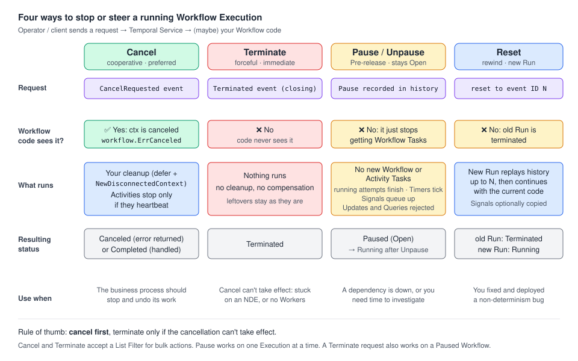

# 08 · Cancel, Terminate, Pause and Reset: stopping and steering a Workflow

> **Level:** core concept + operations · **Read time:** ~20 min
> **Sources:** [Encyclopedia — Cancellation and Termination](https://docs.temporal.io/encyclopedia/workflow/cancellation-and-termination) · [Encyclopedia — Workflow Pause](https://docs.temporal.io/encyclopedia/workflow/workflow-pause) · [Encyclopedia — Event History (Reset)](https://docs.temporal.io/workflow-execution/event#reset) · [Go SDK — Cancel a Workflow](https://docs.temporal.io/develop/go/workflows/cancellation)

---

## 1. The problem

A Workflow can run for minutes or for months. During that time, the world changes:

- the customer **cancels** the trip they were booking, and the flight you already reserved must be released
- a Workflow is **stuck** on a bug and can't process anything, so you need it gone *now*
- a downstream supplier is **down**, and you want to hold a Workflow in place until it recovers, without losing state
- you **shipped a fix** for a non-determinism bug, and the broken Workflow should continue from just before the bad step

Temporal gives you four controls for these situations. They differ in one key question: **does your Workflow code get a say?**



| Control | What it does | Workflow code notified? | CLI |
| --- | --- | --- | --- |
| **Cancel** | Asks the Workflow to stop, and lets it clean up first | ✅ Yes | `temporal workflow cancel` |
| **Terminate** | Closes the Workflow Execution immediately, no cleanup | ❌ No | `temporal workflow terminate` |
| **Pause** *(Pre-release)* | Holds the Execution in place, Open, state kept | ❌ No (it just stops getting Workflow Tasks) | `temporal workflow pause` / `unpause` |
| **Reset** | Terminates the current Run and starts a new Run from a chosen point in the Event History | ❌ No (the new Run replays up to the reset point) | `temporal workflow reset` |

> 📌 **Rule of thumb:** prefer **Cancel**. Use **Terminate** only when the Workflow can't process a
> cancellation, for example when it's blocked on a non-deterministic error or has no Workers to run its Tasks.

---

## 2. Cancellation: cooperative stop

### What happens when you cancel a Workflow

1. A `WorkflowExecutionCancelRequested` event is recorded, with the requester's identity and the reason.
2. The Temporal Service schedules a **new Workflow Task** so the Workflow can react.
3. The Go SDK **cancels the root `workflow.Context`**. Every blocking call on that context (`Get` on an
   Activity future, `workflow.Sleep`, `Receive` on a channel…) returns a canceled error, and
   `ctx.Err()` returns `workflow.ErrCanceled`.
4. Your Workflow runs whatever cleanup it implements.
5. The **closing status depends on what your code returns**:

| Your Workflow… | Closing status | Closing event |
| --- | --- | --- |
| returns the cancellation error (or doesn't handle it) | **Canceled** | `WorkflowExecutionCanceled` |
| handles the request and returns `nil` / a result | **Completed** | `WorkflowExecutionCompleted` |

Both are valid. Which one you want is a **business decision**, not a technical one.

### Two rules you must know

- **A canceled context can't schedule new work.** Cleanup that calls Activities must run in a context
  created with `workflow.NewDisconnectedContext(ctx)`. It's a context that is *not* canceled when the parent is.
- **Activities only learn about cancellation when they heartbeat.** An Activity that doesn't heartbeat
  can't receive a cancellation: it runs to completion, fails or times out. Heartbeat throttling can also
  delay delivery. If a long-running Activity must stop when its Workflow is canceled, it **has to heartbeat**,
  and it needs a `HeartbeatTimeout`.

Set `WaitForCancellation: true` in the Activity options when the Workflow should **wait for the Activity
to acknowledge** the cancellation before the future resolves. Without it, the future resolves as canceled immediately.

### Example: a trip booking saga that cleans up on cancel

A traveler books a flight, a hotel and a car. The booking holds them for a review period. If the traveler
cancels at any point, we release whatever we already reserved, then close the Workflow as **Canceled**.

First the Activities. Each reservation runs the supplier call in a goroutine and **heartbeats every
2 seconds**, so a cancellation reaches it quickly.

```go
// file: travel/activities.go
package travel

import (
	"context"
	"fmt"
	"time"

	"go.temporal.io/sdk/activity"
)

// Supplier is a reservation system (airline GDS, hotel channel manager, car rental API).
// The trip ID is passed as the idempotency key so a retried call doesn't book twice.
type Supplier interface {
	Reserve(ctx context.Context, idempotencyKey, offerID string) (confirmationID string, err error)
	Release(ctx context.Context, confirmationID string) error
}

type TripRequest struct {
	TripID      string
	TravelerID  string
	FlightOffer string
	HotelOffer  string
	CarOffer    string // empty = no car
	HoldPeriod  time.Duration
}

type Reservation struct {
	Kind           string // "flight", "hotel", "car"
	ConfirmationID string
}

type TripActivities struct {
	Flights Supplier
	Hotels  Supplier
	Cars    Supplier
}

func (a *TripActivities) BookFlight(ctx context.Context, req TripRequest) (Reservation, error) {
	return reserveWithHeartbeat(ctx, a.Flights, "flight", req.TripID, req.FlightOffer)
}

func (a *TripActivities) BookHotel(ctx context.Context, req TripRequest) (Reservation, error) {
	return reserveWithHeartbeat(ctx, a.Hotels, "hotel", req.TripID, req.HotelOffer)
}

func (a *TripActivities) RentCar(ctx context.Context, req TripRequest) (Reservation, error) {
	return reserveWithHeartbeat(ctx, a.Cars, "car", req.TripID, req.CarOffer)
}

// ReleaseReservation is the compensation for any of the bookings above.
func (a *TripActivities) ReleaseReservation(ctx context.Context, r Reservation) error {
	supplier := map[string]Supplier{"flight": a.Flights, "hotel": a.Hotels, "car": a.Cars}[r.Kind]
	if supplier == nil {
		return fmt.Errorf("unknown reservation kind %q", r.Kind)
	}
	return supplier.Release(ctx, r.ConfirmationID)
}

// NotifyTraveler sends an email or push notification.
func (a *TripActivities) NotifyTraveler(ctx context.Context, travelerID, message string) error {
	activity.GetLogger(ctx).Info("Notify traveler", "traveler", travelerID, "message", message)
	return nil
}

// reserveWithHeartbeat calls the supplier and heartbeats while it waits.
// Heartbeating is what lets a Workflow cancellation reach this Activity.
func reserveWithHeartbeat(ctx context.Context, s Supplier, kind, tripID, offerID string) (Reservation, error) {
	type result struct {
		id  string
		err error
	}
	done := make(chan result, 1)
	go func() {
		id, err := s.Reserve(ctx, tripID+"-"+kind, offerID)
		done <- result{id, err}
	}()

	ticker := time.NewTicker(2 * time.Second)
	defer ticker.Stop()
	for {
		select {
		case r := <-done:
			if r.err != nil {
				return Reservation{}, r.err
			}
			return Reservation{Kind: kind, ConfirmationID: r.id}, nil
		case <-ticker.C:
			activity.RecordHeartbeat(ctx, kind)
		case <-ctx.Done():
			// The Workflow was canceled (delivered through the heartbeat response).
			return Reservation{}, ctx.Err()
		}
	}
}
```

Now the Workflow. The `defer` block runs on **any** failure, including cancellation. It uses a
**disconnected context** so the compensations can still be scheduled.

```go
// file: travel/workflow.go
package travel

import (
	"errors"
	"time"

	"go.temporal.io/sdk/temporal"
	"go.temporal.io/sdk/workflow"
)

const TaskQueue = "travel"

func TripWorkflowID(tripID string) string { return "trip-" + tripID }

type TripItinerary struct {
	TripID       string
	Reservations []Reservation
}

func TripBookingWorkflow(ctx workflow.Context, req TripRequest) (TripItinerary, error) {
	logger := workflow.GetLogger(ctx)
	var a *TripActivities
	var booked []Reservation

	// Saga cleanup: runs when the Workflow fails OR is canceled.
	var err error
	defer func() {
		if err == nil {
			return
		}
		// ctx is canceled at this point if we were canceled. A disconnected context is not,
		// so Activities can still be scheduled from it.
		cleanupCtx, _ := workflow.NewDisconnectedContext(ctx)
		cleanupCtx = workflow.WithActivityOptions(cleanupCtx, workflow.ActivityOptions{
			StartToCloseTimeout: time.Minute,
			RetryPolicy:         &temporal.RetryPolicy{MaximumAttempts: 10},
		})
		for i := len(booked) - 1; i >= 0; i-- {
			if relErr := workflow.ExecuteActivity(cleanupCtx, a.ReleaseReservation, booked[i]).Get(cleanupCtx, nil); relErr != nil {
				logger.Error("Compensation failed, needs manual follow-up", "reservation", booked[i], "error", relErr)
			}
		}
		msg := "Your trip could not be booked. Nothing was charged."
		if errors.Is(ctx.Err(), workflow.ErrCanceled) {
			msg = "Your trip was cancelled. All reservations were released."
		}
		_ = workflow.ExecuteActivity(cleanupCtx, a.NotifyTraveler, req.TravelerID, msg).Get(cleanupCtx, nil)
	}()

	ctx = workflow.WithActivityOptions(ctx, workflow.ActivityOptions{
		StartToCloseTimeout: 5 * time.Minute,
		HeartbeatTimeout:    10 * time.Second, // required to notice cancellation (and crashes) quickly
		WaitForCancellation: true,             // wait until the Activity really stopped before cleaning up
	})

	steps := []any{a.BookFlight, a.BookHotel}
	if req.CarOffer != "" {
		steps = append(steps, a.RentCar)
	}
	for _, step := range steps {
		var r Reservation
		if err = workflow.ExecuteActivity(ctx, step, req).Get(ctx, &r); err != nil {
			return TripItinerary{}, err // a canceled error here closes the Workflow as Canceled
		}
		booked = append(booked, r)
	}

	// Hold the reservations during the review period. A cancel request during
	// this durable Timer makes Sleep return a canceled error.
	if err = workflow.Sleep(ctx, req.HoldPeriod); err != nil {
		return TripItinerary{}, err
	}

	return TripItinerary{TripID: req.TripID, Reservations: booked}, nil
}
```

Why it works:

- `err` is declared before the `defer`, so the deferred function sees the error that the Workflow returns.
- Returning the canceled error unchanged gives the status **Canceled** and the event `WorkflowExecutionCanceled`.
- `WaitForCancellation: true` makes sure an in-flight `BookHotel` has stopped before we release the
  flight. Otherwise a hotel reservation could land *after* cleanup.

### Variant: treat cancellation as a normal end (status Completed)

Sometimes "cancel" just means "stop watching". This price watcher returns its last result when it's
canceled, so the Execution closes as **Completed**:

```go
// file: travel/price_watch.go
package travel

import (
	"context"
	"errors"
	"time"

	"go.temporal.io/sdk/workflow"
)

type PriceWatchResult struct {
	Route         string
	LowestPriceEU int64 // cents
	Checks        int
}

// FetchFare is a short Activity that reads the current fare for a route.
func FetchFare(ctx context.Context, route string) (int64, error) { return 18900, nil }

func FarePriceWatchWorkflow(ctx workflow.Context, route string) (PriceWatchResult, error) {
	ctx = workflow.WithActivityOptions(ctx, workflow.ActivityOptions{StartToCloseTimeout: 30 * time.Second})
	res := PriceWatchResult{Route: route}

	for {
		var fare int64
		if err := workflow.ExecuteActivity(ctx, FetchFare, route).Get(ctx, &fare); err != nil {
			if errors.Is(ctx.Err(), workflow.ErrCanceled) {
				return res, nil // cancellation handled: status Completed
			}
			return res, err
		}
		res.Checks++
		if res.LowestPriceEU == 0 || fare < res.LowestPriceEU {
			res.LowestPriceEU = fare
		}
		if err := workflow.Sleep(ctx, 6*time.Hour); err != nil {
			if errors.Is(ctx.Err(), workflow.ErrCanceled) {
				return res, nil
			}
			return res, err
		}
		// A real watcher would Continue-As-New regularly: see chapter 09.
	}
}
```

### Sending a cancellation

From a Temporal Client, pass the Workflow ID (and optionally a Run ID). Use the `WithOptions` variant to
record a **reason**:

```go
// file: travel/client_cancel.go
package travel

import (
	"context"

	"go.temporal.io/sdk/client"
)

// CancelTrip is called by the customer-facing API when the traveler clicks "Cancel trip".
func CancelTrip(ctx context.Context, c client.Client, tripID, reason string) error {
	return c.CancelWorkflowWithOptions(ctx, client.CancelWorkflowOptions{
		WorkflowID: TripWorkflowID(tripID),
		// RunID empty = the current Run of this Workflow ID.
		Reason: reason,
	})
}
```

> 💡 `CancelWorkflow` returns as soon as the Service records the request. It doesn't wait for the
> cleanup to finish. To know the outcome, call `c.GetWorkflow(ctx, id, "").Get(ctx, &out)`: it returns a
> canceled error if the Workflow closed as Canceled.

### Heartbeating after a cancellation

An Activity can keep running after it was canceled, for example to send one final heartbeat with its
progress. `activity.RecordHeartbeat` still sends the heartbeat. The SDK logs
`WARN RecordActivityHeartbeat with error Error context canceled`, and the call returns a `context canceled` error.

---

## 3. Cancelling another Workflow

A Workflow can ask **another** Workflow to cancel with `workflow.RequestCancelExternalWorkflow`. The
requesting Workflow records `RequestCancelExternalWorkflowExecutionInitiated`, then
`ExternalWorkflowExecutionCancelRequested` once the Service delivers the request.

```go
// file: travel/group_trip.go
package travel

import "go.temporal.io/sdk/workflow"

type GroupCancellation struct {
	GroupID string
	TripIDs []string
}

// GroupTripCancellationWorkflow cancels every traveler's TripBookingWorkflow when a group trip is called off.
// Each trip runs its own cleanup (see TripBookingWorkflow).
func GroupTripCancellationWorkflow(ctx workflow.Context, in GroupCancellation) error {
	futures := make([]workflow.Future, 0, len(in.TripIDs))
	for _, tripID := range in.TripIDs {
		futures = append(futures, workflow.RequestCancelExternalWorkflow(ctx, TripWorkflowID(tripID), ""))
	}
	for i, f := range futures {
		if err := f.Get(ctx, nil); err != nil {
			workflow.GetLogger(ctx).Warn("Could not cancel trip", "tripID", in.TripIDs[i], "error", err)
		}
	}
	return nil
}
```

For **Child Workflows**, the parent decides with the **Parent Close Policy** what happens to children when
it closes: `TERMINATE` (default), `REQUEST_CANCEL` or `ABANDON`. A canceled child closes with
`ChildWorkflowExecutionCanceled` in the parent's history. See [07 · Child Workflows](07-child-workflows.md).

---

## 4. Termination: forceful stop

### What happens when you terminate a Workflow

- A `WorkflowExecutionTerminated` event is recorded with the reason and the requester's identity. It's the **closing event**.
- Workflow code **can't see or respond** to it. No `defer`, no cleanup, no compensation.
- Pending Activities get **no chance to stop cleanly**.

Everything the Workflow would have cleaned up stays as it was: reserved seats stay reserved, held locks stay
held, partial writes stay written. So: **cancel first, terminate only if the cancellation doesn't take effect.**

The reason is optional and defaults to the current user's name. **Always give one**: it's the only record of why the Execution was stopped.

### Cancel vs Terminate

| | Cancellation | Termination |
| --- | --- | --- |
| **Workflow code notified?** | Yes, as a Cancelled Failure | No |
| **Cleanup and compensation** | Runs, if the Workflow implements it | Doesn't run |
| **Closing status** | Canceled, or Completed if the Workflow handles it and returns normally | Terminated |
| **Closing event** | `WorkflowExecutionCanceled` | `WorkflowExecutionTerminated` |
| **Takes effect** | On the next Workflow Task | Immediately |
| **Works on a stuck Workflow** | No, the Workflow has to process the request | Yes |
| **Failure type** | Cancelled Failure | Terminated Failure |

Both operations are available from the CLI, the Web UI, the SDK Clients and the gRPC API. Both accept a
**List Filter** instead of a Workflow ID to act on many Executions at once.

```bash
temporal workflow cancel    --workflow-id trip-T-1042 --reason "Traveler cancelled from the app"
temporal workflow terminate --workflow-id trip-T-1042 --reason "Stuck on NDE after bad deploy, cancel had no effect"

# Bulk, with a List Filter
temporal workflow cancel --query 'WorkflowType="TripBookingWorkflow" AND ExecutionStatus="Running"' \
  --reason "Supplier contract ended"
```

---

## 5. Workflow Pause: hold in place, keep state

> **Pre-release.** In Temporal Cloud, access is invite-only. Self-hosted needs Temporal Server
> **v1.30.0+** with `frontend.WorkflowPauseEnabled` enabled, Temporal CLI **v1.6.0+**, and UI **v2.47.2+**.

Pause stops **one** Workflow Execution from making new progress until it's Unpaused. The Execution stays
**Open** with status `Paused`, and no state is lost. Use it when:

- a downstream dependency is unhealthy and the Workflow shouldn't continue until it recovers
- you need time to inspect or fix an issue before the Workflow schedules more work
- you're rolling out a Worker change and want to hold specific Executions until the deploy is done

### What happens while a Workflow is Paused

| Thing | Behavior while Paused |
| --- | --- |
| Workflow Tasks | **Not dispatched.** Workflow code doesn't run. |
| New Activity Tasks and Activity retries | **Not dispatched** |
| Activity attempts already running | **Not interrupted.** They can complete, fail, time out and heartbeat. Their results are recorded, and the Workflow processes them after Unpause. |
| Signals | Accepted and recorded. Handlers run after Unpause. |
| Timers | **Keep advancing.** Timers that fire are processed after Unpause. |
| Updates and Queries | **Rejected** |
| Cancel requests | Recorded. Take effect after Unpause. |
| Terminate requests | Take effect **immediately** |
| Timeouts (Execution, Run, Activity) | Keep advancing: Pause doesn't stop time |
| Reset | Terminates the current Run and starts a new one from the reset point |
| Event History | Pause and Unpause are recorded with identity, reason and request ID |

On Unpause, Workflow and Activity Tasks are dispatched again, queued Signals and fired Timers are
processed, and pending Activity retries continue (unless the Activity itself is Paused with
[Activity Pause](https://docs.temporal.io/activity-operations/pause)).

### What Pause is *not*

- It's not **Activity Pause**. Workflow Pause doesn't interrupt a running Activity attempt.
- It's not **bulk**: one Execution at a time. There is no auto-pause policy either.
- It doesn't pause **Child Workflows, Schedules, Task Queues or Namespaces**.
- It's **an operational control, not meant to be called from Workflow code**.
- A Paused Run still counts as **running** for a Schedule's Overlap Policy (see [10 · Schedules](10-schedules-and-cron.md)).
- In Temporal Cloud, a Paused Execution still counts toward **Active Storage**.
- There is no indicator that all in-flight Activity attempts have finished after a Pause.

### Pause from the CLI (the normal way)

```bash
temporal workflow pause   --workflow-id trip-T-1042 --reason "Hotel supplier outage INC-2291"
temporal workflow unpause --workflow-id trip-T-1042 --reason "Supplier recovered"

# Find Paused Executions
temporal workflow list --query 'ExecutionStatus = "Paused"'
temporal workflow describe --workflow-id trip-T-1042
```

---

## 6. Reset: rewind to a known-good point

A **Reset** terminates the current Run and creates a **new Run** with the same Workflow Type and
Workflow ID. The Event History is copied up to and including the **reset point**, and the new Run
continues from there with the **current code**. Progress after the reset point is discarded.

- Valid reset points: `WorkflowTaskStarted`, `WorkflowTaskCompleted`, `WorkflowTaskTimedOut`, `WorkflowTaskFailed`.
- Signals from the original history can optionally be copied to the new history.
- Typical use: a Workflow is blocked by a **non-deterministic error** (chapter [03](03-determinism-and-replay.md)) that you've since **fixed and deployed**.
- Reset only helps if the underlying problem is fixed. Always give a reason: it's recorded in the Event History.
- Because Reset creates a new Run ID, **don't store or branch on the current Run ID** in your code
  (see [04 · Workflow Execution and IDs](04-workflow-execution-and-ids.md)).

```bash
temporal workflow reset \
    --workflow-id trip-T-1042 \
    --event-id 4 \
    --reason "Fixed non-deterministic code in TripBookingWorkflow (PR #812)"

# Specific run / namespace
temporal workflow reset --workflow-id trip-T-1042 --run-id <run-id> \
    --event-id 4 --reason "..." --namespace travel-prod
```

In the **Web UI**: open the Workflow Execution → **Reset** in the top-right menu → pick the Event ID →
give a reason → confirm. The UI shows valid reset points and links to the new Execution.

---

## 7. Go implementation: a small ops tool

Support engineers need these controls without remembering CLI flags. Here is a `trip-admin` command that
wraps them. Cancel and Terminate use the Go SDK Client. **The Go SDK v1.50.0 Client has no Pause method**,
so Pause and Unpause call the gRPC API (`WorkflowService().PauseWorkflowExecution` /
`UnpauseWorkflowExecution`). That API is **Pre-release**.

```go
// file: cmd/trip-admin/main.go
package main

import (
	"context"
	"fmt"
	"log"
	"os"
	"time"

	"github.com/acme/shop/travel"
	"go.temporal.io/api/workflowservice/v1"
	"go.temporal.io/sdk/client"
)

const usage = "usage: trip-admin <cancel|terminate|pause|unpause> <trip-id> <reason>"

func main() {
	if len(os.Args) != 4 {
		log.Fatalln(usage)
	}
	cmd, tripID, reason := os.Args[1], os.Args[2], os.Args[3]
	workflowID := travel.TripWorkflowID(tripID)

	c, err := client.Dial(client.Options{Identity: "trip-admin@" + hostname()})
	if err != nil {
		log.Fatalln(err)
	}
	defer c.Close()

	ctx, cancel := context.WithTimeout(context.Background(), 10*time.Second)
	defer cancel()

	switch cmd {
	case "cancel":
		// Cooperative: TripBookingWorkflow releases its reservations, then closes as Canceled.
		err = c.CancelWorkflowWithOptions(ctx, client.CancelWorkflowOptions{WorkflowID: workflowID, Reason: reason})
	case "terminate":
		// Forceful: no cleanup runs. Use only when cancel had no effect.
		err = c.TerminateWorkflowWithOptions(ctx, client.TerminateWorkflowOptions{WorkflowID: workflowID, Reason: reason})
	case "pause":
		// Pre-release: requires server support (frontend.WorkflowPauseEnabled).
		_, err = c.WorkflowService().PauseWorkflowExecution(ctx, &workflowservice.PauseWorkflowExecutionRequest{
			Namespace:  client.DefaultNamespace,
			WorkflowId: workflowID,
			Reason:     reason,
			Identity:   "trip-admin",
			RequestId:  fmt.Sprintf("pause-%s-%d", workflowID, time.Now().UnixNano()),
		})
	case "unpause":
		_, err = c.WorkflowService().UnpauseWorkflowExecution(ctx, &workflowservice.UnpauseWorkflowExecutionRequest{
			Namespace:  client.DefaultNamespace,
			WorkflowId: workflowID,
			Reason:     reason,
			Identity:   "trip-admin",
			RequestId:  fmt.Sprintf("unpause-%s-%d", workflowID, time.Now().UnixNano()),
		})
	default:
		log.Fatalln(usage)
	}
	if err != nil {
		log.Fatalf("%s %s failed: %v", cmd, workflowID, err)
	}

	desc, err := c.DescribeWorkflow(ctx, workflowID, "")
	if err != nil {
		log.Fatalln(err)
	}
	log.Printf("%s requested for %s, current status: %s", cmd, workflowID, desc.Status)
}

func hostname() string {
	h, _ := os.Hostname()
	return h
}
```

> 📝 Right after `cancel`, the status is usually still `Running`: cancellation takes effect on the next
> Workflow Task, and the cleanup Activities still have to run. After `terminate` it's `Terminated` at once.

And the Worker that runs the trip Workflows:

```go
// file: cmd/travel-worker/main.go
package main

import (
	"log"

	"github.com/acme/shop/travel"
	"go.temporal.io/sdk/client"
	"go.temporal.io/sdk/worker"
)

func main() {
	c, err := client.Dial(client.Options{})
	if err != nil {
		log.Fatalln(err)
	}
	defer c.Close()

	w := worker.New(c, travel.TaskQueue, worker.Options{})
	w.RegisterWorkflow(travel.TripBookingWorkflow)
	w.RegisterWorkflow(travel.FarePriceWatchWorkflow)
	w.RegisterWorkflow(travel.GroupTripCancellationWorkflow)
	w.RegisterActivity(&travel.TripActivities{ /* real supplier clients here */ })
	w.RegisterActivity(travel.FetchFare)

	log.Fatalln(w.Run(worker.InterruptCh()))
}
```

---

## 8. Which control should I use?

```text
Should the Workflow stop for good?
├── Yes → Can it still process Workflow Tasks (Workers up, no non-determinism error)?
│         ├── Yes → CANCEL     (cleanup runs, status Canceled or Completed)
│         └── No  → TERMINATE  (no cleanup: fix leftovers by hand), or fix the code and RESET
└── No, it should continue later
          ├── Something outside is broken and it must not move → PAUSE, then UNPAUSE
          └── Its history contains a bug you have fixed       → RESET to a point before the bad step
```

---

## Key takeaways

- **Cancel** is cooperative: the root `workflow.Context` is canceled, your code cleans up, and the status is
  **Canceled** if you return the error or **Completed** if you handle it and return normally.
- Run cleanup Activities in a `workflow.NewDisconnectedContext`. A canceled context can't schedule work.
- Activities only see cancellation through **heartbeats**: give long Activities a `HeartbeatTimeout`, and use `WaitForCancellation` when cleanup must wait for them.
- **Terminate** is immediate and silent: no cleanup. Use it when cancel can't work, and always give a reason.
- **Pause** (Pre-release) holds an Execution Open without losing state. Time and Timers keep running, Signals queue up, Updates and Queries are rejected.
- **Reset** rewinds to a Workflow Task event and continues with the current code in a new Run. Use it after fixing a non-determinism bug.

⬅️ Previous: [07 · Child Workflows](07-child-workflows.md) · ➡️ Next: [09 · Continue-As-New](09-continue-as-new.md)
