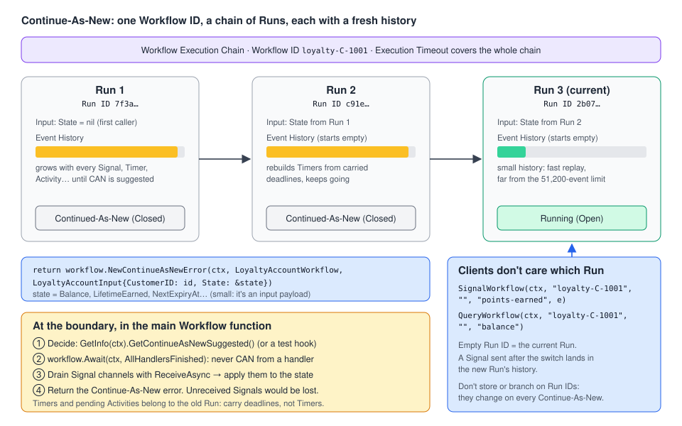

# 09 · Continue-As-New: Workflows that run forever

> **Level:** core concept for long-running Workflows · **Read time:** ~15 min
> **Sources:** [Encyclopedia — Continue-As-New](https://docs.temporal.io/workflow-execution/continue-as-new) · [Encyclopedia — Event History limits](https://docs.temporal.io/workflow-execution/event#event-history-limits) · [Encyclopedia — Workflow Execution limits](https://docs.temporal.io/workflow-execution/limits) · [Encyclopedia — Workflow Execution Chain](https://docs.temporal.io/workflow-execution#workflow-execution-chain) · [Go SDK — Continue-As-New](https://docs.temporal.io/develop/go/workflows/continue-as-new) · [Go SDK — Message passing](https://docs.temporal.io/develop/go/workflows/message-passing) · [Encyclopedia — Schedule (Last completion result)](https://docs.temporal.io/schedule#last-completion-result)

---

## 1. The problem

Some Workflows never really finish. They represent a **thing** rather than a **process**:

- a customer's **loyalty account** that earns and spends points for years
- a **subscription** that renews every month
- a **device twin** that receives telemetry Signals

These are often called **Entity Workflows**. There is no time limit on a Workflow Execution, but every
Activity, Timer and Signal adds events to the **Event History**, and that history has hard limits:

| Limit | Warning | Hard limit (Execution is terminated) |
| --- | --- | --- |
| Events in the history | 10,240 events | **51,200 events** |
| History size | 10 MB | **50 MB** |
| Updates in the history | — | **2,000 Updates** |
| Signals in the history | — | **10,000 Signals** |

A very long history is also slow to **replay** (chapter [03](03-determinism-and-replay.md)). And a Workflow
that started on old code keeps running old code paths for years, which makes **versioning** harder
(chapter [11](11-versioning.md)).

**Continue-As-New** solves this. The Workflow checkpoints its state, **closes the current Run**, and
**atomically starts a new Run** with the **same Workflow ID**, a **new Run ID**, a **fresh, empty
Event History**, and the checkpointed state as its input. Repeat as often as needed, and your Workflow runs forever.

---

## 2. How it works



- The current Run closes with status **Continued-As-New** (a Closed status, like Completed).
- The next Run is part of the same **Workflow Execution Chain**. It keeps the Workflow ID, gets a new
  Run ID, and starts its own Event History.
- The state you pass is just the **Workflow's input arguments**. The original caller usually leaves the
  state fields empty (`nil`), and later Runs receive the state from the previous Run.
- Clients that use the Workflow ID without a Run ID (Signals, Queries, Updates, cancel) automatically
  reach the **current** Run. That's one reason not to rely on Run IDs in your logic.
- `workflow.GetInfo(ctx).ContinuedExecutionRunID` gives the previous Run ID, and `FirstRunID` the first Run of the chain.
- The Workflow Execution Timeout applies to the **whole chain**. The Workflow Run Timeout applies to **one Run**.

### Interactions to remember

| Feature | What happens across Continue-As-New |
| --- | --- |
| **Start Delay** | Applies only to the initial Execution. Not reapplied to the next Run. |
| **Schedules** | If a scheduled Run continues-as-new, `LastCompletionResult` isn't accessible in the new Run, and that Run's status is Continued-As-New, not Completed. |
| **Pending Timers / Activities** | They belong to the old Run. Carry what you need (e.g. a deadline) in the state and recreate it. |
| **Signals not yet received** | Lost with the old Run unless you **drain** the channel before returning. |
| **In-flight Update / Signal handlers** | Must finish first. Never continue-as-new from inside a handler. |

---

## 3. How to Continue-As-New in Go

Return the error built by `workflow.NewContinueAsNewError` from your **main Workflow function**. It
stops the Run right away and starts the next one.

```go
return workflow.NewContinueAsNewError(ctx, LoyaltyAccountWorkflow, LoyaltyAccountInput{...})
```

- `ctx` can override options for the next Run, such as the Task Queue (`workflow.WithWorkflowTaskQueue`)
  or the Run Timeout. If you don't, the next Run uses the current Run's options.
- `wfn` is the Workflow to run next. It's usually the same function, but it can be a different one.
- `workflow.NewContinueAsNewErrorWithOptions(ctx, workflow.ContinueAsNewErrorOptions{…}, wfn, args...)`
  also lets you set a `RetryPolicy` for the next Run (default: the current one is carried over), a
  `BackoffStartInterval` (delay before the next Run's first Workflow Task), and an
  `InitialVersioningBehavior` (experimental, for Worker Versioning).

### When to Continue-As-New

Temporal tracks your history against the limits and **tells you when it's time**:

| Go API | Meaning |
| --- | --- |
| `workflow.GetInfo(ctx).GetContinueAsNewSuggested()` | `true` when the Service suggests continuing-as-new |
| `workflow.GetInfo(ctx).GetContinueAsNewSuggestedReasons()` | why: `ContinueAsNewSuggestedReasonTooManyHistoryEvents`, `…HistorySizeTooLarge`, `…TooManyUpdates` |
| `workflow.GetInfo(ctx).GetCurrentHistoryLength()` / `GetCurrentHistorySize()` | the current event count and size in bytes, for your own thresholds |

Check them **at points where your state is consistent and easy to checkpoint**, typically at the top or
bottom of your main loop. You may also want to Continue-As-New **periodically**, depending on how often you
deploy, so that only a couple of code versions are ever running.

---

## 4. Example: a loyalty account that lives for years

`LoyaltyAccountWorkflow` has the Workflow ID `loyalty-<customerID>`. It:

- receives `points-earned` and `redeem-points` **Signals** forever
- answers a `balance` **Query**
- runs a yearly **expiry Timer** that resets unused points
- continues-as-new when Temporal suggests it, carrying `LoyaltyAccountState`

### Types and Activities

```go
// file: loyalty/types.go
package loyalty

import "time"

const (
	TaskQueue          = "loyalty"
	PointsEarnedSignal = "points-earned"
	RedeemPointsSignal = "redeem-points"
	BalanceQuery       = "balance"
	PointsLifetime     = 365 * 24 * time.Hour
)

func WorkflowID(customerID string) string { return "loyalty-" + customerID }

type PointsEarned struct {
	TxID    string
	Points  int64
	OrderID string
}

type RedeemPoints struct {
	TxID     string
	Points   int64
	RewardID string
}

// LoyaltyAccountState is everything the next Run needs. Keep it small: it travels as a payload.
type LoyaltyAccountState struct {
	Balance        int64
	LifetimeEarned int64
	NextExpiryAt   time.Time
	RunsSoFar      int
}

// LoyaltyAccountInput is the Workflow input. The original caller sets only CustomerID.
type LoyaltyAccountInput struct {
	CustomerID string
	State      *LoyaltyAccountState // nil on the very first Run

	// MaxEventsBeforeContinue is a test hook: when > 0, continue-as-new after
	// this many processed events in a single Run, instead of waiting for the Service's suggestion.
	MaxEventsBeforeContinue int
}

type LoyaltyBalance struct {
	Balance      int64
	NextExpiryAt time.Time
}
```

```go
// file: loyalty/activities.go
package loyalty

import (
	"context"

	"go.temporal.io/sdk/activity"
)

// Notifier sends emails or push notifications.
type Notifier interface {
	Send(ctx context.Context, customerID, message string) error
}

type LoyaltyActivities struct {
	Notifier Notifier
}

func (a *LoyaltyActivities) NotifyPointsExpired(ctx context.Context, customerID string, expired int64) error {
	activity.GetLogger(ctx).Info("Points expired", "customer", customerID, "points", expired)
	if a.Notifier == nil {
		return nil
	}
	return a.Notifier.Send(ctx, customerID, "Your unused loyalty points have expired.")
}
```

### The Workflow

```go
// file: loyalty/workflow.go
package loyalty

import (
	"time"

	"go.temporal.io/sdk/workflow"
)

func LoyaltyAccountWorkflow(ctx workflow.Context, in LoyaltyAccountInput) error {
	logger := workflow.GetLogger(ctx)
	ctx = workflow.WithActivityOptions(ctx, workflow.ActivityOptions{StartToCloseTimeout: time.Minute})

	// 1. Restore state: nil on the first Run, filled by the previous Run afterwards.
	state := LoyaltyAccountState{}
	if in.State != nil {
		state = *in.State
	}
	if state.NextExpiryAt.IsZero() {
		state.NextExpiryAt = workflow.Now(ctx).Add(PointsLifetime)
	}
	state.RunsSoFar++
	logger.Info("Loyalty account run started", "customer", in.CustomerID, "run", state.RunsSoFar,
		"previousRunID", workflow.GetInfo(ctx).ContinuedExecutionRunID)

	// 2. Query handler: read-only view of the state.
	if err := workflow.SetQueryHandler(ctx, BalanceQuery, func() (LoyaltyBalance, error) {
		return LoyaltyBalance{Balance: state.Balance, NextExpiryAt: state.NextExpiryAt}, nil
	}); err != nil {
		return err
	}

	earnedCh := workflow.GetSignalChannel(ctx, PointsEarnedSignal)
	redeemCh := workflow.GetSignalChannel(ctx, RedeemPointsSignal)

	applyEarned := func(e PointsEarned) {
		state.Balance += e.Points
		state.LifetimeEarned += e.Points
	}
	applyRedeem := func(r RedeemPoints) {
		if r.Points > state.Balance {
			logger.Warn("Redeem rejected: insufficient balance", "tx", r.TxID, "balance", state.Balance)
			return
		}
		state.Balance -= r.Points
	}

	// 3. Recreate the expiry Timer from the carried deadline. Timers don't survive
	//    Continue-As-New, deadlines in the state do.
	timerCtx, cancelTimer := workflow.WithCancel(ctx)
	expiry := workflow.NewTimer(timerCtx, state.NextExpiryAt.Sub(workflow.Now(ctx)))

	eventsThisRun := 0
	for {
		selector := workflow.NewSelector(ctx)
		selector.AddReceive(earnedCh, func(c workflow.ReceiveChannel, _ bool) {
			var e PointsEarned
			c.Receive(ctx, &e)
			applyEarned(e)
		})
		selector.AddReceive(redeemCh, func(c workflow.ReceiveChannel, _ bool) {
			var r RedeemPoints
			c.Receive(ctx, &r)
			applyRedeem(r)
		})
		selector.AddFuture(expiry, func(f workflow.Future) {
			if f.Get(ctx, nil) != nil {
				return
			}
			expired := state.Balance
			state.Balance = 0
			state.NextExpiryAt = state.NextExpiryAt.Add(PointsLifetime)
			var a *LoyaltyActivities
			if err := workflow.ExecuteActivity(ctx, a.NotifyPointsExpired, in.CustomerID, expired).Get(ctx, nil); err != nil {
				logger.Error("Expiry notification failed", "error", err)
			}
			expiry = workflow.NewTimer(timerCtx, state.NextExpiryAt.Sub(workflow.Now(ctx)))
		})
		selector.Select(ctx)
		eventsThisRun++

		// 4. Checkpoint when Temporal suggests it (or when the test hook says so).
		if shouldContinueAsNew(ctx, in, eventsThisRun) {
			break
		}
	}

	// 5. Before leaving this Run: no handler may still be running, and no
	//    received-but-unprocessed Signal may be left behind.
	if err := workflow.Await(ctx, func() bool { return workflow.AllHandlersFinished(ctx) }); err != nil {
		return err
	}
	for {
		var e PointsEarned
		if !earnedCh.ReceiveAsync(&e) {
			break
		}
		applyEarned(e)
	}
	for {
		var r RedeemPoints
		if !redeemCh.ReceiveAsync(&r) {
			break
		}
		applyRedeem(r)
	}
	cancelTimer()

	logger.Info("Continuing as new", "customer", in.CustomerID, "balance", state.Balance,
		"historyLength", workflow.GetInfo(ctx).GetCurrentHistoryLength(),
		"reasons", workflow.GetInfo(ctx).GetContinueAsNewSuggestedReasons())

	return workflow.NewContinueAsNewError(ctx, LoyaltyAccountWorkflow, LoyaltyAccountInput{
		CustomerID:              in.CustomerID,
		State:                   &state,
		MaxEventsBeforeContinue: in.MaxEventsBeforeContinue,
	})
}

func shouldContinueAsNew(ctx workflow.Context, in LoyaltyAccountInput, eventsThisRun int) bool {
	if workflow.GetInfo(ctx).GetContinueAsNewSuggested() {
		return true
	}
	return in.MaxEventsBeforeContinue > 0 && eventsThisRun >= in.MaxEventsBeforeContinue
}
```

Things to notice:

- **State lives in one struct.** Handlers mutate it, and the same struct is passed to the next Run. If
  it's not in `LoyaltyAccountState`, the next Run doesn't know about it.
- **The Timer is rebuilt from a deadline** (`NextExpiryAt`), not from a duration. Each Run computes the
  remaining time with `workflow.Now(ctx)`, so the expiry date stays correct across any number of Runs.
- **Drain before returning.** `ReceiveAsync` returns `false` when the channel is empty. Signals that
  arrived while we were deciding to continue are applied to the state, so they reach the next Run.
- **The decision is made in the main loop, never inside a handler.** Continue-As-New from an Update
  handler isn't supported. Wait for `workflow.AllHandlersFinished` first.
- Each run starts with an almost empty history, so replays stay fast.

> 💡 If senders might deliver the same Signal twice (for example, a retried webhook), keep a small set of
> recent `TxID`s in the state to deduplicate. Keep it **bounded**: the state is a payload and must stay small.

### Starting it and sending events

Use **Signal-With-Start** so the account Workflow is created on the customer's first purchase and simply
signaled afterwards (see [06 · Message passing](06-message-passing.md)):

```go
// file: loyalty/client.go
package loyalty

import (
	"context"

	"go.temporal.io/sdk/client"
)

// AwardPoints is called by the order service when an order is paid.
func AwardPoints(ctx context.Context, c client.Client, customerID string, e PointsEarned) error {
	_, err := c.SignalWithStartWorkflow(ctx, WorkflowID(customerID), PointsEarnedSignal, e,
		client.StartWorkflowOptions{TaskQueue: TaskQueue},
		LoyaltyAccountWorkflow, LoyaltyAccountInput{CustomerID: customerID})
	return err
}

// GetBalance queries whichever Run is current: no Run ID needed.
func GetBalance(ctx context.Context, c client.Client, customerID string) (LoyaltyBalance, error) {
	v, err := c.QueryWorkflow(ctx, WorkflowID(customerID), "", BalanceQuery)
	if err != nil {
		return LoyaltyBalance{}, err
	}
	var b LoyaltyBalance
	err = v.Get(&b)
	return b, err
}
```

```go
// file: cmd/loyalty-worker/main.go
package main

import (
	"log"

	"github.com/acme/shop/loyalty"
	"go.temporal.io/sdk/client"
	"go.temporal.io/sdk/worker"
)

func main() {
	c, err := client.Dial(client.Options{})
	if err != nil {
		log.Fatalln(err)
	}
	defer c.Close()

	w := worker.New(c, loyalty.TaskQueue, worker.Options{})
	w.RegisterWorkflow(loyalty.LoyaltyAccountWorkflow)
	w.RegisterActivity(&loyalty.LoyaltyActivities{})
	log.Fatalln(w.Run(worker.InterruptCh()))
}
```

---

## 5. Testing Continue-As-New

Waiting for thousands of events in a test is slow. Add a **test hook** that forces an early
Continue-As-New (here `MaxEventsBeforeContinue`), then assert that the Workflow returned a
Continue-As-New error carrying the right state. The test environment doesn't start the next Run: it
returns the `*workflow.ContinueAsNewError`, which you can inspect.

```go
// file: loyalty/workflow_test.go
package loyalty

import (
	"errors"
	"testing"
	"time"

	"go.temporal.io/sdk/converter"
	"go.temporal.io/sdk/testsuite"
	"go.temporal.io/sdk/workflow"
)

func TestLoyaltyAccountContinuesAsNewWithState(t *testing.T) {
	var suite testsuite.WorkflowTestSuite
	env := suite.NewTestWorkflowEnvironment()
	env.RegisterActivity(&LoyaltyActivities{})

	env.RegisterDelayedCallback(func() {
		env.SignalWorkflow(PointsEarnedSignal, PointsEarned{TxID: "tx-1", Points: 120})
	}, time.Minute)
	env.RegisterDelayedCallback(func() {
		env.SignalWorkflow(PointsEarnedSignal, PointsEarned{TxID: "tx-2", Points: 80})
	}, 2*time.Minute)
	env.RegisterDelayedCallback(func() {
		env.SignalWorkflow(RedeemPointsSignal, RedeemPoints{TxID: "tx-3", Points: 50})
	}, 3*time.Minute)

	env.ExecuteWorkflow(LoyaltyAccountWorkflow, LoyaltyAccountInput{CustomerID: "C-1001", MaxEventsBeforeContinue: 3})

	if !env.IsWorkflowCompleted() {
		t.Fatal("workflow did not finish its run")
	}
	err := env.GetWorkflowError()
	if !workflow.IsContinueAsNewError(err) {
		t.Fatalf("expected Continue-As-New, got %v", err)
	}

	var can *workflow.ContinueAsNewError
	errors.As(err, &can)
	if can.WorkflowType.Name != "LoyaltyAccountWorkflow" {
		t.Fatalf("continued as %q", can.WorkflowType.Name)
	}
	var next LoyaltyAccountInput
	if err := converter.GetDefaultDataConverter().FromPayloads(can.Input, &next); err != nil {
		t.Fatal(err)
	}
	if next.State == nil || next.State.Balance != 150 || next.State.RunsSoFar != 1 {
		t.Fatalf("unexpected carried state: %+v", next.State)
	}
}
```

---

## 6. Gotchas

- **Don't Continue-As-New from a Signal or Update handler.** Do it from the main Workflow function, just
  like completing or failing it.
- **Drain Signals** with `ReceiveAsync` before returning, or they're lost with the old Run.
- **Wait for handlers** with `workflow.Await(ctx, func() bool { return workflow.AllHandlersFinished(ctx) })`.
- **Carry deadlines, not Timers.** Pending Timers and Activities belong to the closing Run.
- **Keep the carried state small.** It's an input payload and is subject to the payload size limits.
- **Don't build logic on the Run ID.** It changes on every Continue-As-New (and on Retry, Cron and Reset).
- If you use Schedules, a Run that continues-as-new loses access to `LastCompletionResult`.
- Pending operations are limited **per Run** too: by default 2,000 incomplete Activities, Child Workflows,
  Signals or cancel requests each. Continue-As-New doesn't raise these limits. It only resets the history.

---

## Key takeaways

- Continue-As-New closes the current Run (status **Continued-As-New**) and starts a new Run with the
  **same Workflow ID**, a **new Run ID** and an **empty history**. The checkpointed state is the input.
- In Go: `return workflow.NewContinueAsNewError(ctx, MyWorkflow, nextInput)` from the main function.
- Decide **when** with `workflow.GetInfo(ctx).GetContinueAsNewSuggested()`, plus a test hook to trigger it early in tests.
- Before returning: `Await(AllHandlersFinished)`, drain Signal channels, and rebuild Timers from carried deadlines in the next Run.
- It's what makes **Entity Workflows** possible: Workflows that represent a long-lived object and run for years.

⬅️ Previous: [08 · Cancel, Terminate, Pause and Reset](08-cancel-terminate-pause-reset.md) · ➡️ Next: [10 · Schedules and Cron Jobs](10-schedules-and-cron.md)
