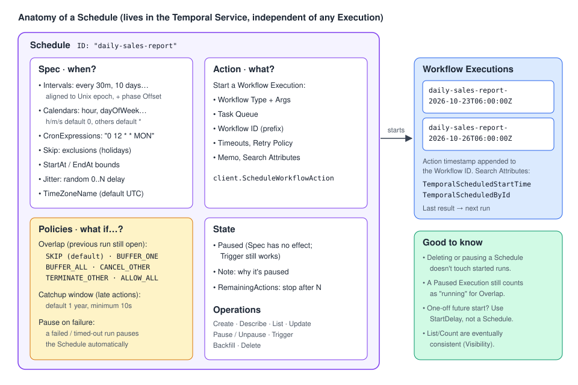

# 10 · Schedules, Start Delay & Cron Jobs: running Workflows on a clock

> **Level:** sub-feature (time-based starts) · **Read time:** ~25 min
> **Sources:** [Encyclopedia — Schedule](https://docs.temporal.io/schedule) · [Encyclopedia — Cron Job](https://docs.temporal.io/cron-job) · [Encyclopedia — Timers and Start Delays](https://docs.temporal.io/workflow-execution/timers-delays) · [Encyclopedia — Workflow Pause](https://docs.temporal.io/encyclopedia/workflow/workflow-pause) · [Go SDK — Schedules](https://docs.temporal.io/develop/go/workflows/schedules)

---

## 1. The problem

A lot of business work runs on a clock, not on a user click:

- "Build the sales report every weekday at 06:00 UTC, except on Christmas."
- "Send the trial-expiry reminder in 13 days, once."
- "Reconcile payouts every hour. If the previous run is still going, don't start a second one."

Without Temporal you would run a crontab on some VM, add a lock so two runs don't overlap,
write a "catch up after the outage" script, and find a way to pause it during incidents. If the VM
dies at 05:59, the report silently never runs.

Temporal gives you three tools that start Workflow Executions for you, **durably**, from the Temporal Service:

| Tool | Use it when… | Status |
| --- | --- | --- |
| **Schedule** | the start is **recurring** (every 30 min, every Monday at noon…) | ✅ recommended |
| **Start Delay** | the start happens **once**, at a future point | ✅ for one-off delays |
| **Temporal Cron Job** | you maintain old code that already uses it | ⚠️ legacy: "We recommend using Schedules instead of Cron Jobs" |

> 💡 Inside a running Workflow you wait with **Timers** (`workflow.Sleep`, `workflow.NewTimer`, see
> [05](05-timers-selectors-concurrency.md)). The tools in this chapter decide **when an Execution starts**.

---

## 2. Schedules: the mental model

A Schedule is **an object with its own identity (the Schedule ID), separate from any Workflow
Execution**. That is the big difference with a Cron Job, where the cron string is just a property of
one Workflow Execution.



A Schedule has four parts:

| Part | What it holds | Go type |
| --- | --- | --- |
| **Spec** | *When* to act: intervals, calendar expressions, cron strings, exclusions, start/end bounds, jitter, time zone | `client.ScheduleSpec` |
| **Action** | *What* to start: Workflow Type, Task Queue, arguments, timeouts, retry policy, memo | `client.ScheduleWorkflowAction` |
| **Policies** | *How* to behave on overlap, lateness and failures | `client.ScheduleOptions.Overlap`, `.CatchupWindow`, `.PauseOnFailure` |
| **State** | Paused or not, a note for humans, a limited number of remaining actions | `client.ScheduleOptions.Paused`, `.Note`, `.RemainingActions` |

Workflow Executions started by a Schedule get three extra properties:

- The **Action's timestamp is appended to the Workflow ID** (so each run has a distinct ID).
- The **`TemporalScheduledStartTime`** Search Attribute holds that timestamp.
- The **`TemporalScheduledById`** Search Attribute holds the Schedule ID.

Unless many Schedules fire at the same moment, Actions start within about **1 second** of the
specified time.

> 📝 Internally, a Schedule is implemented as a Workflow. `ListSchedules` and `CountSchedules` are
> served by the Visibility subsystem: they share the Visibility API rate limit and are **eventually
> consistent**, so a Schedule you just created or deleted may not show up in a list right away.

---

## 3. The Spec: describing *when*

There are two kinds of spec. You can combine several of each in one Schedule; the times are the
**union** of all of them, **minus** the `Skip` times.

### 3.1 Intervals and the phase offset

`client.ScheduleIntervalSpec{Every: 30 * time.Minute}` means "every 30 minutes". Intervals are
**aligned to the Unix epoch** (1970-01-01 00:00 UTC). For short intervals you don't care. For long
ones you do: a 7-day interval with no offset fires every **Thursday** at midnight UTC, because
1970-01-01 was a Thursday.

The `Offset` field (the "phase") shifts that alignment. The Schedule fires when:

```text
(currentTimestampUTC - offset) % interval == 0
```

To fire **every 10 days, including 2024-06-19 at 17:00 UTC**:

```text
reference = 2024-06-19T17:00:00Z = 1718816400
interval  = 10 days = 864000 s
offset    = 1718816400 % 864000 = 320400 s   (= 3 days 17 h)
```

So you set `Every: 10 * 24 * time.Hour, Offset: 320400 * time.Second`. You can compute it in Go too
(see `TenDayPayoutSpec` in section 6).

### 3.2 Calendars and cron strings

A calendar expression matches wall-clock fields, like cron. In Go it is a
`client.ScheduleCalendarSpec` where each field is a list of `client.ScheduleRange{Start, End, Step}`:

| Field | Range | Default when empty |
| --- | --- | --- |
| `Second`, `Minute`, `Hour` | 0-59 / 0-59 / 0-23 | matches **0** |
| `DayOfMonth` | 1-31 | all days |
| `Month` | 1-12 | all months |
| `DayOfWeek` | 0-6, **0 = Sunday** | all days |
| `Year` | any | all years |
| `Comment` | free text describing the intent | — |

A `ScheduleRange` with only `Start` set is a single value (`End` defaults to `Start`, `Step` to 1).
Because hour/minute/second default to 0, "every weekday at 06:00" only needs `Hour` and `DayOfWeek`.

If you prefer strings, `ScheduleSpec.CronExpressions` accepts classic cron strings such as
`"0 12 * * MON"`. Whatever form you use, Temporal converts it to a canonical representation, so
`Describe` may show it differently from what you typed, with the same meaning.

### 3.3 Other spec features

| Feature | Go field | Notes |
| --- | --- | --- |
| **Exclusions** | `Skip []ScheduleCalendarSpec` | "Every Monday at noon except holidays". You supply the holidays yourself: there are no predefined sets. All fields, seconds included, must match for a time to be skipped. |
| **Time bounds** | `StartAt`, `EndAt` | No actions before `StartAt` or after `EndAt`. |
| **Jitter** | `Jitter` | Adds a random 0..Jitter delay to each action, capped by the time to the next action. Useful so 500 Schedules don't all hit the same API at 06:00:00. |
| **Time zone** | `TimeZoneName` (IANA name) | Default is **UTC**, and Temporal recommends staying in UTC. With a DST zone, a 02:30 spec can fire zero or two times on transition days. |

---

## 4. Policies: what happens when things don't go to plan

### 4.1 Overlap Policy: the previous run is still running

| Policy (`enums.SCHEDULE_OVERLAP_POLICY_…`) | Behavior |
| --- | --- |
| `SKIP` *(default)* | Don't start the new run. |
| `BUFFER_ONE` | Start it as soon as the current one finishes. At most **one** waits in the buffer; later ones are dropped. |
| `BUFFER_ALL` | Buffer every action and run them one after the other (subject to the Catchup Window and internal buffer limits). |
| `CANCEL_OTHER` | Request cancellation of the running one, start the new one after the old one finishes cancelling. |
| `TERMINATE_OTHER` | Terminate the running one and start the new one, without waiting for Workflow cooperation. |
| `ALLOW_ALL` | Start anyway. The **only** policy where several runs of the same Schedule can be open at once. |

### 4.2 Catchup Window: how late is too late?

If the Temporal Service was down, or an overlap policy delayed an action, the **Catchup Window**
decides how late an automated action may still run. Default: **1 year**. Minimum: **10 seconds**. A
sales report that runs at 14:00 instead of 06:00 is useless, so you set a short window and accept
that a long outage means a missed run (you can always Backfill it later, see section 7). The window
is measured from the jitter-adjusted time. Manual triggers and Backfills ignore it.

### 4.3 Pause-on-failure

With `PauseOnFailure: true`, a run that **fails or times out** (not one that is cancelled or terminated)
**pauses the Schedule automatically**. A human then looks at it before more broken reports go out.
With `ALLOW_ALL`, the pause only affects runs scheduled after the failed one finished.

### 4.4 Interaction with Workflow Pause

[Workflow Pause](08-cancel-terminate-pause-reset.md) (pre-release) pauses **one Execution**. It does
**not** pause the Schedule that started it. A Paused Execution is still **open**, so it counts as
"the running one" for the overlap policy: with `SKIP` every new action is skipped, with `BUFFER_ONE`
one action waits, with `CANCEL_OTHER` the next start waits until the paused run processes the
cancel (which only happens after Unpause), with `TERMINATE_OTHER` it is terminated.

> 🛠️ Runbook: if you pause a scheduled Execution to investigate, **pause the Schedule too**. When
> you're done, unpause the Execution, then unpause the Schedule, and Backfill any actions that were skipped.

Pausing a **Schedule** is the opposite: it stops future actions but doesn't touch Executions it already started.

---

## 5. The Workflow side: a report that knows yesterday's result

A Workflow started by a Schedule is a **normal Workflow**. Two extra APIs are useful:

- `workflow.HasLastCompletionResult(ctx)` / `workflow.GetLastCompletionResult(ctx, &v)`: the result
  of the **most recent successful run**. Failures and timeouts don't change it.
- `workflow.GetLastError(ctx)`: the failure of the most recent run that ended before this one started.
  Unlike the completion result, a **successful** run resets it to `nil`.

```go
// file: reporting/activities.go
package reporting

import (
	"context"
	"fmt"
	"time"
)

type DailySales struct {
	Day          string // "2026-10-23"
	OrderCount   int
	RevenueCents int64
}

// SalesWarehouse is the analytics database (BigQuery, ClickHouse...).
type SalesWarehouse interface {
	SalesForDay(ctx context.Context, day time.Time) (DailySales, error)
}

// ReportPublisher posts the report to Slack / email.
type ReportPublisher interface {
	Publish(ctx context.Context, title, body string) error
}

type ReportActivities struct {
	Warehouse SalesWarehouse
	Publisher ReportPublisher
}

func (a *ReportActivities) LoadDailySales(ctx context.Context, day time.Time) (DailySales, error) {
	return a.Warehouse.SalesForDay(ctx, day)
}

func (a *ReportActivities) PublishSalesReport(ctx context.Context, r DailySalesReport) error {
	body := fmt.Sprintf("%d orders, %.2f EUR (%+.1f%% vs previous report)",
		r.Today.OrderCount, float64(r.Today.RevenueCents)/100, r.RevenueChangePct)
	return a.Publisher.Publish(ctx, "Daily sales "+r.Today.Day, body)
}
```

```go
// file: reporting/workflow.go
package reporting

import (
	"time"

	"go.temporal.io/sdk/temporal"
	"go.temporal.io/sdk/workflow"
)

const TaskQueue = "reporting"

type DailySalesReport struct {
	Today            DailySales
	Previous         *DailySales // nil on the very first successful run
	RevenueChangePct float64
}

// scheduledStartTime is set by the Schedule on every Execution it starts.
var scheduledStartTime = temporal.NewSearchAttributeKeyTime("TemporalScheduledStartTime")

func DailySalesReportWorkflow(ctx workflow.Context) (DailySalesReport, error) {
	logger := workflow.GetLogger(ctx)
	ctx = workflow.WithActivityOptions(ctx, workflow.ActivityOptions{StartToCloseTimeout: 5 * time.Minute})

	// Report on the day BEFORE the scheduled time, not before "now": a buffered or
	// backfilled run may start late, but it must still report on the right day.
	at, ok := workflow.GetTypedSearchAttributes(ctx).GetTime(scheduledStartTime)
	if !ok {
		at = workflow.Now(ctx) // started by hand, not by the Schedule
	}
	day := at.UTC().Truncate(24*time.Hour).AddDate(0, 0, -1)

	// Did the previous run fail? Useful context for the on-call person.
	if lastErr := workflow.GetLastError(ctx); lastErr != nil {
		logger.Warn("Previous report run failed", "error", lastErr)
	}

	var a *ReportActivities
	report := DailySalesReport{}
	if err := workflow.ExecuteActivity(ctx, a.LoadDailySales, day).Get(ctx, &report.Today); err != nil {
		return DailySalesReport{}, err
	}

	// The result returned by the last SUCCESSFUL run of this Schedule.
	if workflow.HasLastCompletionResult(ctx) {
		var previous DailySalesReport
		if err := workflow.GetLastCompletionResult(ctx, &previous); err == nil && previous.Today.RevenueCents > 0 {
			report.Previous = &previous.Today
			delta := report.Today.RevenueCents - previous.Today.RevenueCents
			report.RevenueChangePct = 100 * float64(delta) / float64(previous.Today.RevenueCents)
		}
	}

	if err := workflow.ExecuteActivity(ctx, a.PublishSalesReport, report).Get(ctx, nil); err != nil {
		return DailySalesReport{}, err
	}
	// Whatever we return becomes the next run's "last completion result".
	return report, nil
}
```

Things to know about the last completion result:

- **Keep it small.** A run may return up to the max blob size (2 MiB by default), but a result
  within 1 KiB of that limit is **not** passed to the next run. Return a summary, not raw data.
- **Continue-As-New breaks the chain.** If a scheduled run uses [Continue-As-New](09-continue-as-new.md),
  its status is `Continued-As-New`, not `Completed`, and `LastCompletionResult` isn't available to that new iteration.
- **With `ALLOW_ALL`, "last" means "completed most recently when this run started".** In the timeline
  below, D asks at time T and gets **A's** result: not B's (A completed later), and not C's (C
  completed after D started; the value is captured at start, not at query time).

```text
time -------------------------------------------->
 A     |----------------------|
 B               |-------|
 C                          |---------------|
 D                                |--------------T
```

---

## 6. Operating Schedules from Go

All Schedule operations go through `c.ScheduleClient()`. `Create` returns a `client.ScheduleHandle`;
later you get one back with `GetHandle(ctx, scheduleID)`.

### 6.1 Create

```go
// file: cmd/report-schedules/create.go
package main

import (
	"context"
	"fmt"
	"time"

	"github.com/acme/shop/reporting"
	enumspb "go.temporal.io/api/enums/v1"
	"go.temporal.io/sdk/client"
)

const DailySalesScheduleID = "daily-sales-report"

// WeekdayMorningSpec: Monday-Friday at 06:00:00 UTC, except December 25th.
func WeekdayMorningSpec() client.ScheduleSpec {
	return client.ScheduleSpec{
		Calendars: []client.ScheduleCalendarSpec{{
			Hour:      []client.ScheduleRange{{Start: 6}},         // minute and second default to 0
			DayOfWeek: []client.ScheduleRange{{Start: 1, End: 5}}, // 0 = Sunday
			Comment:   "Weekday mornings, before the sales stand-up",
		}},
		Skip: []client.ScheduleCalendarSpec{{
			Month:      []client.ScheduleRange{{Start: 12}},
			DayOfMonth: []client.ScheduleRange{{Start: 25}},
			Hour:       []client.ScheduleRange{{Start: 6}}, // all fields must match to skip
			Comment:    "No report on Christmas",
		}},
		Jitter: 30 * time.Second,
	}
}

// TenDayPayoutSpec: every 10 days, aligned so that one firing is 2024-06-19 17:00 UTC.
func TenDayPayoutSpec() client.ScheduleSpec {
	every := 10 * 24 * time.Hour
	reference := time.Date(2024, 6, 19, 17, 0, 0, 0, time.UTC)
	offset := time.Duration(reference.Unix()%int64(every/time.Second)) * time.Second // 320400s
	return client.ScheduleSpec{
		Intervals: []client.ScheduleIntervalSpec{{Every: every, Offset: offset}},
	}
}

func CreateDailySalesSchedule(ctx context.Context, c client.Client) (client.ScheduleHandle, error) {
	handle, err := c.ScheduleClient().Create(ctx, client.ScheduleOptions{
		ID:   DailySalesScheduleID,
		Spec: WeekdayMorningSpec(),
		Action: &client.ScheduleWorkflowAction{
			ID:                       "daily-sales-report", // the action timestamp is appended per run
			Workflow:                 reporting.DailySalesReportWorkflow,
			TaskQueue:                reporting.TaskQueue,
			WorkflowExecutionTimeout: time.Hour,
		},
		Overlap:        enumspb.SCHEDULE_OVERLAP_POLICY_BUFFER_ONE, // never two reports at once
		CatchupWindow:  2 * time.Hour,                              // a report after 08:00 is useless
		PauseOnFailure: true,                                       // a human looks before the next run
		Note:           "Owned by #team-data",
	})
	if err != nil {
		return nil, fmt.Errorf("create schedule %s: %w", DailySalesScheduleID, err)
	}
	return handle, nil
}
```

Other creation options: `Paused: true` creates it paused, `RemainingActions: n` stops it (as if
paused) after `n` scheduled actions, `TriggerImmediately: true` runs one action right now,
`ScheduleBackfill` backfills at creation time.

> 🧹 **Auto-deletion:** once a Schedule has created all its Workflow Executions (for example
> `EndAt` is in the past or `RemainingActions` reached 0), the Temporal Service deletes it, since it
> won't fire again. It doesn't guarantee *when*.

### 6.2 Describe, List, Pause, Trigger, Backfill, Update, Delete

```go
// file: cmd/report-schedules/operate.go
package main

import (
	"context"
	"fmt"
	"log"
	"time"

	enumspb "go.temporal.io/api/enums/v1"
	"go.temporal.io/sdk/client"
)

// DescribeSchedule shows what the Schedule will do next and what it did recently.
func DescribeSchedule(ctx context.Context, c client.Client, id string) error {
	desc, err := c.ScheduleClient().GetHandle(ctx, id).Describe(ctx)
	if err != nil {
		return fmt.Errorf("describe %s: %w", id, err)
	}
	log.Println("paused:", desc.Schedule.State.Paused, "note:", desc.Schedule.State.Note)
	log.Println("next runs:", desc.Info.NextActionTimes)
	log.Println("skipped (overlap):", desc.Info.NumActionsSkippedOverlap,
		"missed (catchup window):", desc.Info.NumActionsMissedCatchupWindow)
	for _, run := range desc.Info.RunningWorkflows {
		log.Println("running:", run.WorkflowID)
	}
	return nil
}

// ListSchedules pages through every Schedule (eventually consistent).
func ListSchedules(ctx context.Context, c client.Client) error {
	it, err := c.ScheduleClient().List(ctx, client.ScheduleListOptions{PageSize: 100})
	if err != nil {
		return err
	}
	for it.HasNext() {
		entry, err := it.Next()
		if err != nil {
			return err
		}
		log.Println(entry.ID, entry.WorkflowType.Name, "paused:", entry.Paused, "next:", entry.NextActionTimes)
	}
	return nil
}

// PauseForIncident stops future actions. The note tells colleagues why.
func PauseForIncident(ctx context.Context, c client.Client, id, incident string) error {
	return c.ScheduleClient().GetHandle(ctx, id).Pause(ctx, client.SchedulePauseOptions{
		Note: "Paused during " + incident + ": warehouse replica is lagging",
	})
}

func ResumeAfterIncident(ctx context.Context, c client.Client, id, incident string) error {
	return c.ScheduleClient().GetHandle(ctx, id).Unpause(ctx, client.ScheduleUnpauseOptions{
		Note: incident + " resolved",
	})
}

// RunNow starts one action immediately. It works even when the Schedule is paused.
// By default it follows the Schedule's overlap policy; here we override it.
func RunNow(ctx context.Context, c client.Client, id string) error {
	return c.ScheduleClient().GetHandle(ctx, id).Trigger(ctx, client.ScheduleTriggerOptions{
		Overlap: enumspb.SCHEDULE_OVERLAP_POLICY_ALLOW_ALL,
	})
}

// BackfillOutage replays every action that should have happened during [from, to].
// BUFFER_ALL runs them one after the other; ALLOW_ALL would run them in parallel.
func BackfillOutage(ctx context.Context, c client.Client, id string, from, to time.Time) error {
	return c.ScheduleClient().GetHandle(ctx, id).Backfill(ctx, client.ScheduleBackfillOptions{
		Backfill: []client.ScheduleBackfill{{
			Start:   from,
			End:     to,
			Overlap: enumspb.SCHEDULE_OVERLAP_POLICY_BUFFER_ALL,
		}},
	})
}

// MoveToSevenOClock changes the spec. DoUpdate receives the current description and
// returns the full Schedule to save.
func MoveToSevenOClock(ctx context.Context, c client.Client, id string) error {
	return c.ScheduleClient().GetHandle(ctx, id).Update(ctx, client.ScheduleUpdateOptions{
		DoUpdate: func(in client.ScheduleUpdateInput) (*client.ScheduleUpdate, error) {
			spec := WeekdayMorningSpec()
			spec.Calendars[0].Hour = []client.ScheduleRange{{Start: 7}}
			spec.Skip[0].Hour = []client.ScheduleRange{{Start: 7}}
			in.Description.Schedule.Spec = &spec
			return &client.ScheduleUpdate{Schedule: &in.Description.Schedule}, nil
		},
	})
}

// DeleteSchedule removes the Schedule. Executions it already started keep running.
func DeleteSchedule(ctx context.Context, c client.Client, id string) error {
	return c.ScheduleClient().GetHandle(ctx, id).Delete(ctx)
}
```

```go
// file: cmd/report-schedules/main.go
package main

import (
	"context"
	"log"
	"os"
	"time"

	"go.temporal.io/sdk/client"
)

// Usage: report-schedules create|describe|list|pause|resume|run-now|backfill|move|delete
func main() {
	c, err := client.Dial(client.Options{})
	if err != nil {
		log.Fatalln(err)
	}
	defer c.Close()
	ctx := context.Background()

	cmd := "describe"
	if len(os.Args) > 1 {
		cmd = os.Args[1]
	}
	id := DailySalesScheduleID
	switch cmd {
	case "create":
		_, err = CreateDailySalesSchedule(ctx, c)
	case "describe":
		err = DescribeSchedule(ctx, c, id)
	case "list":
		err = ListSchedules(ctx, c)
	case "pause":
		err = PauseForIncident(ctx, c, id, "INC-4242")
	case "resume":
		err = ResumeAfterIncident(ctx, c, id, "INC-4242")
	case "run-now":
		err = RunNow(ctx, c, id)
	case "backfill":
		now := time.Now().UTC()
		err = BackfillOutage(ctx, c, id, now.AddDate(0, 0, -3), now)
	case "move":
		err = MoveToSevenOClock(ctx, c, id)
	case "delete":
		err = DeleteSchedule(ctx, c, id)
	default:
		log.Fatalln("unknown command", cmd)
	}
	if err != nil {
		log.Fatalln(err)
	}
}
```

The same operations exist in the CLI (`temporal schedule …`, for example `temporal schedule trigger`;
see the [CLI reference](https://docs.temporal.io/cli/command-reference/schedule)) and in the Web UI.

| Operation | What it does | Affects running Executions? |
| --- | --- | --- |
| **Describe** | Spec, policies, state, next action times, recent actions, running Workflows | No |
| **List** | All Schedules (eventually consistent) | No |
| **Pause / Unpause** | Stop / resume future actions; a note records why | No |
| **Trigger** | Run one action now (follows the overlap policy unless overridden; ignores the Catchup Window) | Depends on the overlap policy |
| **Backfill** | Take all actions of a past (or future) time range now | Depends on the overlap policy |
| **Update** | Replace the Schedule definition | No |
| **Delete** | Remove the Schedule | No: started Workflows keep running |

---

## 7. Start Delay: one start, later

For a **single** future start, don't create a Schedule: set `StartDelay` on `client.StartWorkflowOptions`.
The Execution is created right away (so its Workflow ID is reserved and visible), but its first
Workflow Task isn't dispatched until the delay expires.

```go
// file: reporting/trial.go
package reporting

import (
	"context"
	"time"

	"go.temporal.io/sdk/workflow"
)

type TrialReminderInput struct {
	AccountID string
	Email     string
}

type Mailer interface {
	SendTrialExpiryReminder(ctx context.Context, accountID, email string) error
}

type TrialActivities struct{ Mailer Mailer }

func (a *TrialActivities) SendTrialExpiryReminder(ctx context.Context, in TrialReminderInput) error {
	return a.Mailer.SendTrialExpiryReminder(ctx, in.AccountID, in.Email)
}

// TrialExpiryReminderWorkflow has no timer: the wait is the Start Delay.
func TrialExpiryReminderWorkflow(ctx workflow.Context, in TrialReminderInput) error {
	ctx = workflow.WithActivityOptions(ctx, workflow.ActivityOptions{StartToCloseTimeout: time.Minute})
	var a *TrialActivities
	return workflow.ExecuteActivity(ctx, a.SendTrialExpiryReminder, in).Get(ctx, nil)
}
```

```go
// file: cmd/start-trial-reminder/main.go
package main

import (
	"context"
	"log"
	"time"

	"github.com/acme/shop/reporting"
	"go.temporal.io/sdk/client"
)

func main() {
	c, err := client.Dial(client.Options{})
	if err != nil {
		log.Fatalln(err)
	}
	defer c.Close()

	in := reporting.TrialReminderInput{AccountID: "acct_7781", Email: "owner@example.com"}
	run, err := c.ExecuteWorkflow(context.Background(), client.StartWorkflowOptions{
		ID:         "trial-expiry-reminder-" + in.AccountID,
		TaskQueue:  reporting.TaskQueue,
		StartDelay: 13 * 24 * time.Hour, // the trial lasts 14 days: remind one day before
	}, reporting.TrialExpiryReminderWorkflow, in)
	if err != nil {
		log.Fatalln(err)
	}
	log.Println("reminder scheduled", run.GetID(), run.GetRunID())
}
```

Rules of Start Delay:

- It is **incompatible** with Schedules and Cron Jobs.
- A **Signal-With-Start** or **Update-With-Start** during the delay dispatches the first Workflow Task
  immediately: the rest of the delay is skipped. An **Update** also unblocks it. A **plain Signal**
  does not: it is recorded, and the Workflow stays delayed.
- It only applies to the **first** run. A later Continue-As-New run is not delayed.

> 💡 Start Delay vs `workflow.Sleep` at the top of the Workflow: both wait durably. Start Delay
> keeps the Execution from doing *anything* (no Workflow Task, no code running) until it fires.

---

## 8. Temporal Cron Jobs (legacy)

> ⚠️ **Not recommended.** Use Schedules: they can be paused, updated, triggered, backfilled and
> described. This section exists so you can read old code.

A Cron Job is a `CronSchedule` string on `StartWorkflowOptions`. The Server then creates a **chain of
Runs** with the same Workflow ID:

```go
// file: cmd/start-legacy-cron/main.go
package main

// LEGACY EXAMPLE: prefer a Schedule (cmd/report-schedules). Kept to show how old code looks.

import (
	"context"
	"log"

	"github.com/acme/shop/reporting"
	"go.temporal.io/sdk/client"
)

func main() {
	c, err := client.Dial(client.Options{})
	if err != nil {
		log.Fatalln(err)
	}
	defer c.Close()

	_, err = c.ExecuteWorkflow(context.Background(), client.StartWorkflowOptions{
		ID:           "daily-sales-report-cron",
		TaskQueue:    reporting.TaskQueue,
		CronSchedule: "15 8 * * *", // 08:15 UTC every day
	}, reporting.DailySalesReportWorkflow)
	if err != nil {
		log.Fatalln(err)
	}
}
```

How it works:

- **Format:** five fields `minute hour day-of-month month day-of-week` (Sunday = 0), interpreted in
  **UTC**. The `robfig/cron` shortcuts work too: `@yearly`, `@monthly`, `@weekly`, `@daily`,
  `@hourly`, and `@every <duration>` (any `time.ParseDuration` string).
- **Chaining:** the Server creates each Run immediately but applies a `firstWorkflowTaskBackoff`, so
  its first Workflow Task isn't queued until the scheduled time. The next Run is created only after
  the current Run **Completes, Fails or hits its Run Timeout**. If a Retry Policy is set, a failed Run
  is retried first. If the next slot arrives while the current Run (or its retries) is still open,
  the new Run starts after it finishes.
- **Every Run gets the same input and the same options** as the first one. `GetLastCompletionResult`
  works here too.
- **Stopping it:** only **Terminate** or reaching the **Workflow Execution Timeout** stops the chain.
  A **Cancel** only affects the **current** Run. Use the Workflow ID in both requests.
- **Time zones:** prefix with `CRON_TZ=America/New_York`. Avoid it if you can: around DST
  transitions a job can run zero, one or two times; self-hosted servers need up-to-date `tzdata`;
  a tzdata update can change the meaning of your spec; and the next Run's absolute time is computed
  when the previous Run finishes, so a time-zone rule change in between isn't picked up.

---

## 9. Choosing between them

| | Schedule | Start Delay | Cron Job |
| --- | --- | --- | --- |
| Recurring | ✅ | ❌ (once) | ✅ |
| Has its own identity | ✅ Schedule ID | ❌ (it's the Workflow ID) | ❌ (a property of the Workflow) |
| Pause / update / trigger / backfill | ✅ | ❌ | ❌ |
| Overlap & catchup policies | ✅ | n/a | Only "wait for the current Run" |
| Several specs, exclusions, jitter, start/end | ✅ | n/a | ❌ |
| `GetLastCompletionResult` | ✅ | n/a | ✅ |
| Recommended | ✅ | ✅ for one-off delays | ❌ legacy |

---

## Key takeaways

- **Recurring → Schedule. Once, later → Start Delay. Cron Jobs → legacy only.**
- A Schedule = **Spec** (when) + **Action** (what) + **Policies** (overlap, catchup, pause-on-failure) + **State** (paused, note, remaining actions).
- Calendars default hour/minute/second to 0 and are UTC by default. Intervals align to the Unix epoch; use the **phase offset** for long intervals.
- Pick the **overlap policy** deliberately: `SKIP` is the default; `ALLOW_ALL` is the only one that allows parallel runs.
- In Go, everything goes through `c.ScheduleClient()`: `Create`, `GetHandle` → `Describe`, `Pause`/`Unpause`, `Trigger`, `Backfill`, `Update`, `Delete`; plus `List`.
- Scheduled Workflows can read the previous success with `GetLastCompletionResult` (keep it small) and the previous failure with `GetLastError`.
- Pausing an Execution doesn't pause its Schedule, and pausing a Schedule doesn't pause its Executions.

⬅️ Previous: [09 · Continue-As-New](09-continue-as-new.md) · ➡️ Next: [11 · Versioning](11-versioning.md)
