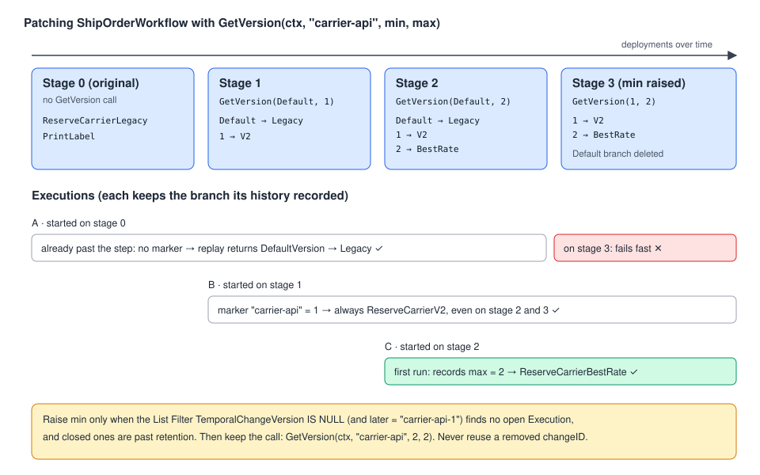

# 11 · Versioning: changing Workflow code while Executions are running

> **Level:** core concept for production · **Read time:** ~25 min
> **Sources:** [Encyclopedia — Workflow Definition: Versioning](https://docs.temporal.io/workflow-definition#workflow-versioning) · [Encyclopedia — Patching](https://docs.temporal.io/patching) · [Go SDK — Versioning](https://docs.temporal.io/develop/go/workflows/versioning) · [Worker Versioning](https://docs.temporal.io/production-deployment/worker-deployments/worker-versioning)

---

## 1. The problem

Workflows live long: an order waits days for a carrier, a subscription runs for years. Your code
changes every week. So sooner or later, a Workflow Execution **started on old code** is resumed by a
Worker running **new code**.

Remember how a Worker resumes an Execution ([03](03-determinism-and-replay.md)): it **replays** the
Workflow function from the start and checks every Command it emits against the Event History. If
the new code emits a different Command at the same position, for example `ScheduleActivityTask(ReserveCarrierV2)`
where the history says `ActivityTaskScheduled(ReserveCarrierLegacy)`, the Worker reports a
**non-determinism error** and the Execution is stuck.

| Usually safe without versioning | Needs versioning |
| --- | --- |
| Changing Activity / Child Workflow **arguments**, options and timeouts | Adding, removing or reordering Activities, Child Workflows, Timers, Side Effects, external Signals/Cancels |
| Changing a Timer's duration (but not to or from 0) | Changing the **type** or **ID** of an Activity or Child Workflow |
| Adding a Signal handler for a Signal that was never sent to this Execution | Changing how the Workflow ends (complete / fail / Continue-As-New) |
| Adding or removing calls that don't produce Commands (`workflow.GetInfo`, logging) | Changing the branch taken before any of the above |

> ✅ Only the **orchestration logic** is concerned. Code **inside an Activity** can change freely: it
> isn't replayed.

Temporal offers two strategies, and you can combine them:

| Strategy | Idea | When |
| --- | --- | --- |
| **Worker Versioning** *(recommended)* | Each Worker build is a **Deployment Version**. Pinned Workflows keep running on the build that started them. Old and new code never meet. | Default for teams that can run old and new Workers side by side during a rollout. |
| **Patching** (`workflow.GetVersion`) | One code base with **branches**: old Executions take the old branch, new ones the new branch. | When Executions must move to new code while running, or you run a single Worker fleet. |

---

## 2. Worker Versioning in one page

With Worker Versioning, you tag each Worker with a **deployment name** and a **build ID**. Temporal
routes tasks by version:

- **Pinned** Workflows stay on the Deployment Version that started them until they finish (or until
  someone moves them manually). New code never replays old histories, so you don't need patches.
- **Auto-upgrade** Workflows move to the current version of the Task Queue when the next task is
  dispatched. They still need patching for incompatible changes.

The Go side is a few options. The rollout itself (setting the current version, ramping, draining
old versions) is done with the CLI or the API; read the official
[Worker Versioning guide](https://docs.temporal.io/production-deployment/worker-deployments/worker-versioning)
before turning it on.

```go
// file: cmd/shipping-worker/main.go
package main

import (
	"log"
	"os"

	"github.com/acme/shop/shipping"
	"github.com/acme/shop/shipping/stage2"
	"go.temporal.io/sdk/client"
	"go.temporal.io/sdk/worker"
	"go.temporal.io/sdk/workflow"
)

func main() {
	c, err := client.Dial(client.Options{})
	if err != nil {
		log.Fatalln(err)
	}
	defer c.Close()

	w := worker.New(c, shipping.TaskQueue, worker.Options{
		DeploymentOptions: worker.DeploymentOptions{
			UseVersioning: true,
			Version: worker.WorkerDeploymentVersion{
				DeploymentName: "shipping-service",
				BuildID:        os.Getenv("BUILD_ID"), // e.g. the git SHA injected by CI
			},
			// Executions started on this build stay on this build.
			DefaultVersioningBehavior: workflow.VersioningBehaviorPinned,
		},
	})

	// You can also choose the behavior per Workflow Type.
	w.RegisterWorkflowWithOptions(stage2.ShipOrderWorkflow, workflow.RegisterOptions{
		Name:               "ShipOrderWorkflow",
		VersioningBehavior: workflow.VersioningBehaviorPinned,
	})
	w.RegisterActivity(&shipping.CarrierActivities{Carriers: shipping.FakeCarrierAPI{}})

	log.Fatalln(w.Run(worker.InterruptCh()))
}
```

> ⚠️ The pre-2025 experimental Worker Versioning (Build ID compatibility sets) was scheduled for
> removal from Temporal Server in March 2026. Don't start new work on it.

The rest of the chapter is about **patching**, because you need it with auto-upgrade Workflows,
without Worker Versioning, and to understand what goes wrong in the first place.

---

## 3. The running example: changing the carrier integration

The shipping team ships orders. The shared Activities live in one package:

```go
// file: shipping/activities.go
package shipping

import (
	"context"
	"fmt"
)

const TaskQueue = "shipping"

type ShipOrderInput struct {
	OrderID   string
	Warehouse string
	WeightKg  float64
}

type Reservation struct {
	Carrier    string
	TrackingID string
}

// CarrierAPI wraps the carriers' HTTP APIs.
type CarrierAPI interface {
	Reserve(ctx context.Context, api string, in ShipOrderInput) (Reservation, error)
	PrintLabel(ctx context.Context, r Reservation) (string, error)
}

type CarrierActivities struct{ Carriers CarrierAPI }

// ReserveCarrierLegacy: the original SOAP integration.
func (a *CarrierActivities) ReserveCarrierLegacy(ctx context.Context, in ShipOrderInput) (Reservation, error) {
	return a.Carriers.Reserve(ctx, "soap-v1", in)
}

// ReserveCarrierV2: the new REST API of the same carrier.
func (a *CarrierActivities) ReserveCarrierV2(ctx context.Context, in ShipOrderInput) (Reservation, error) {
	return a.Carriers.Reserve(ctx, "rest-v2", in)
}

// ReserveCarrierBestRate: compares several carriers and books the cheapest.
func (a *CarrierActivities) ReserveCarrierBestRate(ctx context.Context, in ShipOrderInput) (Reservation, error) {
	return a.Carriers.Reserve(ctx, "rate-shopping", in)
}

func (a *CarrierActivities) PrintLabel(ctx context.Context, r Reservation) (string, error) {
	return a.Carriers.PrintLabel(ctx, r)
}

// FakeCarrierAPI lets the samples run without a real carrier.
type FakeCarrierAPI struct{}

func (FakeCarrierAPI) Reserve(ctx context.Context, api string, in ShipOrderInput) (Reservation, error) {
	return Reservation{Carrier: api, TrackingID: fmt.Sprintf("TRK-%s", in.OrderID)}, nil
}

func (FakeCarrierAPI) PrintLabel(ctx context.Context, r Reservation) (string, error) {
	return "https://labels.example.com/" + r.TrackingID + ".pdf", nil
}
```

Each stage of the Workflow below is in its own package (`shipping/stage0` … `shipping/stage4`) so
every version compiles side by side. In real life it is **the same file** edited over several releases.

### Stage 0: the original code

```go
// file: shipping/stage0/workflow.go
package stage0

import (
	"time"

	"github.com/acme/shop/shipping"
	"go.temporal.io/sdk/workflow"
)

func ShipOrderWorkflow(ctx workflow.Context, in shipping.ShipOrderInput) (string, error) {
	ctx = workflow.WithActivityOptions(ctx, workflow.ActivityOptions{StartToCloseTimeout: time.Minute})
	var a *shipping.CarrierActivities

	var res shipping.Reservation
	if err := workflow.ExecuteActivity(ctx, a.ReserveCarrierLegacy, in).Get(ctx, &res); err != nil {
		return "", err
	}
	var labelURL string
	err := workflow.ExecuteActivity(ctx, a.PrintLabel, res).Get(ctx, &labelURL)
	return labelURL, err
}
```

Now the carrier retires its SOAP API. If you simply replace `ReserveCarrierLegacy` with
`ReserveCarrierV2` and deploy, every Execution that **already scheduled** `ReserveCarrierLegacy`
fails on replay with a non-determinism error. The Go SDK detects this at runtime (section 7).

---

## 4. Patching with `workflow.GetVersion`

```go
v := workflow.GetVersion(ctx, changeID, minSupported, maxSupported)
```

- `changeID`: a name for this change, unique in the Workflow (`"carrier-api"`).
- `minSupported` / `maxSupported`: the range of versions this code can still run.
  `workflow.DefaultVersion` (= -1) means "the code from before `GetVersion` existed".

How it behaves:

| Situation | `GetVersion` returns | Side effect |
| --- | --- | --- |
| First execution of this call (not replaying) | `maxSupported` (unless the Worker sets a `PreferredVersionProvider`) | Records a **marker** in the Event History, and adds the value to the **`TemporalChangeVersion`** Search Attribute |
| Replay, and the history **has** a marker for this `changeID` | the **recorded** version, even if `maxSupported` changed since | none |
| Any later call with the **same** `changeID` in the same Execution | the same version as the first call | none |
| Replay of a history recorded **before** the `GetVersion` call existed (no marker) | `workflow.DefaultVersion` | none |
| The recorded version is **outside** `[minSupported, maxSupported]` | — | the Workflow Task fails, so a too-old Execution stops here instead of running the wrong code |



### Stage 1: introduce the change

```go
// file: shipping/stage1/workflow.go
package stage1

import (
	"time"

	"github.com/acme/shop/shipping"
	"go.temporal.io/sdk/workflow"
)

func ShipOrderWorkflow(ctx workflow.Context, in shipping.ShipOrderInput) (string, error) {
	ctx = workflow.WithActivityOptions(ctx, workflow.ActivityOptions{StartToCloseTimeout: time.Minute})
	var a *shipping.CarrierActivities

	var res shipping.Reservation
	var err error
	v := workflow.GetVersion(ctx, "carrier-api", workflow.DefaultVersion, 1)
	if v == workflow.DefaultVersion {
		// Executions that already passed this point on stage-0 code.
		err = workflow.ExecuteActivity(ctx, a.ReserveCarrierLegacy, in).Get(ctx, &res)
	} else {
		// New Executions.
		err = workflow.ExecuteActivity(ctx, a.ReserveCarrierV2, in).Get(ctx, &res)
	}
	if err != nil {
		return "", err
	}

	var labelURL string
	err = workflow.ExecuteActivity(ctx, a.PrintLabel, res).Get(ctx, &labelURL)
	return labelURL, err
}
```

Executions that were **waiting before** the reservation (say, on a Timer) also replay without a
marker, but they haven't scheduled anything yet at that position. When they reach the call for real,
`GetVersion` isn't replaying any more, so it records version 1 and they take the new branch.

### Stage 2: a second change on the same spot

Business wants rate shopping across carriers. Same `changeID`, raise `maxSupported` to 2, add a branch:

```go
// file: shipping/stage2/workflow.go
package stage2

import (
	"time"

	"github.com/acme/shop/shipping"
	"go.temporal.io/sdk/workflow"
)

func ShipOrderWorkflow(ctx workflow.Context, in shipping.ShipOrderInput) (string, error) {
	ctx = workflow.WithActivityOptions(ctx, workflow.ActivityOptions{StartToCloseTimeout: time.Minute})
	var a *shipping.CarrierActivities

	var res shipping.Reservation
	var err error
	v := workflow.GetVersion(ctx, "carrier-api", workflow.DefaultVersion, 2)
	switch v {
	case workflow.DefaultVersion: // started on stage-0 code
		err = workflow.ExecuteActivity(ctx, a.ReserveCarrierLegacy, in).Get(ctx, &res)
	case 1: // started on stage-1 code
		err = workflow.ExecuteActivity(ctx, a.ReserveCarrierV2, in).Get(ctx, &res)
	default: // 2: new Executions
		err = workflow.ExecuteActivity(ctx, a.ReserveCarrierBestRate, in).Get(ctx, &res)
	}
	if err != nil {
		return "", err
	}

	var labelURL string
	err = workflow.ExecuteActivity(ctx, a.PrintLabel, res).Get(ctx, &labelURL)
	return labelURL, err
}
```

### Stage 3: drop the oldest branch

Once **no** Execution that ran stage-0 code is left (all closed **and** past the retention period,
so they can't be replayed or queried), raise `minSupported` to 1 and delete the `DefaultVersion` branch:

```go
// file: shipping/stage3/workflow.go
package stage3

import (
	"time"

	"github.com/acme/shop/shipping"
	"go.temporal.io/sdk/workflow"
)

func ShipOrderWorkflow(ctx workflow.Context, in shipping.ShipOrderInput) (string, error) {
	ctx = workflow.WithActivityOptions(ctx, workflow.ActivityOptions{StartToCloseTimeout: time.Minute})
	var a *shipping.CarrierActivities

	var res shipping.Reservation
	var err error
	v := workflow.GetVersion(ctx, "carrier-api", 1, 2) // a stage-0 history now fails here, on purpose
	if v == 1 {
		err = workflow.ExecuteActivity(ctx, a.ReserveCarrierV2, in).Get(ctx, &res)
	} else {
		err = workflow.ExecuteActivity(ctx, a.ReserveCarrierBestRate, in).Get(ctx, &res)
	}
	if err != nil {
		return "", err
	}

	var labelURL string
	err = workflow.ExecuteActivity(ctx, a.PrintLabel, res).Get(ctx, &labelURL)
	return labelURL, err
}
```

### Stage 4: one branch left, but keep the call

When version 1 Executions are gone too, only one branch remains. **Keep the `GetVersion` call**:

```go
// file: shipping/stage4/workflow.go
package stage4

import (
	"time"

	"github.com/acme/shop/shipping"
	"go.temporal.io/sdk/workflow"
)

func ShipOrderWorkflow(ctx workflow.Context, in shipping.ShipOrderInput) (string, error) {
	ctx = workflow.WithActivityOptions(ctx, workflow.ActivityOptions{StartToCloseTimeout: time.Minute})
	var a *shipping.CarrierActivities

	// Kept on purpose:
	//  1. an Execution still on an older version fails here instead of running the wrong code;
	//  2. the next change to this spot only needs maxSupported 2 → 3 and a new branch.
	workflow.GetVersion(ctx, "carrier-api", 2, 2)

	var res shipping.Reservation
	if err := workflow.ExecuteActivity(ctx, a.ReserveCarrierBestRate, in).Get(ctx, &res); err != nil {
		return "", err
	}
	var labelURL string
	err := workflow.ExecuteActivity(ctx, a.PrintLabel, res).Get(ctx, &labelURL)
	return labelURL, err
}
```

Rules for the end of a change's life:

- You only need to keep the **first** `GetVersion` call for a given `changeID`. Later calls with the
  same `changeID` in the same Workflow can be removed.
- You *may* remove that first call too, but only if all older Executions are past retention, and you
  **never reuse that `changeID`**. A later change to the same spot uses a new ID (`"carrier-api-fix2"`)
  starting again from `workflow.DefaultVersion`:

```go
// file: shipping/stage5/workflow.go
package stage5

import (
	"time"

	"github.com/acme/shop/shipping"
	"go.temporal.io/sdk/workflow"
)

func ShipOrderWorkflow(ctx workflow.Context, in shipping.ShipOrderInput) (string, error) {
	ctx = workflow.WithActivityOptions(ctx, workflow.ActivityOptions{StartToCloseTimeout: time.Minute})
	var a *shipping.CarrierActivities

	var res shipping.Reservation
	var err error
	// The "carrier-api" call was removed, so this change needs a NEW change ID.
	if workflow.GetVersion(ctx, "carrier-api-fix2", workflow.DefaultVersion, 1) == workflow.DefaultVersion {
		err = workflow.ExecuteActivity(ctx, a.ReserveCarrierBestRate, in).Get(ctx, &res)
	} else {
		err = workflow.ExecuteActivity(ctx, a.ReserveCarrierV2, in).Get(ctx, &res) // e.g. back to a single carrier
	}
	if err != nil {
		return "", err
	}
	var labelURL string
	err = workflow.ExecuteActivity(ctx, a.PrintLabel, res).Get(ctx, &labelURL)
	return labelURL, err
}
```

---

## 5. When is a version safe to delete? Ask Visibility

Because `GetVersion` writes the **`TemporalChangeVersion`** Search Attribute, you can find open
Executions per version with a List Filter (Web UI, `temporal workflow list --query …`, or `ListWorkflow` in Go).
The value is `<changeID>-<version>`:

```text
WorkflowType = "ShipOrderWorkflow"
    AND ExecutionStatus = "Running"
    AND TemporalChangeVersion = "carrier-api-1"
```

Executions started **before** the `GetVersion` call was added have no marker at all:

```text
WorkflowType = "ShipOrderWorkflow"
    AND ExecutionStatus = "Running"
    AND TemporalChangeVersion IS NULL
```

When both queries return nothing (and retention has passed for closed ones you might replay),
you can raise `minSupported`.

```go
// file: cmd/version-audit/main.go
package main

import (
	"context"
	"log"

	"go.temporal.io/api/workflowservice/v1"
	"go.temporal.io/sdk/client"
)

// Counts running ShipOrderWorkflow Executions still pinned to an old carrier-api branch.
func main() {
	c, err := client.Dial(client.Options{})
	if err != nil {
		log.Fatalln(err)
	}
	defer c.Close()

	queries := map[string]string{
		"pre-GetVersion (stage 0)": `WorkflowType = "ShipOrderWorkflow" AND ExecutionStatus = "Running" AND TemporalChangeVersion IS NULL`,
		"carrier-api-1":            `WorkflowType = "ShipOrderWorkflow" AND ExecutionStatus = "Running" AND TemporalChangeVersion = "carrier-api-1"`,
	}
	for label, q := range queries {
		resp, err := c.CountWorkflow(context.Background(), &workflowservice.CountWorkflowExecutionsRequest{Query: q})
		if err != nil {
			log.Fatalln(err)
		}
		log.Printf("%-26s %d running", label, resp.GetCount())
	}
}
```

---

## 6. Patching semantics from the Encyclopedia (`patched()`), mapped to Go

The [Patching](https://docs.temporal.io/patching) page describes the `patched()` function of the
**Python, .NET and Ruby** SDKs. Go has `GetVersion` instead, but the underlying idea is the same: a
**marker in the history decides the branch**, and replay must find markers where the code expects them.

| `patched()` behavior (Python/.NET/Ruby) | What to remember in Go |
| --- | --- |
| Not replaying → writes a marker (first time) and returns `true` | Not replaying → `GetVersion` records `maxSupported` and returns it |
| Replaying, marker found at this position → `true` | Replaying, marker found → returns the recorded version |
| Replaying, **no** marker for this ID → `false`, and every later call with that ID also returns `false`, even after replay catches up | Same idea: replaying with no marker → `DefaultVersion`, and the SDK remembers the version per `changeID` for the Execution, so later calls with that ID return `DefaultVersion` too. Branch on the returned value, never on "am I replaying" |
| Marker exists **later** in the history than the call → non-determinism error | Don't move a `GetVersion` call to an earlier position than where its marker was recorded |
| Recommendation: **put the newest code first** (`if patched("v3") … elif patched("v2")`) | Not needed in Go: one `GetVersion` per `changeID` returns a **number**, so a `switch` on it is explicit |

The practical consequence on both sides: an Execution that started on old code **doesn't always run
the newest code**, even after replay. That is the point. It runs the branch that matches its history.

---

## 7. The other options, and the safety nets

### Workflow cutover: a new Workflow Type

The blunt alternative to patching: copy the function under a new name and register both.

```go
// file: shipping/cutover/workflows.go
package cutover

import (
	"time"

	"github.com/acme/shop/shipping"
	"go.temporal.io/sdk/workflow"
)

// ShipOrderWorkflow is the frozen original. Running Executions finish on it.
func ShipOrderWorkflow(ctx workflow.Context, in shipping.ShipOrderInput) (string, error) {
	return ship(ctx, in, func(a *shipping.CarrierActivities) any { return a.ReserveCarrierLegacy })
}

// ShipOrderWorkflowV2 is the new code. Every starter must switch to this type.
func ShipOrderWorkflowV2(ctx workflow.Context, in shipping.ShipOrderInput) (string, error) {
	return ship(ctx, in, func(a *shipping.CarrierActivities) any { return a.ReserveCarrierBestRate })
}

func ship(ctx workflow.Context, in shipping.ShipOrderInput, reserve func(*shipping.CarrierActivities) any) (string, error) {
	ctx = workflow.WithActivityOptions(ctx, workflow.ActivityOptions{StartToCloseTimeout: time.Minute})
	var a *shipping.CarrierActivities
	var res shipping.Reservation
	if err := workflow.ExecuteActivity(ctx, reserve(a), in).Get(ctx, &res); err != nil {
		return "", err
	}
	var labelURL string
	err := workflow.ExecuteActivity(ctx, a.PrintLabel, res).Get(ctx, &labelURL)
	return labelURL, err
}
```

```go
// file: shipping/cutover/register.go
package cutover

import "go.temporal.io/sdk/worker"

// Register both types on the same Worker until no ShipOrderWorkflow Execution is left.
func Register(w worker.WorkflowRegistry) {
	w.RegisterWorkflow(ShipOrderWorkflow)
	w.RegisterWorkflow(ShipOrderWorkflowV2)
}
```

Downsides: duplicated code, every starter (APIs, Schedules, parent Workflows) must change the type
name, and **running** Executions never get the new behavior. It is a cutover, not a migration.

### The Go SDK runtime check

The Go SDK checks at replay time that these calls still match the history, and fails with a
non-determinism error if you **add, remove or reorder** them without versioning:

`workflow.ExecuteActivity()` · `workflow.ExecuteChildWorkflow()` · `workflow.NewTimer()` ·
`workflow.RequestCancelWorkflow()` · `workflow.SideEffect()` · `workflow.SignalExternalWorkflow()` · `workflow.Sleep()`

It is **not** a full check: it doesn't compare Activity arguments or Timer durations, for example.
Don't rely on it to find breaking changes for you.

> 📝 The docs list `workflow.RequestCancelWorkflow()`; in Go SDK v1.50.0 the function is named
> `workflow.RequestCancelExternalWorkflow()`.

### Replay tests: the real safety net

Download real histories from production as JSON (Web UI download, or the CLI's `temporal workflow show`) and replay them against the **new** code in CI. If a change breaks determinism, the
test fails before the deploy does.

```go
// file: shipping/stage2/replay_test.go
package stage2

import (
	"testing"

	"go.temporal.io/sdk/worker"
	"go.temporal.io/sdk/workflow"
)

// Histories captured from production while stage-0 and stage-1 code was running.
var recordedHistories = []string{
	"testdata/ship-order-stage0.json",
	"testdata/ship-order-stage1.json",
}

func TestShipOrderWorkflowReplaysOldHistories(t *testing.T) {
	replayer := worker.NewWorkflowReplayer()
	// Register under the Type name used in the histories.
	replayer.RegisterWorkflowWithOptions(ShipOrderWorkflow, workflow.RegisterOptions{Name: "ShipOrderWorkflow"})

	for _, file := range recordedHistories {
		if err := replayer.ReplayWorkflowHistoryFromJSONFile(nil, file); err != nil {
			t.Fatalf("%s no longer replays on the current code: %v", file, err)
		}
	}
}
```

---

## 8. Checklist before deploying a Workflow change

1. Does the change **add, remove, reorder or retype** a Command-producing call (or change the branch before one)? If not, ship it.
2. If yes: are you on **Worker Versioning with Pinned** Workflows? Deploy a new version; old Executions stay on old Workers.
3. Otherwise wrap the change in **`GetVersion`** with a new `changeID` (or bump `maxSupported` of an existing one).
4. Add the old histories to the **replay test** and run it in CI.
5. Later, use **`TemporalChangeVersion`** list filters to know when old branches can be removed. Raise `minSupported`, keep the call.
6. Consider **Continue-As-New** for long-lived Workflows so they pick up new code regularly ([09](09-continue-as-new.md)).

---

## Key takeaways

- Replay + long-lived Executions = old histories meet new code. Changing the **sequence of Commands** breaks them.
- **Worker Versioning** (recommended) keeps old Executions on old builds: configure `worker.Options.DeploymentOptions` and a Versioning Behavior (Pinned or Auto-upgrade).
- **`workflow.GetVersion(ctx, changeID, min, max)`** branches per Execution: `max` for new runs, the recorded value on replay, `DefaultVersion` for pre-patch histories.
- Lifecycle: add a branch → bump `max` → raise `min` when old versions are gone → keep the call → new `changeID` if you ever remove it.
- Find remaining Executions per version with **`TemporalChangeVersion`** List Filters.
- A **new Workflow Type** (cutover) is simple but doesn't migrate running Executions.
- The SDK runtime check is partial. **Replay tests** with `worker.NewWorkflowReplayer()` are the real safety net.

⬅️ Previous: [10 · Schedules, Start Delay & Cron Jobs](10-schedules-and-cron.md) · ➡️ Next: [12 · Dynamic Workflows](12-dynamic-workflows.md)
