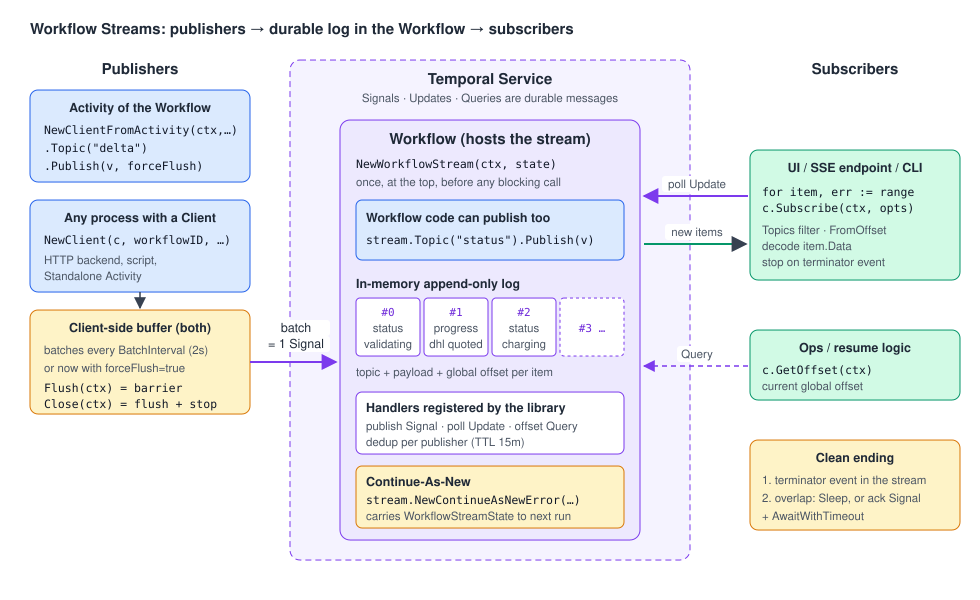

# 13 · Workflow Streams: following a Workflow in real time

> **Level:** sub-feature (Public Preview) · **Read time:** ~20 min
> **Sources:** [Go SDK — Workflow Streams](https://docs.temporal.io/develop/go/workflows/workflow-streams) · [Go SDK — Message passing](https://docs.temporal.io/develop/go/workflows/message-passing) · [`workflowstreams` API reference](https://pkg.go.dev/go.temporal.io/sdk/contrib/workflowstreams)

> 🧪 **Public Preview.** Workflow Streams ships as a separate contrib module,
> `go.temporal.io/sdk/contrib/workflowstreams` (v0.1.1 when this chapter was written). APIs may change
> before it is stable. Pin the version in your `go.mod`.

---

## 1. The problem

Users want to **watch** a long process while it runs:

- an order page that shows "validating → charging → shipping" live,
- a progress bar for a catalog import,
- an AI feature that prints the model's answer **token by token**.

With what you know so far, you would poll a **Query** every second ([06](06-message-passing.md)). That
works, but you get snapshots and not events. You miss intermediate states, you build your own
"what changed since last time" logic, and a Query only reads Workflow state. An Activity that is
producing tokens can't expose them that way without returning them to the Workflow first.

**Workflow Streams** adds a **durable event channel** to a Workflow. Publishers (the Workflow
itself, its Activities, or any process with a Temporal Client) append events to named **topics**.
Subscribers follow the stream from any offset and receive events in order, in near real time.

---

## 2. How it works



It is plain Temporal message passing, packaged as a library:

| Piece | Built on | What it does |
| --- | --- | --- |
| The **log** | Workflow state | An in-memory, append-only list of items. Each item has a **topic**, a **payload** and a global **offset**. The Workflow **hosts** the log. |
| **Publish** | a **Signal** (`__temporal_workflow_stream_publish`) | Clients buffer events and send them in **batches**. Each batch is one Signal. |
| **Subscribe** | an **Update** (long poll) | Subscribers ask "give me items after offset N". The Update returns when new items exist. |
| **Offset** | a **Query** | Returns the current global offset of the stream. |

Because publishing and subscribing go through the Temporal Service, the stream gets Temporal's
guarantees: **ordered** delivery, **publisher deduplication** (exactly-once inside the dedup window,
see section 8), and survival across **Continue-As-New**.

Key rules:

- Construct **exactly one** `WorkflowStream` per Workflow, **at the top** of the Workflow function,
  **before any blocking call**. The constructor registers the three handlers. If you construct it
  after a blocking call, publishes that arrived earlier are missed. If you construct it twice, the
  handlers are registered twice (Go has no API to detect that).
- The Workflow **hosts** the stream, but it **doesn't read** its own stream. Workflow logic depends on
  Activity results, not on streamed events.
- `Publish` applies **no backpressure**. A slow subscriber never slows a publisher. If you need a
  limit, apply it before calling `Publish`.

---

## 3. Core API at a glance

| Where you are | Constructor | Publish | Notes |
| --- | --- | --- | --- |
| Workflow code | `workflowstreams.NewWorkflowStream(ctx, priorState, opts...)` | `stream.Topic("status").Publish(v) error` | Appends synchronously to the in-memory log |
| Activity started by a Workflow | `workflowstreams.NewClientFromActivity(ctx, opts)` | `streamClient.Topic("delta").Publish(v, forceFlush)` | Finds the client and parent Workflow ID from the Activity context |
| Any process with a Client | `workflowstreams.NewClient(c, workflowID, opts)` | same | HTTP backends, scripts, **Standalone Activities** |
| Subscriber | `NewClient` (or `NewClientFromActivity`) | — | `for item, err := range streamClient.Subscribe(ctx, opts)` |

Client-side helpers:

- `Publish(value, forceFlush bool)` appends to an in-memory buffer and returns immediately.
  `forceFlush=true` wakes the background flusher so this batch ships now instead of at the next
  `BatchInterval` (default 2s).
- `Flush(ctx)` is a **barrier**: when it returns nil, the Temporal Service has received every prior
  publication.
- `Close(ctx)` flushes and stops the flusher. **Always check its error.** Subscribers don't need `Close`.
- `GetOffset(ctx)` runs the offset Query.

---

## 4. Publish from the Workflow and from an Activity

Example: an order tracking page. The Workflow publishes coarse **status** events. The shipping-quote
Activity publishes fine-grained **progress** events from inside the Activity, while it calls carriers.

### Event types

```go
// file: tracking/events.go
package tracking

// Topic names shared by publishers and subscribers.
const (
	TopicStatus   = "status"
	TopicProgress = "progress"
)

// StatusEvent is published by the Workflow at each business milestone.
type StatusEvent struct {
	State    string // "validating", "quoting", "charging", "completed", "failed"
	Progress int    // 0..100
	Detail   string
}

// ProgressEvent is published from inside Activities.
type ProgressEvent struct {
	Message string
}
```

### The Activities

`QuoteShippingRates` publishes one event per carrier. It uses `NewClientFromActivity`, so it needs
neither the Temporal Client nor the Workflow ID in its input.

```go
// file: tracking/activities.go
package tracking

import (
	"context"
	"fmt"
	"time"

	"go.temporal.io/sdk/activity"
	"go.temporal.io/sdk/contrib/workflowstreams"
)

type ShippingQuote struct {
	Carrier    string
	PriceCents int64
}

// CarrierAPI is the external rating service (fake it in tests).
type CarrierAPI interface {
	Quote(ctx context.Context, carrier, orderID string) (int64, error)
}

type OrderActivities struct {
	Carriers CarrierAPI
}

func (a *OrderActivities) ValidateOrder(ctx context.Context, orderID string) error { return nil }

func (a *OrderActivities) ChargePayment(ctx context.Context, orderID string, amountCents int64) error {
	return nil
}

func (a *OrderActivities) QuoteShippingRates(ctx context.Context, orderID string) (ShippingQuote, error) {
	streamClient, err := workflowstreams.NewClientFromActivity(ctx, workflowstreams.Options{
		BatchInterval: 200 * time.Millisecond,
	})
	if err != nil {
		return ShippingQuote{}, err // e.g. called as a Standalone Activity: no parent Workflow
	}
	progress := streamClient.Topic(TopicProgress)

	best := ShippingQuote{}
	for _, carrier := range []string{"colissimo", "dhl", "ups"} {
		price, err := a.Carriers.Quote(ctx, carrier, orderID)
		if err != nil {
			_ = streamClient.Close(ctx)
			return ShippingQuote{}, err
		}
		progress.Publish(ProgressEvent{Message: fmt.Sprintf("%s quoted %d cents", carrier, price)}, false)
		activity.RecordHeartbeat(ctx, carrier)
		if best.Carrier == "" || price < best.PriceCents {
			best = ShippingQuote{Carrier: carrier, PriceCents: price}
		}
	}
	// Close flushes the buffer. Return its error so a failed flush fails the Activity.
	if err := streamClient.Close(ctx); err != nil {
		return ShippingQuote{}, err
	}
	return best, nil
}
```

### The Workflow

```go
// file: tracking/workflow.go
package tracking

import (
	"time"

	"go.temporal.io/sdk/contrib/workflowstreams"
	"go.temporal.io/sdk/workflow"
)

type OrderTrackingInput struct {
	OrderID     string
	AmountCents int64
	// nil on a fresh start; set only when continuing as new (see section 7).
	StreamState *workflowstreams.WorkflowStreamState
}

func OrderTrackingWorkflow(ctx workflow.Context, in OrderTrackingInput) (ShippingQuote, error) {
	// 1) FIRST thing, before any blocking call: create the stream (registers its handlers).
	stream, err := workflowstreams.NewWorkflowStream(ctx, in.StreamState)
	if err != nil {
		return ShippingQuote{}, err
	}
	status := stream.Topic(TopicStatus)

	ctx = workflow.WithActivityOptions(ctx, workflow.ActivityOptions{
		StartToCloseTimeout: time.Minute,
		HeartbeatTimeout:    20 * time.Second,
	})
	var a *OrderActivities

	fail := func(err error) (ShippingQuote, error) {
		_ = status.Publish(StatusEvent{State: "failed", Detail: err.Error()})
		_ = workflow.Sleep(ctx, 30*time.Second) // let subscribers read the terminator
		return ShippingQuote{}, err
	}

	if err := status.Publish(StatusEvent{State: "validating", Detail: "checking stock"}); err != nil {
		return ShippingQuote{}, err
	}
	if err := workflow.ExecuteActivity(ctx, a.ValidateOrder, in.OrderID).Get(ctx, nil); err != nil {
		return fail(err)
	}

	_ = status.Publish(StatusEvent{State: "quoting", Progress: 30, Detail: "asking carriers"})
	var quote ShippingQuote
	if err := workflow.ExecuteActivity(ctx, a.QuoteShippingRates, in.OrderID).Get(ctx, &quote); err != nil {
		return fail(err)
	}

	_ = status.Publish(StatusEvent{State: "charging", Progress: 70, Detail: "authorizing payment"})
	total := in.AmountCents + quote.PriceCents
	if err := workflow.ExecuteActivity(ctx, a.ChargePayment, in.OrderID, total).Get(ctx, nil); err != nil {
		return fail(err)
	}

	// 2) In-band terminator: subscribers stop when they see "completed".
	if err := status.Publish(StatusEvent{State: "completed", Progress: 100, Detail: "via " + quote.Carrier}); err != nil {
		return ShippingQuote{}, err
	}
	// 3) Brief overlap so in-flight polls can fetch the terminator before the Workflow closes.
	if err := workflow.Sleep(ctx, 30*time.Second); err != nil {
		return ShippingQuote{}, err
	}
	return quote, nil
}
```

`WorkflowTopicHandle.Publish` (Workflow side) returns an `error`. `TopicHandle.Publish` (client side)
returns nothing and takes a `forceFlush` flag. Same name, different signatures.

---

## 5. Publish from any client

Any process that knows the Workflow ID can publish. Example: the warehouse scanner backend pushes
"parcel scanned" events into the order's stream. It is an HTTP service, not an Activity, so it uses
`NewClient`.

`Flush` is the mid-stream barrier: here we only mark the scan batch as forwarded once Temporal has it.

```go
// file: tracking/warehouse_publisher.go
package tracking

import (
	"context"

	"go.temporal.io/sdk/client"
	"go.temporal.io/sdk/contrib/workflowstreams"
)

// ScanLog is the warehouse system's own table.
type ScanLog interface {
	MarkForwarded(ctx context.Context, orderID string, scans []string) error
}

func ForwardWarehouseScans(ctx context.Context, c client.Client, log ScanLog, orderID string, scans []string) (err error) {
	streamClient := workflowstreams.NewClient(c, orderID, workflowstreams.Options{})
	defer func() {
		// Close flushes whatever is still buffered. Don't lose its error.
		if closeErr := streamClient.Close(ctx); err == nil {
			err = closeErr
		}
	}()

	progress := streamClient.Topic(TopicProgress)
	for _, scan := range scans {
		progress.Publish(ProgressEvent{Message: "warehouse: " + scan}, false)
	}

	// Barrier: every event above has reached the Temporal Service.
	if err := streamClient.Flush(ctx); err != nil {
		return err
	}
	return log.MarkForwarded(ctx, orderID, scans) // only safe now
}
```

> ⚠️ The client publish path **is not goroutine-safe**. Don't call `Publish` on the same `Client` from
> several goroutines. Route events to one owner goroutine.

For a **Standalone Activity** there is no parent Workflow, so `NewClientFromActivity` returns an
error. Use `NewClient(activity.GetClient(ctx), workflowIDFromInput, opts)` instead.

---

## 6. Subscribe

`Subscribe` returns an `iter.Seq2[WorkflowStreamItem, error]`. Range over it. It handles re-polling,
pagination (a poll response is capped around 1 MB) and Workflow-side truncation for you.

`SubscribeOptions`:

| Field | Meaning | Default |
| --- | --- | --- |
| `Topics` | topic filter | empty = all topics |
| `FromOffset` | global offset to start from (store it to resume after a reconnect) | 0 = beginning |
| `PollCooldown` | minimum interval between polls when nothing is ready | 100 ms |

Each `item.Data` is the **raw payload**. Decode it with a converter that matches the publisher (the
default data converter, unless you passed `WithPayloadConverters`). One subscription can read several
topics with different types: switch on `item.Topic`.

The loop ends cleanly when the Workflow closes (Completed, Failed, Canceled, Terminated or Timed Out),
but it doesn't tell you **which**. Call `DescribeWorkflow` afterwards when the outcome matters.

```go
// file: cmd/order-tracker/main.go
package main

import (
	"context"
	"fmt"
	"log"
	"os"

	"github.com/acme/shop/tracking"
	"go.temporal.io/sdk/client"
	"go.temporal.io/sdk/contrib/workflowstreams"
	"go.temporal.io/sdk/converter"
)

// WatchOrder prints every status and progress event until the "completed" terminator arrives
// or the Workflow closes, then reports the final status.
func WatchOrder(ctx context.Context, c client.Client, orderID string, fromOffset int64) error {
	stream := workflowstreams.NewClient(c, orderID, workflowstreams.Options{}) // subscribe-only: no Close
	dc := converter.GetDefaultDataConverter()

	opts := workflowstreams.SubscribeOptions{
		Topics:     []string{tracking.TopicStatus, tracking.TopicProgress},
		FromOffset: fromOffset,
	}
loop:
	for item, err := range stream.Subscribe(ctx, opts) {
		if err != nil {
			return err
		}
		switch item.Topic {
		case tracking.TopicStatus:
			var evt tracking.StatusEvent
			if err := dc.FromPayload(item.Data, &evt); err != nil {
				return err
			}
			fmt.Printf("#%d [%3d%%] %s: %s\n", item.Offset, evt.Progress, evt.State, evt.Detail)
			if evt.State == "completed" || evt.State == "failed" {
				break loop
			}
		case tracking.TopicProgress:
			var evt tracking.ProgressEvent
			if err := dc.FromPayload(item.Data, &evt); err != nil {
				return err
			}
			fmt.Printf("#%d        %s\n", item.Offset, evt.Message)
		}
	}

	// The stream doesn't say how the Workflow ended. Ask Temporal.
	desc, err := c.DescribeWorkflow(ctx, orderID, "")
	if err != nil {
		return err
	}
	fmt.Println("Workflow status:", desc.Status)
	return nil
}

func main() {
	c, err := client.Dial(client.Options{})
	if err != nil {
		log.Fatalln(err)
	}
	defer c.Close()
	if err := WatchOrder(context.Background(), c, os.Args[1], 0); err != nil {
		log.Fatalln(err)
	}
}
```

---

## 7. Closing the stream cleanly

A `for … range` doesn't know when the publisher is done. The documented pattern has two parts:

1. **An in-band terminator.** Publish an event the subscriber recognizes and stops on
   (`State: "completed"` above).
2. **A brief overlap before the Workflow returns.** A poll still in flight when the Workflow closes is
   consumed silently, so a Workflow that returns right after the terminator can lose it.

Two ways to get the overlap:

| Option | How | Trade-off |
| --- | --- | --- |
| **Fixed sleep** | `workflow.Sleep(ctx, 30*time.Second)` after the terminator (section 4) | Simple. Every run lasts 30s longer. |
| **Ack handshake** | Subscriber Signals the Workflow when it has the terminator. The Workflow waits with `workflow.AwaitWithTimeout` | Returns as soon as the subscriber confirms. The timeout is the fallback when nobody is subscribed. |

### Full example: streaming generated product copy (ack handshake + retries)

An Activity calls an LLM and publishes **text deltas** as they arrive. The interesting part is the
retry: a retried attempt is a **new publisher**, so the subscriber would see the failed attempt's
partial text **plus** the new attempt's full text. From the second attempt on, the Activity
publishes a `retry` event, and the consumer clears its buffer when it sees one.

```go
// file: copywriting/activity.go
package copywriting

import (
	"context"
	"iter"
	"strings"
	"time"

	"go.temporal.io/sdk/activity"
	"go.temporal.io/sdk/contrib/workflowstreams"
)

const (
	TopicDelta = "delta"
	TopicRetry = "retry"
	TopicClose = "close"

	AckSignal = "subscriber-acknowledged-terminator"
)

type TextDelta struct{ Text string }

type RetryEvent struct{ Attempt int32 }

type ProductBrief struct {
	SKU      string
	Name     string
	Keywords []string
}

// generateDeltas stands in for your LLM SDK's streaming call. Disable the provider's own
// retries and let the Temporal Retry Policy own retries.
func generateDeltas(brief ProductBrief) iter.Seq[string] {
	words := append([]string{"Meet", "the", brief.Name + ":"}, brief.Keywords...)
	return func(yield func(string) bool) {
		for _, w := range words {
			if !yield(w + " ") {
				return
			}
		}
	}
}

func GenerateProductDescription(ctx context.Context, brief ProductBrief) (string, error) {
	attempt := activity.GetInfo(ctx).Attempt
	streamClient, err := workflowstreams.NewClientFromActivity(ctx, workflowstreams.Options{
		BatchInterval: 200 * time.Millisecond,
	})
	if err != nil {
		return "", err
	}
	deltas := streamClient.Topic(TopicDelta)

	// Tell consumers that an earlier attempt's deltas are stale. Flush now: latency matters.
	if attempt > 1 {
		streamClient.Topic(TopicRetry).Publish(RetryEvent{Attempt: attempt}, true)
	}

	var full strings.Builder
	first := true
	for token := range generateDeltas(brief) {
		// forceFlush only on the first delta so the user sees text immediately;
		// later deltas are batched every 200ms (one Signal per batch, not per token).
		deltas.Publish(TextDelta{Text: token}, first)
		first = false
		full.WriteString(token)
		activity.RecordHeartbeat(ctx)
	}
	streamClient.Topic(TopicClose).Publish(struct{}{}, false)

	if err := streamClient.Close(ctx); err != nil {
		return "", err
	}
	return full.String(), nil
}
```

```go
// file: copywriting/workflow.go
package copywriting

import (
	"time"

	"go.temporal.io/sdk/contrib/workflowstreams"
	"go.temporal.io/sdk/temporal"
	"go.temporal.io/sdk/workflow"
)

type ProductCopyInput struct {
	Brief       ProductBrief
	StreamState *workflowstreams.WorkflowStreamState
}

func ProductCopyWorkflow(ctx workflow.Context, in ProductCopyInput) (string, error) {
	// The Workflow hosts the stream; the Activity publishes to it.
	if _, err := workflowstreams.NewWorkflowStream(ctx, in.StreamState); err != nil {
		return "", err
	}

	subscriberDone := false
	ackCh := workflow.GetSignalChannel(ctx, AckSignal)
	workflow.Go(ctx, func(ctx workflow.Context) {
		ackCh.Receive(ctx, nil)
		subscriberDone = true
	})

	ctx = workflow.WithActivityOptions(ctx, workflow.ActivityOptions{
		StartToCloseTimeout: 5 * time.Minute,
		HeartbeatTimeout:    30 * time.Second,
		RetryPolicy:         &temporal.RetryPolicy{MaximumAttempts: 3},
	})
	var description string
	if err := workflow.ExecuteActivity(ctx, GenerateProductDescription, in.Brief).Get(ctx, &description); err != nil {
		return "", err
	}

	// Wait for the subscriber to ack the "close" event; 30s is the fallback when nobody listens.
	_, _ = workflow.AwaitWithTimeout(ctx, 30*time.Second, func() bool { return subscriberDone })
	return description, nil
}
```

The consumer can be a CLI, a desktop UI, or an SSE endpoint that forwards to a browser. `render` stands
for "redraw whatever displays the text".

```go
// file: copywriting/consumer.go
package copywriting

import (
	"context"
	"strings"

	"go.temporal.io/sdk/client"
	"go.temporal.io/sdk/contrib/workflowstreams"
	"go.temporal.io/sdk/converter"
)

// StreamProductCopy follows one ProductCopyWorkflow (its Workflow ID is copyJobID) and calls
// render with the full text so far after every change.
func StreamProductCopy(ctx context.Context, c client.Client, copyJobID string, render func(string)) (string, error) {
	stream := workflowstreams.NewClient(c, copyJobID, workflowstreams.Options{})
	dc := converter.GetDefaultDataConverter()
	var text []string

	opts := workflowstreams.SubscribeOptions{Topics: []string{TopicDelta, TopicRetry, TopicClose}}
	for item, err := range stream.Subscribe(ctx, opts) {
		if err != nil {
			return "", err
		}
		switch item.Topic {
		case TopicRetry:
			// The previous attempt's deltas are stale: drop what we've shown.
			text = text[:0]
			render("")
		case TopicDelta:
			var d TextDelta
			if err := dc.FromPayload(item.Data, &d); err != nil {
				return "", err
			}
			text = append(text, d.Text)
			render(strings.Join(text, ""))
		case TopicClose:
			// Ack so the Workflow can return without waiting for its 30s fallback.
			if err := c.SignalWorkflow(ctx, copyJobID, "", AckSignal, nil); err != nil {
				return "", err
			}
			return strings.Join(text, ""), nil
		}
	}
	return strings.Join(text, ""), nil
}
```

---

## 8. Long-running streams and Continue-As-New

A Workflow that streams for hours accumulates history and must **Continue-As-New**
([09](09-continue-as-new.md)). The stream's log and its dedup state live in Workflow memory, so they
must be **carried across** the boundary. Subscribers follow the rollover automatically.

The recipe:

1. Add a `*workflowstreams.WorkflowStreamState` field to the Workflow input and pass it to
   `NewWorkflowStream` (nil on a fresh start).
2. Return `stream.NewContinueAsNewError(ctx, wfn, buildArgs)` instead of
   `workflow.NewContinueAsNewError`. It **detaches waiting pollers**, **waits for in-flight handlers**,
   snapshots the state (15-minute publisher TTL), and calls `buildArgs(state)` to build the next run's arguments.

Example: a shipment timeline that lives until the parcel is delivered and republishes every carrier
scan it receives as a Signal.

```go
// file: tracking/shipment_timeline.go
package tracking

import (
	"go.temporal.io/sdk/contrib/workflowstreams"
	"go.temporal.io/sdk/workflow"
)

const CarrierScanSignal = "carrier-scan"

type CarrierScan struct {
	Location  string
	Delivered bool
}

type ShipmentTimelineInput struct {
	TrackingNumber string
	ScansSeen      int
	StreamState    *workflowstreams.WorkflowStreamState
}

func ShipmentTimelineWorkflow(ctx workflow.Context, in ShipmentTimelineInput) error {
	stream, err := workflowstreams.NewWorkflowStream(ctx, in.StreamState)
	if err != nil {
		return err
	}
	scans := stream.Topic("scans")
	scanCh := workflow.GetSignalChannel(ctx, CarrierScanSignal)
	scansSeen := in.ScansSeen

	handle := func(scan CarrierScan) (delivered bool, err error) {
		scansSeen++
		return scan.Delivered, scans.Publish(scan)
	}

	for {
		var scan CarrierScan
		scanCh.Receive(ctx, &scan)
		delivered, err := handle(scan)
		if err != nil {
			return err
		}
		if delivered {
			return nil // a real Workflow would also add the closing overlap from section 7
		}

		if workflow.GetInfo(ctx).GetContinueAsNewSuggested() {
			// Don't lose Signals that already arrived: drain them into the stream first.
			for scanCh.ReceiveAsync(&scan) {
				delivered, err := handle(scan)
				if err != nil {
					return err
				}
				if delivered {
					return nil
				}
			}
			return stream.NewContinueAsNewError(ctx, ShipmentTimelineWorkflow,
				func(state *workflowstreams.WorkflowStreamState) []any {
					return []any{ShipmentTimelineInput{
						TrackingNumber: in.TrackingNumber,
						ScansSeen:      scansSeen,
						StreamState:    state,
					}}
				})
		}
	}
}
```

### The manual recipe (custom TTL, other Continue-As-New options)

When you need a different publisher TTL, or other Continue-As-New options such as another Task
Queue, do the steps yourself. `Truncate(upToOffset)` keeps the carried log small. Polls that ask for
an offset before the new base then get a `TruncatedOffset` error.

```go
// file: tracking/manual_rollover.go
package tracking

import (
	"time"

	"go.temporal.io/sdk/contrib/workflowstreams"
	"go.temporal.io/sdk/workflow"
)

// rolloverShipmentTimeline is the explicit version of stream.NewContinueAsNewError.
func rolloverShipmentTimeline(ctx workflow.Context, stream *workflowstreams.WorkflowStream,
	in ShipmentTimelineInput, keepFromOffset int64) error {
	// Drop old entries so the carried state stays well under the payload size limit.
	if err := stream.Truncate(keepFromOffset); err != nil {
		return err
	}
	stream.DetachPollers() // unblock waiting polls, reject new ones
	if err := workflow.Await(ctx, func() bool { return workflow.AllHandlersFinished(ctx) }); err != nil {
		return err
	}
	state, err := stream.GetState(30 * time.Minute) // custom publisher TTL (default is 15m)
	if err != nil {
		return err
	}
	ctx = workflow.WithWorkflowTaskQueue(ctx, "tracking-v2")
	in.StreamState = state
	return workflow.NewContinueAsNewError(ctx, ShipmentTimelineWorkflow, in)
}
```

> ⚠️ The carried state includes the **whole in-memory log** of the previous run. Streams with large
> items can hit the per-payload size limit at rollover. Keep items small (store big blobs elsewhere,
> for example with External Storage, and publish references), and truncate.

---

## 9. Delivery guarantees and tuning

| Knob | Default | What to know |
| --- | --- | --- |
| `Options.BatchInterval` | 2s | Time between automatic flushes. Lower means lower latency but more Signals in history. |
| `Options.MaxBatchSize` | 0 (off) | Flush once the buffer holds this many items. |
| `forceFlush` on `Publish` | false | Use for latency-sensitive events (first token, `retry`), not for every event. |
| `Options.MaxRetryDuration` | 10m | How long a failed batch is retried. Then the batch is dropped and a `*FlushTimeoutError` is returned. |
| Publisher TTL (`GetState(ttl)`) | 15m | At Continue-As-New, dedup entries for publishers silent longer than this are dropped. |
| `Options.PayloadConverters` / `WithPayloadConverters` | default converters | Per-item serialization only. Use matching converters on both sides. |

What this means in practice:

- **Exactly-once inside the dedup window.** `MaxRetryDuration` must stay **below** the publisher TTL.
  Otherwise a publisher that comes back after a long partition can create duplicates.
- **A flush timeout is at-most-once.** The dropped batch may or may not have reached the Workflow.
  The `FlushTimeoutError` also **stops the background flusher**. Later publishes pile up until you
  call `Flush` or `Close`.
- **The codec chain runs once per batch.** Encryption and compression from your client's data
  converter apply to the Signal/Update envelope, never per item. Items are never double-encoded.
- **Retried Activities publish twice.** Design consumers to reset on a `retry` event (section 7).

---

## Key takeaways

- Workflow Streams = an **ordered, durable event log hosted by a Workflow**, built on a publish
  **Signal**, a poll **Update** and an offset **Query**. Contrib module, **Public Preview**.
- Create **one** `WorkflowStream` at the **top** of the Workflow. Publish from the Workflow,
  from Activities (`NewClientFromActivity`) or from any client (`NewClient`).
- Client publishes are buffered and batched. `forceFlush` for latency, `Flush` as a barrier, and
  **always check `Close`**.
- Subscribers range over `Subscribe(...)`, decode `item.Data`, resume with `FromOffset`, and call
  `DescribeWorkflow` to learn how the run ended.
- End streams with a **terminator event plus an overlap** (sleep or ack handshake).
- Long-lived streams carry `WorkflowStreamState` through **`stream.NewContinueAsNewError`**.

⬅️ Previous: [12 · Dynamic Workflows](12-dynamic-workflows.md) · ↩️ Back to the [Roadmap](README.md)
