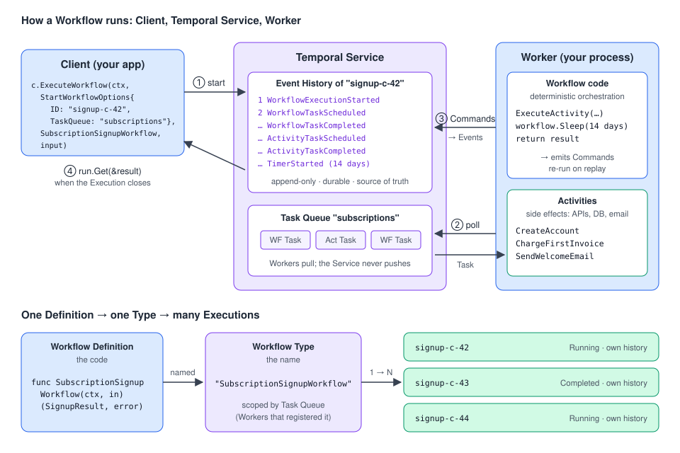

# Temporal Workflows with Go: a roadmap

> A progressive onboarding guide to **Temporal Workflows** for Go developers. It is based on the
> Temporal Encyclopedia (the concepts) and the Temporal Go SDK docs (how to do it in Go), read side by side.
> Every chapter has **compilable Go examples** with production-like names.
>
> Companion guides: [Temporal Activities with Go](../../activities/docs/README.md). Workflows orchestrate, Activities do the side effects. [Temporal Testing with Go](../../testing/docs/README.md) shows how to test both.
>
> New to Temporal? Start with [Temporal Architecture with Go](../../architecture/docs/README.md): which part runs where, and why replay works.



---

## Why this matters, in 30 seconds

Real business processes are long and fragile. A signup charges a card, sends emails, waits 14 days
for a trial to end, then converts the account. An order waits for a courier, a payment, a human.
Without Temporal you glue this together with cron jobs, queues, status columns, retry loops and
"stuck order" dashboards, and every crash leaves something half done.

A **Workflow** is **ordinary Go code that describes the whole process**, including the waiting.
Temporal records every step in an **Event History**. If a Worker crashes, another Worker **replays**
the code against that history and continues exactly where it stopped, even if the stop happened 13
days into a 14-day sleep. You write the process as a function. Temporal makes it **durable**.

The price: Workflow code must be **deterministic**, and you must change it carefully once executions
are running. Most of this roadmap is about using that power without breaking that rule.

---

## The roadmap

Read in order. Each stage builds on the previous one.

### Stage 1: Foundations *(core concepts, must-know)*

| # | Chapter | You'll be able to… |
| --- | --- | --- |
| 01 | [What is a Workflow?](01-what-is-a-workflow.md) | Explain the problem Workflows solve, Definition vs Type vs Execution, the Workflow/Activity split and the vocabulary. Run a first end-to-end program. |
| 02 | [Defining Workflows in Go](02-defining-workflows.md) | Write Workflow functions with the right signature, inputs and results, name and register them, and use the Go replacements for `time`, `go`, `chan`, `select` and maps. |

### Stage 2: How Workflows really run *(core concepts, the mental model)*

| # | Chapter | You'll be able to… |
| --- | --- | --- |
| 03 | [Determinism, Event History & Replay](03-determinism-and-replay.md) | Read an Event History, explain Commands vs Events and replay, spot non-deterministic code, use Side Effects, and write a replay test. |
| 04 | [Workflow Execution: lifecycle, IDs & limits](04-workflow-execution-and-ids.md) | Pick Workflow IDs, use the ID Reuse and Conflict policies, read statuses, set timeouts carefully, and know the history limits. |
| 05 | [Timers, Selectors & concurrency](05-timers-selectors-concurrency.md) | Sleep for days, race a Timer against an Activity, fan out and pick the first result, and wait on conditions with `workflow.Await`. |

### Stage 3: Talking to and composing Workflows *(daily use)*

| # | Chapter | You'll be able to… |
| --- | --- | --- |
| 06 | [Message passing: Queries, Signals & Updates](06-message-passing.md) | Turn a Workflow into a stateful service: read it with Queries, steer it with Signals and Updates, use Signal-With-Start and Update-With-Start, and write safe handlers. |
| 07 | [Child Workflows](07-child-workflows.md) | Split big processes into Child Workflows, choose a Parent Close Policy, and start fire-and-forget children correctly. |

### Stage 4: Controlling executions over time *(operations & long-running)*

| # | Chapter | You'll be able to… |
| --- | --- | --- |
| 08 | [Cancel, Terminate, Pause & Reset](08-cancel-terminate-pause-reset.md) | Choose between the four controls, write cancellation-aware Workflows that clean up, and know what each control guarantees. |
| 09 | [Continue-As-New](09-continue-as-new.md) | Run entity Workflows forever by checkpointing state into a fresh run before the history gets too big. |
| 10 | [Schedules, Start Delay & Cron Jobs](10-schedules-and-cron.md) | Run Workflows on a clock with Schedules (overlap, catch-up, backfill, pause), delay a one-off start, and recognise legacy Cron Jobs. |

### Stage 5: Evolving and extending *(advanced)*

| # | Chapter | You'll be able to… |
| --- | --- | --- |
| 11 | [Versioning: Worker Versioning & Patching](11-versioning.md) | Ship changes to Workflow code without breaking running executions, with `workflow.GetVersion` or Worker Versioning. |
| 12 | [Dynamic Workflows](12-dynamic-workflows.md) | Handle Workflow Types that aren't known at compile time. |
| 13 | [Workflow Streams *(Public Preview)*](13-workflow-streams.md) | Stream progress events and LLM tokens from a Workflow to UIs in real time. |

---

## Core concepts vs. implementation details

| **Core concepts**: understand these first | **Implementation details, options & sub-features**: learn when needed |
| --- | --- |
| Workflow Definition, Type and Execution ([01](01-what-is-a-workflow.md)) | Custom Workflow Type names, starting by name ([02](02-defining-workflows.md)) |
| Workflow vs Activity: orchestration vs side effects ([01](01-what-is-a-workflow.md)) | `workflow.Go`, channels, `WaitGroup`, `DeterministicKeys` ([02](02-defining-workflows.md)) |
| Event History, Commands, Events, Replay ([03](03-determinism-and-replay.md)) | `SideEffect`, `MutableSideEffect`, `IsReplaying`, replay tests ([03](03-determinism-and-replay.md)) |
| Determinism ([03](03-determinism-and-replay.md)) | Go runtime non-determinism checks ([03](03-determinism-and-replay.md), [11](11-versioning.md)) |
| Workflow ID vs Run ID, statuses ([04](04-workflow-execution-and-ids.md)) | ID Reuse / Conflict policies, Memo, Workflow timeouts & retries, limits ([04](04-workflow-execution-and-ids.md)) |
| Durable Timers ([05](05-timers-selectors-concurrency.md)) | Selectors, soft timeouts, pick-first, `AwaitWithTimeout` ([05](05-timers-selectors-concurrency.md)) |
| Messages: Query, Signal, Update ([06](06-message-passing.md)) | Validators, Signal/Update-With-Start, `Mutex`, `AllHandlersFinished` ([06](06-message-passing.md)) |
| Cancellation vs Termination ([08](08-cancel-terminate-pause-reset.md)) | Disconnected cleanup contexts, Pause, Reset ([08](08-cancel-terminate-pause-reset.md)) |
| Continue-As-New and the Execution Chain ([09](09-continue-as-new.md)) | Suggested-CAN reasons, draining Signals, test hooks ([09](09-continue-as-new.md)) |
| Versioning strategy ([11](11-versioning.md)) | `GetVersion` lifecycle, cutover, Worker Versioning config ([11](11-versioning.md)) |
| — | Child Workflows ([07](07-child-workflows.md)), Schedules & Cron ([10](10-schedules-and-cron.md)), Dynamic Workflows ([12](12-dynamic-workflows.md)), Workflow Streams ([13](13-workflow-streams.md)) |

---

## Which tool do I need?

```text
I need to…
├── run a multi-step process that must survive crashes            → a Workflow            → 01, 02
├── call an API / DB / LLM from it                                → an Activity           → Activities guide
├── wait (minutes … years)                                        → workflow.Sleep / Timer → 05
├── wait for whichever happens first (event, timeout, result)     → Selector / AwaitWithTimeout → 05
├── read its state from outside                                   → Query                 → 06
├── push an event into it, fire-and-forget                        → Signal                → 06
├── change it and get an answer / a rejection back                → Update (+ validator)  → 06
├── create-or-reach "the one execution for this business key"     → Workflow ID + Signal/Update-With-Start → 04, 06
├── split a huge process or delegate to another team's service    → Child Workflow        → 07
├── stop it                                                       → Cancel (cleanup) or Terminate (force) → 08
├── hold it during an incident                                    → Pause (Pre-release)   → 08
├── keep it alive forever (an entity)                             → Continue-As-New       → 09
├── start it every day / hour / Monday                            → Schedule              → 10
├── start it once, later                                          → Start Delay           → 10
├── change its code while executions are running                  → Worker Versioning or GetVersion → 11
└── show live progress in a UI                                    → Workflow Streams (Preview) or Queries → 13, 06
```

---

## Go API cheat sheet

| I want to… | Go API | Chapter |
| --- | --- | --- |
| Define a Workflow | `func ProcessThing(ctx workflow.Context, in ThingInput) (ThingResult, error)` | 02 |
| Register it | `w.RegisterWorkflow(fn)`, `w.RegisterWorkflowWithOptions(fn, workflow.RegisterOptions{Name: …})` | 02 |
| Start it | `c.ExecuteWorkflow(ctx, client.StartWorkflowOptions{ID, TaskQueue, …}, fn, in)` → `run.Get(ctx, &out)` | 01, 04 |
| Get back to it | `c.GetWorkflow(ctx, id, runID)`, `c.DescribeWorkflow(ctx, id, runID)` | 04 |
| Read time, log, sleep | `workflow.Now(ctx)`, `workflow.GetLogger(ctx)`, `workflow.Sleep(ctx, d)` | 02, 05 |
| Run things concurrently | `workflow.Go`, `workflow.NewChannel`, `workflow.NewWaitGroup`, `workflow.NewSelector` | 02, 05 |
| Iterate a map | `for _, k := range workflow.DeterministicKeys(m)` | 02 |
| Record a non-deterministic value | `workflow.SideEffect`, `workflow.MutableSideEffect` | 03 |
| Test replay safety | `worker.NewWorkflowReplayer()` + `ReplayWorkflowHistoryFromJSONFile` | 03, 11 |
| Control duplicates | `WorkflowIDReusePolicy`, `WorkflowIDConflictPolicy`, `WorkflowExecutionErrorWhenAlreadyStarted` | 04 |
| Durable timer / race | `workflow.NewTimer`, `selector.AddFuture`, `workflow.AwaitWithTimeout` | 05 |
| Handle messages | `workflow.SetQueryHandler`, `workflow.GetSignalChannel`, `workflow.SetUpdateHandlerWithOptions` | 06 |
| Send messages | `c.QueryWorkflow`, `c.SignalWorkflow`, `c.SignalWithStartWorkflow`, `c.UpdateWorkflow`, `c.UpdateWithStartWorkflow` | 06 |
| Wait for handlers | `workflow.Await(ctx, func() bool { return workflow.AllHandlersFinished(ctx) })` | 06, 09 |
| Start a child | `workflow.ExecuteChildWorkflow(workflow.WithChildOptions(ctx, opts), fn, in)` | 07 |
| Clean up on cancel | `defer` + `workflow.NewDisconnectedContext(ctx)` | 08 |
| Cancel / terminate | `c.CancelWorkflow`, `c.TerminateWorkflow` (and `…WithOptions` for a reason) | 08 |
| Checkpoint into a new run | `return workflow.NewContinueAsNewError(ctx, fn, nextInput)`, `GetInfo(ctx).GetContinueAsNewSuggested()` | 09 |
| Run on a schedule | `c.ScheduleClient().Create(ctx, client.ScheduleOptions{ID, Spec, Action, …})` | 10 |
| Start later, once | `client.StartWorkflowOptions{StartDelay: d}` | 10 |
| Patch running code | `workflow.GetVersion(ctx, "change-id", workflow.DefaultVersion, 1)` | 11 |
| Catch unknown Workflow Types | `w.RegisterDynamicWorkflow(fn, workflow.DynamicRegisterOptions{})` | 12 |
| Stream progress | `workflowstreams.NewWorkflowStream`, `Topic(…).Publish`, `NewClient(…).Subscribe` | 13 |

---

## Diagrams

| Diagram | Used in |
| --- | --- |
| [Workflows mental model](../img/workflow-mental-model.svg) | README, 01 |
| [Commands, Events and Replay](../img/workflow-replay.svg) | 03 |
| [Workflow Execution statuses](../img/workflow-execution-status.svg) | 04 |
| [Workflow ID Reuse & Conflict policies](../img/workflow-id-policies.svg) | 04 |
| [Timer vs Activity race (soft timeout)](../img/workflow-timer-race.svg) | 05 |
| [Queries, Signals and Updates](../img/workflow-message-passing.svg) | 06 |
| [Parent Close Policy](../img/child-workflow-parent-close.svg) | 07 |
| [Cancel, Terminate, Pause, Reset](../img/workflow-stop-controls.svg) | 08 |
| [Continue-As-New chain](../img/continue-as-new-chain.svg) | 09 |
| [Schedule anatomy](../img/schedule-anatomy.svg) | 10 |
| [GetVersion lifecycle](../img/workflow-versioning-getversion.svg) | 11 |
| [Workflow Streams](../img/workflow-streams.svg) | 13 |

---

## About the code samples

- Each chapter is a **self-contained module** named `github.com/acme/shop`. Every Go block starts with
  `// file: <path>` so you can paste it into that path. Short ❌ fragments without that header are
  anti-patterns shown on purpose and aren't meant to compile.
- All samples were compiled and `go vet`-checked against **Go SDK v1.50.0** (`go.temporal.io/sdk`)
  and, for chapter 13, `go.temporal.io/sdk/contrib/workflowstreams` v0.1.1.
- External systems (payment providers, couriers, email, LLMs) are **interfaces or fakes**. Swap in your real clients.
- Run everything locally with `temporal server start-dev` (UI at <http://localhost:8233>).

### Notes from checking the docs against the SDK

- **Already-started errors.** The Encyclopedia says the default Conflict Policy (Fail) returns a
  "Workflow execution already started" error. The Go client in SDK v1.50.0 doesn't: unless you set
  `WorkflowExecutionErrorWhenAlreadyStarted: true`, `ExecuteWorkflow` returns a `WorkflowRun` for the
  existing run with a `nil` error. This also happens when the Reuse Policy rejects the start. See [chapter 04](04-workflow-execution-and-ids.md).
- **`workflow.RequestCancelWorkflow()`** appears in the Go Versioning page's runtime-check list. It
  doesn't exist. The real function is `workflow.RequestCancelExternalWorkflow()` ([03](03-determinism-and-replay.md), [11](11-versioning.md)).
- **Dynamic handlers.** The Dynamic Handler page lists Go among the SDKs with dynamic Workflows, Activities, Signals and Queries.
  SDK v1.50.0 has dynamic **Workflows and Activities only**. It has no dynamic Signal, Query or Update handler API ([12](12-dynamic-workflows.md)).
- **Pausing from Go.** Workflow Pause is Pre-release. The Go client has no `Pause` method, but the
  gRPC `PauseWorkflowExecution` / `UnpauseWorkflowExecution` calls exist through `c.WorkflowService()` ([08](08-cancel-terminate-pause-reset.md)).
- **`GetVersion` and `patched()`.** The Encyclopedia's `patched()` walkthrough targets Python, .NET and Ruby.
  Go's `GetVersion` behaves the same way on replay without a marker: it keeps returning `DefaultVersion`
  for that change ID ([11](11-versioning.md)).
- **Not in the Go docs pages, but in the SDK:**
  - `GetInfo(ctx).GetContinueAsNewSuggestedReasons()` tells you *why* Continue-As-New is suggested.
  - `NewContinueAsNewErrorWithOptions` exists.
  - `DynamicRegisterOptions.LoadDynamicRuntimeOptions` exists.
  - `workflow.DeterministicKeys` gives you sorted map keys.

---

## Sources

**Encyclopedia:** [Workflows](https://docs.temporal.io/workflows) · [Workflow Definition](https://docs.temporal.io/workflow-definition) · [Workflow Execution](https://docs.temporal.io/workflow-execution) · [Workflow Id and Run Id](https://docs.temporal.io/workflow-execution/workflowid-runid) · [Events and Event History](https://docs.temporal.io/workflow-execution/event) · [Continue-As-New](https://docs.temporal.io/workflow-execution/continue-as-new) · [Limits](https://docs.temporal.io/workflow-execution/limits) · [Timers and Start Delay](https://docs.temporal.io/workflow-execution/timers-delays) · [Cancellation and Termination](https://docs.temporal.io/encyclopedia/workflow/cancellation-and-termination) · [Workflow Pause](https://docs.temporal.io/encyclopedia/workflow/workflow-pause) · [Dynamic Handler](https://docs.temporal.io/dynamic-handler) · [Schedule](https://docs.temporal.io/schedule) · [Cron Job](https://docs.temporal.io/cron-job) · [Patching](https://docs.temporal.io/patching)

**Go SDK:** [Basics](https://docs.temporal.io/develop/go/workflows/basics) · [Child Workflows](https://docs.temporal.io/develop/go/workflows/child-workflows) · [Continue-As-New](https://docs.temporal.io/develop/go/workflows/continue-as-new) · [Cancellation](https://docs.temporal.io/develop/go/workflows/cancellation) · [Timeouts](https://docs.temporal.io/develop/go/workflows/timeouts) · [Message passing](https://docs.temporal.io/develop/go/workflows/message-passing) · [Schedules](https://docs.temporal.io/develop/go/workflows/schedules) · [Timers](https://docs.temporal.io/develop/go/workflows/timers) · [Selectors](https://docs.temporal.io/develop/go/workflows/selectors) · [Side Effects](https://docs.temporal.io/develop/go/workflows/side-effects) · [Dynamic Workflow](https://docs.temporal.io/develop/go/workflows/dynamic-workflow) · [Versioning](https://docs.temporal.io/develop/go/workflows/versioning) · [Workflow Streams](https://docs.temporal.io/develop/go/workflows/workflow-streams)
